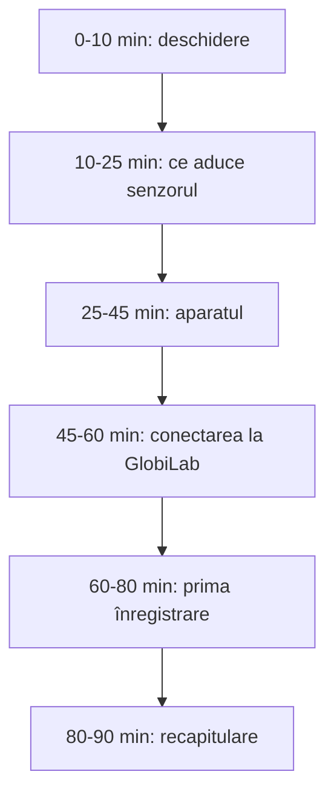

Sesiunea 1 din 4, 90 de minute, unitatea 1 a cursului: *De la demonstrație la măsurare: Labdisc și GlobiLab*. Forma de lucru: curs / laborator.

> [!abstract] Ce veți putea face
> Rezultatele sesiunii, din curriculumul cursului:
>
> - Să descrie structura dispozitivului Labdisc, senzorii și modurile de conectare.
> - Să explice parametrii unei înregistrări.
> - Să configureze Labdisc și GlobiLab pentru o înregistrare.
>
> Pe scurt: utilizarea dispozitivului Labdisc și a aplicației GlobiLab pentru configurarea unei înregistrări și citirea datelor în timp real.

## Ce conține

- Învățarea bazată pe investigație la științe: de la experimentul demonstrativ la măsurarea realizată de elevi.
- Structura dispozitivului Labdisc: taste, ecran, senzori integrați și externi, porturi, alimentare. Modelele Labdisc (GenSci, Physio, BioChem, Enviro) și ce măsoară fiecare.
- Aplicația GlobiLab: instalare, conectare prin USB și Bluetooth, configurarea înregistrării (senzori, rata de eșantionare, numărul de eșantioane).
- Prima înregistrare: temperatură, lumină, nivel sonor; citirea graficului în timp real.

> [!tip] De citit înainte sau după
> - [[formare/labdisc/index|Labdisc pe scurt]]
> - [[formare/labdisc/aparatul|Aparatul: taste, ecran, senzori, configurare]]
> - [[formare/labdisc/globilab|GlobiLab: instalare, interfață, colectarea datelor]]
> - [[formare/labdisc/modele/index|Modelele Labdisc și senzorii lor]]
> - [[la-clasa/implementare/ce-labdisc-aveti|Ce Labdisc aveți?]]

## Cuvintele sesiunii

Înainte de aparat, vocabularul. Atingeți fiecare cartonaș, spuneți-vă explicația în gând, apoi întoarceți-l ca să verificați.

```cartonase
Data logger (înregistrator de date) :: Aparat care măsoară cu senzori și păstrează valorile în timp. Labdisc adună mai mulți senzori într-un singur disc.
Senzor integrat :: Senzor montat în disc, de exemplu temperatura ambientală sau presiunea aerului.
Senzor extern :: Se conectează la o intrare a discului: sonda de temperatură externă, electrodul de pH sau de oxigen dizolvat, intrarea universală.
Rata de eșantionare :: Câte valori măsoară senzorul într-o unitate de timp, de exemplu 10 pe secundă.
Numărul de eșantioane :: Câte valori se înregistrează în total. Împreună cu rata, stabilește durata înregistrării.
Durata înregistrării :: Numărul de eșantioane împărțit la rată: 1000 de eșantioane la 10 pe secundă înseamnă 100 s.
USB :: Conexiune prin cablu, stabilă; potrivită pentru laborator.
Bluetooth :: Conexiune fără fir cu laptopul, tableta sau telefonul; utilă pe teren. Trebuie activată pe disc.
Marker :: Punct pus pe grafic, care arată valoarea exactă și momentul în care a fost măsurată.
Adnotare :: Text sau imagine scrise direct pe grafic, ca să explice ce s-a întâmplat în acel moment.
```

## Desfășurarea, pas cu pas

Minutele sunt de la începutul sesiunii. Întrebarea din chenarul „Întrebarea formatorului” e cea pe care formatorul o pune grupului; o puteți folosi la fel cu elevii.



### Deschidere și evaluare inițială (min 0-10)

**Scop:** Cadrul de lucru stabilit, așteptări cunoscute.

1. Bun venit, agenda zilei
2. Echipe de 2-3 la un Labdisc
3. Asalt de idei pe un panou Padlet comun: „Ce lucrare de laborator nu reușiți să o faceți la clasă și de ce?”

> [!question] Întrebarea formatorului
> „Azi lucrăm cu aparatul în mână. Până la prânz fiecare echipă are grafice proprii.”

**Produs:** Lista de obstacole, pe panoul Padlet al grupului, reluată la S4.

**Aveți nevoie de:** Agenda proiectată, un panou Padlet deschis pentru tot grupul.

> [!warning]- Dacă nu merge
> Dacă întârzie participanți: începeți cu echipele prezente, recapitulare de 2 min la sosire.

### Mini-input: ce aduce senzorul în lecție (min 10-25)

**Scop:** Diferența dintre experiment demonstrativ și investigație înțeleasă.

1. Aceeași răcire a apei, cu termometru și cu Labdisc
2. Comparăm ce vede elevul: 3 valori citite pe termometru sau o curbă în timp real
3. Învățarea bazată pe investigație, pe scurt

| Cu termometrul | Cu Labdisc |
|---|---|
| 3 valori citite pe termometru | o curbă în timp real |
| elevul citește valorile una câte una | elevul are timp să gândească asupra datelor |

> [!question] Întrebarea formatorului
> „Senzorul nu face experimentul în locul elevului. Îi dă timp să gândească asupra datelor.”

**Aveți nevoie de:** Proiector, un Labdisc conectat la proiector.

> [!warning]- Dacă nu merge
> Dacă proiectorul nu preia Bluetooth-ul: conectare prin USB.

### Cunoașterea dispozitivului Labdisc (min 25-45)

**Scop:** Participanții cunosc dispozitivul: taste, ecran, senzori, porturi.

1. Pornire, limba, Bluetooth
2. Fiecare echipă își identifică modelul (GenSci, Physio, BioChem sau Enviro) și, cu tabelul senzorilor din ghid, spune ce poate și ce nu poate măsura
3. Găsește senzorii pe disc și citește o valoare direct pe ecran
4. Comparăm modelele: care se potrivește disciplinei voastre și ce aveți la școală

> [!question] Întrebarea formatorului
> „Ce model aveți pe masă? Ce experiment din disciplina voastră nu ați putea face cu el?”

**Produs:** Fișa modelului, în documentul comun al echipei: senzori disponibili și experimente posibile.

**Aveți nevoie de:** Labdisc încărcate (toate cele 4 modele), tabelul senzorilor pe modele din ghid.

> [!warning]- Dacă nu merge
> Baterie descărcată: încărcătorul pe masa formatorului; echipa lucrează cu un dispozitiv vecin.

Tabelul senzorilor pe modele e în [[formare/labdisc/aparatul#1.3 Senzori integrați și senzori externi|Aparatul, secțiunea 1.3]]; fiecare model are pagina lui în [[formare/labdisc/modele/index|Modelele Labdisc]], cu un test scurt la final.

### Conectarea la GlobiLab (min 45-60)

**Scop:** Labdisc conectat la GlobiLab și înregistrarea configurată.

1. Conectare USB sau Bluetooth
2. „Configurare”: senzori, rata de eșantionare, numărul de eșantioane
3. Calculăm durata: număr de eșantioane / rată

> [!question] Întrebarea formatorului
> „10 eșantioane pe secundă și 1000 de eșantioane: cât durează înregistrarea?”

Răspundeți întâi în gând, apoi verificați în calculator. După aceea schimbați rata la 1 pe secundă și urmăriți cum se schimbă durata.

```durata
```

> [!example] Cum alegeți rata
> Rata se alege după cât de repede se schimbă fenomenul. Răcirea unui pahar cu apă e lentă: 1 valoare pe secundă ajunge. Un sunet sau o descărcare electrică se schimbă în fracțiuni de secundă și cer rate mari. O rată prea mare la un fenomen lent nu face graficul mai bun, doar fișierul mai mare.

**Produs:** Dispozitiv conectat, setări salvate.

**Aveți nevoie de:** Laptopuri cu GlobiLab, cabluri USB.

> [!warning]- Dacă nu merge
> Bluetooth-ul nu găsește dispozitivul: cablu USB. GlobiLab neinstalat: laptop de rezervă.

Puneți pașii unei înregistrări în ordine. Folosiți săgețile, apoi apăsați „Verifică ordinea”.

```ordine
titlu: Ordonați pașii pentru prima înregistrare în GlobiLab
Porniți Labdisc și activați Bluetooth-ul sau legați cablul USB
Deschideți GlobiLab și conectați discul
Apăsați „Configurare” și bifați senzorii
Setați rata de eșantionare și numărul de eșantioane
Confirmați setările
Apăsați Run și faceți experimentul
Apăsați Stop
Puneți un marker și o adnotare pe grafic
```

### Prima înregistrare în 10 minute (min 60-80)

**Scop:** Prima înregistrare proprie, citită și adnotată.

1. Sonda de temperatură ținută în palmă 60 s, apoi eliberată (merge pe toate modelele)
2. A doua mărime, după model: lumina acoperită și descoperită sau nivelul sonor
3. Marker pe grafic, o adnotare care explică fenomenul

Înainte să apăsați Run, prevedeți. Desenați pe grafic curba pe care o așteptați pentru sonda ținută în palmă un minut și apoi eliberată, apoi apăsați „Arată datele”.

```grafic
titlu: Sonda de temperatură în palmă 60 s, apoi eliberată
x: Timp (s)
y: Temperatura (°C)
prezicere: da
nota: Date ilustrative, calculate cu o lege exponențială de încălzire și răcire (aer 22 °C, palmă 34 °C); nu sunt o măsurare. Curba voastră va avea alte valori.
date:
0, 22.0
10, 28.8
20, 31.7
30, 33.0
40, 33.6
50, 33.8
60, 33.9
70, 31.5
80, 29.6
90, 28.1
100, 26.9
110, 25.9
120, 25.1
130, 24.5
140, 24.0
```

> [!example]- Aceeași primă înregistrare, după disciplină
> Formatorul alege a doua mărime după grupul care participă și după modelul de pe masă.
>
> - **Fizică:** lumina, cu senzorul acoperit și descoperit, sau nivelul sonor când cineva vorbește lângă disc.
> - **Chimie:** temperatura amestecului când turnați oțet peste bicarbonat de sodiu, cu sonda externă în pahar (reacția absoarbe căldură).
> - **Biologie:** umiditatea relativă când suflați aer expirat spre senzor; pe BioChem, ritmul cardiac cu clema pentru ureche.
> - **Geografie:** temperatura și umiditatea aerului lângă fereastra deschisă și în mijlocul clasei.
> - **Clasele primare:** lumina la umbră și la soare, cu discul pe pervaz.

> [!question] Întrebarea formatorului
> „Puneți markerul acolo unde ați luat mâna. Ce spune graficul după acel moment?”

> [!question]- Un răspuns posibil
> Temperatura nu revine dintr-odată la cea a aerului. Scade repede la început și tot mai încet după aceea, pentru că sonda cedează căldură cu atât mai repede cu cât e mai caldă decât aerul. Același lucru se vede și la încălzire: sonda nu sare la temperatura palmei, se apropie de ea treptat. Asta e o adnotare bună pentru grafic.

**Produs:** Grafic adnotat (primul artefact).

**Aveți nevoie de:** Sonde de temperatură externă, lanternă.

> [!warning]- Dacă nu merge
> Grafic plat: verificăm senzorul bifat la „Configurare”.

### Recapitulare (min 80-90)

**Scop:** Verificarea înțelegerii, întrebări rezolvate.

1. Trei întrebări rapide: rata, durata, senzorul potrivit
2. Ce s-a blocat și cum am rezolvat

Întrebările rapide, cu răspuns imediat. Alegeți o variantă și citiți explicația, mai ales când ați greșit.

```quiz
? Setați 10 eșantioane pe secundă și 1000 de eșantioane. Cât durează înregistrarea?
+ 100 s | 1000 ÷ 10 = 100 s, adică 1 min 40 s.
- 10 000 s | Ați înmulțit rata cu numărul de eșantioane. Durata este numărul de eșantioane împărțit la rată.
- 1000 s | Aceasta ar fi durata la 1 eșantion pe secundă.

? Vreți să urmăriți cum se răcește un pahar cu apă caldă timp de 10 minute. Ce rată alegeți?
+ 1 pe secundă | Răcirea e lentă; 600 de valori în 10 minute dau o curbă netedă.
- 1000 pe secundă | Ați strânge 600 000 de valori pentru un fenomen care se schimbă cu câteva grade pe minut. Fișierul crește, graficul nu devine mai bun.
- 1 pe minut | Ați avea doar 11 puncte și ați pierde detaliile din primele minute, când temperatura scade cel mai repede.

? Oricare ar fi modelul de Labdisc, ce senzor folosiți pentru temperatura apei dintr-un pahar?
+ Sonda de temperatură externă | Există pe toate cele patru modele și se scufundă în apă.
- Senzorul de temperatură ambientală | Măsoară aerul din jurul discului; nu se pune în apă.
- Termocuplul | E doar pe BioChem; e gândit pentru temperaturi foarte joase sau foarte înalte.

? Ați apăsat Run, dar graficul e o linie plată. Ce verificați întâi?
+ Dacă senzorul e bifat la „Configurare” | E primul pas din lista „Dacă nu merge” a sesiunii și se verifică în câteva secunde.
- Rata de eșantionare | Rata schimbă cât de des se măsoară, nu dacă senzorul e activ.
- Reinstalați GlobiLab | Programul desenează graficul, deci funcționează; problema e în setări sau în experiment.

? GlobiLab nu găsește discul prin Bluetooth. Ce faceți?
+ Verificați că Bluetooth-ul e activat pe disc sau treceți pe cablul USB | Fără Bluetooth activat, discul nu comunică cu GlobiLab; cablul USB e soluția sigură.
- Schimbați modelul de Labdisc | Problema e de conexiune, nu de model; toate modelele se conectează la fel.
- Reduceți numărul de eșantioane | Setările înregistrării nu influențează conexiunea.
```

> [!question] Întrebarea formatorului
> „Ce i-ați spune unui coleg care deschide Labdisc prima dată?”

**Produs:** Lista de sfaturi practice.

> [!warning]- Dacă nu merge
> Dacă ați depășit timpul: recapitularea trece la începutul S2.

## După sesiune: lucrul individual

- Instalarea aplicației GlobiLab pe dispozitivul propriu și studierea ghidului de utilizare Labdisc.
- O înregistrare de probă în laboratorul școlii.

**Produsul:** Grafic adnotat al unei înregistrări proprii. **Evaluarea:** autoevaluare după lista de verificare.

## Autoevaluare

Bifați ce puteți face fără ajutor. Bifele rămân doar în browserul dumneavoastră.

- [ ] Pot descrie structura dispozitivului Labdisc, senzorii și modurile de conectare.
- [ ] Pot explica parametrii unei înregistrări.
- [ ] Pot configura Labdisc și GlobiLab pentru o înregistrare.

## Reflecție

> [!quote] „Ce i-ați spune unui coleg care deschide Labdisc prima dată?”

Scrieți, în Padlet-ul cursului sau în documentul comun al grupului (de exemplu un Google Doc), un lucru pe care îl duceți la clasă din sesiunea aceasta și un lucru care încă nu e clar.
