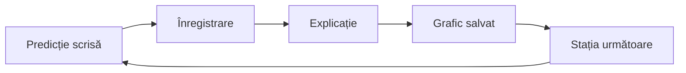

Sesiunea 2 din 4, 90 de minute, unitatea 2 a cursului: *Experimente din curriculum cu Labdisc*. Forma de lucru: laborator / seminar.

> [!abstract] Ce veți putea face
> Rezultatele sesiunii, din curriculumul cursului:
>
> - Să realizeze experimente de fizică cu senzorii de distanță, temperatură, tensiune și curent electric.
> - Să analizeze datele cu markerul, adnotările și funcțiile matematice.
> - Să exporte datele în format .CSV și să le reprezinte grafic.
>
> Pe scurt: realizarea experimentelor din curriculumul la fizică cu senzori digitali și interpretarea graficelor obținute.

Stațiile de mai jos sunt cele de la fizică, disciplina de la care a pornit cursul. Când grupul e de chimie, biologie, geografie sau clase primare, formatorul pune stații din curriculumul lor; regula stațiilor și analiza datelor rămân aceleași. Exemple sunt în chenarul „Stații pentru alte discipline”.

## Ce conține

- Stația „Mișcare”: senzorul de distanță, graficul x(t), viteza obținută prin funcția „Derivată”, mișcarea pe planul înclinat.
- Stația „Fenomene termice”: sonda de temperatură externă, răcirea apei, comparația cu temperatura ambientală.
- Stația „Electricitate”: senzorii de tensiune și de curent electric, dependența I = f(U) pentru un rezistor (legea lui Ohm).
- Analiza datelor în GlobiLab: marker, adnotare, funcții matematice, exportul în format .CSV.

> [!example]- Stații pentru alte discipline
> Câte o idee de stație, cu senzorii din [[formare/labdisc/aparatul#1.3 Senzori integrați și senzori externi|tabelul senzorilor pe modele]]. Mai multe sunt în [[la-clasa/proiecte/index|proiectele de lecție]].
>
> - **Chimie:** pH-ul unor soluții din casă (oțet, apă cu bicarbonat, apă de la robinet), cu electrodul de pH (GenSci, Enviro, BioChem).
> - **Biologie:** pulsul în repaus și după zece genuflexiuni, cu senzorul de ritm cardiac (BioChem).
> - **Geografie:** temperatura, umiditatea și presiunea barometrică în clasă și în curte; pe Enviro, și radiația UV.
> - **Clasele primare:** lumina la umbră și la soare, temperatura apei calde și a apei reci.

> [!tip] De citit înainte sau după
> - [[formare/labdisc/globilab|GlobiLab]]: markerul, adnotările, funcțiile matematice, exportul .CSV
> - [[la-clasa/anexe/fise-de-statie|Fișele celor trei stații]]
> - [[la-clasa/metodologie/prezice-observa-explica|Prezice, observă, explică]]

## Desfășurarea, pas cu pas

Minutele sunt de la începutul sesiunii. Întrebarea din chenarul „Întrebarea formatorului” e cea pe care formatorul o pune grupului; o puteți folosi la fel cu elevii.

### Instrucțiuni pentru stații (min 0-10)

**Scop:** Echipele știu regulile stațiilor.

1. Trei stații, 22 de minute fiecare
2. La fiecare stație: predicție scrisă în documentul comun al echipei, înregistrare, explicație
3. Graficul se salvează înainte de rotire



> [!question] Întrebarea formatorului
> „Scrieți predicția înainte de a apăsa Run. O predicție greșită e la fel de utilă ca una corectă.”

**Aveți nevoie de:** Fișele celor trei stații, deschise pe laptop sau tabletă.

### Stația „Mișcare” (min 10-32)

**Scop:** Mișcarea descrisă prin grafice x(t) și v(t).

1. Un membru merge în fața senzorului de distanță reproducând un grafic dat
2. Căruciorul pe planul înclinat
3. Funcția „Derivată” dă v(t); ce înseamnă panta lui x(t)?

> [!question] Întrebarea formatorului
> „Cum trebuie să mergi ca graficul să fie o linie orizontală?”

> [!question]- Ce înseamnă panta lui x(t)?
> Panta graficului x(t) este viteza. O linie orizontală înseamnă viteză zero: persoana stă pe loc. O linie tot mai abruptă, ca la căruciorul lăsat liber pe planul înclinat, înseamnă că viteza crește; funcția „Derivată” arată atunci un grafic v(t) care urcă.

**Produs:** Grafic x(t) și v(t) adnotat.

**Aveți nevoie de:** Plan înclinat, cărucior, spațiu liber 2-3 m.

> [!warning]- Dacă nu merge
> Valori care sar: obiectul e prea aproape (sub 0,4 m) sau suprafața nu reflectă; folosim o carte ca țintă.

### Stația „Fenomene termice” (min 32-54)

**Scop:** Răcirea apei analizată pe grafic.

1. Apă caldă în pahar, sonda externă în apă
2. Înregistrare 1/s, 10 min, cu temperatura ambientală pe același grafic
3. Unde scade temperatura mai repede și de ce?

Faceți ce fac echipele la stație: desenați întâi curba pe care o așteptați pentru apa din pahar, apoi apăsați „Arată datele”.

```grafic
titlu: Răcirea apei calde într-un pahar
x: Timp (min)
y: Temperatura (°C)
prezicere: da
nota: Date ilustrative, calculate cu legea răcirii (aerul la 22 °C, apa la 80 °C la început); nu sunt o măsurare.
date:
0, 80.0
1, 75.5
2, 71.4
3, 67.6
4, 64.1
5, 60.9
6, 57.9
7, 55.1
8, 52.6
9, 50.2
10, 48.1
```

> [!question] Întrebarea formatorului
> „Comparați primul și ultimul minut. Ce vă spune panta?”

> [!question]- Un răspuns posibil
> În primul minut apa pierde aproape 5 °C, în ultimul doar 2 °C. Panta scade pentru că apa se răcește cu atât mai repede cu cât diferența față de aer e mai mare. Curba temperaturii ambientale, pe același grafic, rămâne aproape orizontală: e ținta spre care se apropie apa.

**Produs:** Grafic T(t) cu două curbe, adnotat.

**Aveți nevoie de:** Fierbător, pahare, sonde de temperatură.

> [!warning] Securitate
> Apă fierbinte doar la masa stației, formatorul toarnă.

### Stația „Electricitate” (min 54-76)

**Scop:** Dependența I = f(U) pentru un rezistor obținută din date.

1. Circuit cu sursă, rezistor, senzorii de tensiune și curent
2. 5 valori ale tensiunii, câte o citire stabilă pentru fiecare
3. Export .CSV, graficul I = f(U) în foaia de calcul (Excel sau Google Sheets); ce reprezintă panta?

> [!question] Întrebarea formatorului
> „Dacă dublăm rezistența și păstrăm sursa, cum se schimbă linia?”

Fără Labdisc la îndemână, puteți repeta stația în simulare: schimbați tensiunea și rezistența, notați curentul într-un tabel Google Sheets, apoi verificați răspunsul la întrebarea formatorului.

```simulare
url: https://phet.colorado.edu/sims/html/ohms-law/latest/ohms-law_ro.html
titlu: Legea lui Ohm
sursa: PhET Interactive Simulations, University of Colorado Boulder, CC BY 4.0.
```

> [!question]- Un răspuns posibil
> Panta dreptei I = f(U) este 1/R. Dacă rezistența se dublează, panta se înjumătățește: dreapta trece tot prin origine, dar e mai puțin înclinată, iar la aceeași tensiune curentul e de două ori mai mic.

**Produs:** Tabel U, I și graficul I = f(U).

**Aveți nevoie de:** Surse de curent sau baterii, rezistoare, cabluri banana, Excel sau Google Sheets.

> [!warning]- Dacă nu merge
> Curentul depășește domeniul senzorului (±1 A): rezistor mai mare. Fără sursă reglabilă: 1, 2, 3 baterii în serie.

### Discuție de sinteză (min 76-90)

**Scop:** Graficele comparate, ideile fixate.

1. Fiecare echipă arată un grafic
2. Ce am măsurat, ce am calculat, ce am interpretat
3. Legătura cu competențele specifice 2 și 3 din curriculum

> [!question] Întrebarea formatorului
> „Unde a gândit elevul în aceste 22 de minute?”

**Produs:** Trei grafice salvate (al doilea artefact).

**Aveți nevoie de:** Proiector.

> [!warning]- Dacă nu merge
> Dacă o stație nu a funcționat: graficul formatorului, salvat dinainte.

## Analiza datelor în GlobiLab

Instrumentele de analiză sunt aceleași la orice disciplină. Întoarceți cartonașele: întâi spuneți ce face funcția, apoi verificați. Descrierea completă e în [[formare/labdisc/globilab#2.3 Principalele pictograme ale aplicației și funcțiilor acestora|GlobiLab, secțiunea 2.3]].

```cartonase
Marker :: Arată valoarea exactă și momentul într-un punct al graficului. Doi markeri delimitează intervalul pe care lucrează funcțiile.
Adnotare :: Text sau imagine scrise pe grafic, care explică ce s-a întâmplat acolo.
Derivată :: Graficul ritmului de schimbare. Din x(t) dă v(t).
Integrală :: Aria de sub grafic (valoare × timp).
Smooth :: Netezește datele: fiecare punct devine media lui cu două valori anterioare și două ulterioare.
Regresie cuadratică :: Parabola care se potrivește cel mai bine datelor dintre doi markeri, cu ecuația ei.
FFT :: Împarte ecranul: sus măsurarea în timp, jos componentele ei pe frecvențe. Utilă la sunete.
Export .CSV :: Pictograma Excel salvează datele într-un fișier .CSV și le deschide în foaia de calcul.
```

Al doilea grafic de prezis vine de la biologie: pulsul unui elev care face zece genuflexiuni. Desenați curba, apoi comparați.

```grafic
titlu: Pulsul în repaus, în timpul a zece genuflexiuni și după
x: Timp (s)
y: Pulsul (bătăi pe minut)
prezicere: da
nota: Date ilustrative: repaus 20 s, genuflexiuni între 20 și 40 s, apoi revenire; construite cu o creștere și o scădere exponențială, nu sunt o măsurare. Pulsul real diferă mult de la un elev la altul.
date:
0, 72
10, 72
20, 72
30, 99
40, 107
50, 100
60, 94
70, 90
80, 86
90, 83
100, 81
110, 79
120, 78
130, 77
140, 76
```

> [!question]- Ce ar trebui să observe elevii?
> Pulsul crește repede în timpul efortului, dar revine încet: după două minute e încă peste valoarea de repaus. Întrebarea bună pentru clasă: „De ce nu coboară pulsul imediat ce vă opriți?” Adnotați pe grafic începutul și sfârșitul efortului.

## Verificați-vă

Cinci întrebări din toate stațiile. Răspunsul apare imediat, cu explicația.

```quiz
? Cum trebuie să mergeți în fața senzorului de distanță ca graficul x(t) să fie o linie orizontală?
+ Să stați pe loc | Distanța nu se schimbă, deci viteza e zero și panta e zero.
- Să mergeți cu viteză constantă | Atunci distanța crește uniform și graficul e o dreaptă înclinată.
- Să mergeți foarte încet | Distanța tot crește, deci linia urcă, doar mai puțin abrupt.

? La senzorul de distanță valorile sar fără motiv. Care e prima cauză de verificat?
+ Ținta e mai aproape de 0,4 m sau nu reflectă bine | Sub 0,4 m senzorul nu măsoară corect; o carte ținută drept e o țintă bună.
- Rata de eșantionare e prea mică | O rată mică dă puncte mai rare, nu valori care sar.
- Persoana merge prea încet | Mersul lent dă o pantă mică, nu valori care sar.

? Înregistrați 10 minute la 1 eșantion pe secundă. Câte eșantioane setați?
+ 600 | 10 min = 600 s; la 1 pe secundă înseamnă 600 de eșantioane.
- 10 | Ar fi un eșantion pe minut, nu pe secundă.
- 60 | Ar acoperi doar un minut.

? Ce reprezintă panta dreptei I = f(U) pentru un rezistor?
+ 1/R | Din I = U/R, curentul crește cu 1/R pentru fiecare volt.
- Rezistența R | R ar fi panta graficului U = f(I), cu axele inversate.
- Puterea | Puterea este produsul U × I, nu raportul lor.

? Ați măsurat pH-ul în trei pahare și vreți să le comparați la clasă. Ce faceți după Stop?
+ Puneți un marker pe valoarea stabilă din fiecare pahar și adnotați graficul | Markerul dă valoarea exactă, adnotarea spune ce pahar e; graficul devine un rezultat citibil.
- Aplicați funcția Derivată | Derivata arată cât de repede se schimbă pH-ul, nu valoarea lui în fiecare pahar.
- Exportați direct în .CSV fără să priviți graficul | Exportul e util, dar fără să citiți graficul nu știți ce valori sunt stabile și care sunt din momentul scufundării electrodului.
```

## După sesiune: lucrul individual

- Repetarea unuia dintre experimentele din stații, individual sau cu elevii.
- Exportul datelor în format .CSV și prelucrarea lor în foaia de calcul.

**Produsul:** Set de date, grafic și trei întrebări de interpretare pentru elevi. **Evaluarea:** evaluare reciprocă.

## Autoevaluare

Bifați ce puteți face fără ajutor. Bifele rămân doar în browserul dumneavoastră.

- [ ] Pot realiza experimente de fizică cu senzorii de distanță, temperatură, tensiune și curent electric.
- [ ] Pot analiza datele cu markerul, adnotările și funcțiile matematice.
- [ ] Pot exporta datele în format .CSV și le pot reprezenta grafic.

## Reflecție

> [!quote] „Unde a gândit elevul în aceste 22 de minute?”

Scrieți, în Padlet-ul cursului sau în documentul comun al grupului (de exemplu un Google Doc), un lucru pe care îl duceți la clasă din sesiunea aceasta și un lucru care încă nu e clar.
