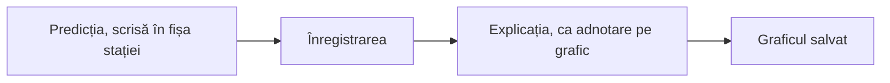

Unitatea 2 din 4 a cursului.

> [!abstract] Ce veți putea face
> - Să aleagă modelul și senzorii potriviți pentru un experiment din disciplina sa.
> - Să realizeze experimente din curriculum cu senzori digitali.
> - Să analizeze datele cu markerul, adnotările și funcțiile matematice și să le exporte.
>
> Pe scurt: realizarea experimentelor din curriculumul disciplinei cu senzori digitali și interpretarea graficelor obținute.

> [!tip] De citit pe parcurs
> - [[formare/labdisc/globilab|GlobiLab]]: markerul, adnotările, funcțiile matematice, exportul .CSV
> - [[la-clasa/anexe/fise-de-statie|Fișele de stație]]
> - [[la-clasa/metodologie/prezice-observa-explica|Prezice, observă, explică]]

## Experimente pe stații, după disciplina profesorilor

### Lucrul pe stații: predicție, înregistrare, explicație

Fiecare disciplină are trei stații, adică trei experimente scurte din curriculum. La fiecare stație lucrați la fel:



1. Scrieți predicția în fișa digitală a stației (o copie a fișei în Google Docs) înainte de a apăsa Run.
2. Configurați senzorii indicați și înregistrați.
3. Adăugați explicația pe grafic, ca adnotare în GlobiLab, și salvați graficul.

> [!quote] O predicție greșită e la fel de utilă ca una corectă.

După fiecare stație, întrebați-vă: ce am prezis, ce arată graficul și de unde vine diferența?

### Stațiile fiecărei discipline

Deschideți stațiile disciplinei voastre. Fiecare are întrebarea pentru elevi, senzorii, modelele pe care merge și materialele. Dacă modelul vostru nu are senzorul cerut, alegeți o stație care merge pe el.

> [!example]- Fizică
> 1. **Mișcarea.** Senzori: distanță; funcția „Derivată” dă viteza. Modele: GenSci, Physio. Întrebarea: cum trebuie să mergi în fața senzorului ca graficul x(t) să fie o linie orizontală? Dar una înclinată? Materiale: plan înclinat, cărucior, spațiu liber 2-3 m.
> 2. **Fenomenele termice.** Senzori: temperatură externă și ambientală. Modele: toate. Întrebarea: când se răcește apa mai repede, în primul minut sau în al zecelea? Materiale: fierbător, pahare.
> 3. **Circuitul electric.** Senzori: tensiune, curent electric. Modele: GenSci, Physio. Întrebarea: ce se întâmplă cu intensitatea curentului dacă dublăm tensiunea? (legea lui Ohm) Materiale: sursă de curent sau baterii, rezistoare, cabluri banana. Fără Labdisc la îndemână, aceeași întrebare se explorează în [simularea PhET „Legea lui Ohm”](https://phet.colorado.edu/sims/html/ohms-law/latest/ohms-law_ro.html).

> [!example]- Chimie
> 1. **Efectul termic al dizolvării.** Senzori: temperatură externă. Modele: toate. Întrebarea: se încălzește sau se răcește apa când dizolvăm clorură de calciu? Dar clorură de amoniu? Materiale: pahare, apă, clorură de calciu, clorură de amoniu, ochelari de protecție.
> 2. **pH-ul și neutralizarea.** Senzori: pH. Modele: GenSci, Enviro, BioChem. Întrebarea: cum se schimbă pH-ul oțetului când adăugăm picătură cu picătură o soluție de bicarbonat de sodiu? Materiale: electrod de pH, oțet, soluție de bicarbonat de sodiu, pipete, apă distilată.
> 3. **Conductivitatea soluțiilor.** Senzori: conductivitate. Model: BioChem. Întrebarea: conduce apa cu sare la fel ca apa cu zahăr? Ce se schimbă când creștem concentrația? Materiale: electrod de conductivitate, sare, zahăr, apă distilată.

> [!example]- Biologie
> 1. **Ritmul cardiac la efort.** Senzori: ritm cardiac. Model: BioChem. Întrebarea: în cât timp revine pulsul la valoarea de repaus după 30 de genuflexiuni? Materiale: clemă pentru ureche.
> 2. **Transpirația plantelor.** Senzori: umiditate relativă, temperatură ambientală. Modele: GenSci, Enviro, BioChem. Întrebarea: cât crește umiditatea într-o pungă închisă în jurul unei ramuri cu frunze, față de una fără frunze? Materiale: plantă în ghiveci, pungi transparente, bandă adezivă.
> 3. **Aerul expirat.** Senzori: umiditate relativă, temperatură. Modele: GenSci, Enviro, BioChem. Întrebarea: prin ce diferă aerul expirat de aerul din clasă? Materiale: pungă de plastic, pahar.

> [!example]- Geografie
> 1. **Microclimatul școlii.** Senzori: temperatură, umiditate, presiunea aerului, lumină, GPS. Modele: GenSci, Enviro (Enviro fără lumină). Întrebarea: unde este mai cald și mai umed, în clasă, pe coridor sau în curte? De ce? Materiale: acces în curte, harta școlii în Google My Maps (punctele de măsurare).
> 2. **Calitatea apei.** Senzori: pH, turbiditate. Modele: Enviro, BioChem. Întrebarea: prin ce diferă apa de la robinet, apa îmbuteliată și apa dintr-o baltă sau din ploaie? Materiale: electrod de pH, cuve, probe de apă.
> 3. **Încălzirea suprafețelor.** Senzori: temperatură IR, UV. Model: Enviro. Întrebarea: care suprafață se încălzește mai tare la aceeași lumină: asfalt, iarbă, nisip, hârtie albă sau neagră? Materiale: probe de suprafețe, lampă (în interior) sau acces în curte.

> [!example]- Științe la clasele primare
> 1. **Topirea gheții.** Senzori: temperatură externă. Modele: toate. Întrebarea: ce arată termometrul cât timp gheața se topește? Materiale: cuburi de gheață, pahar.
> 2. **Aerul sub presiune.** Senzori: presiunea aerului. Modele: toate. Întrebarea: ce se întâmplă cu aerul din seringă când apăsăm pistonul? Materiale: seringă, tubul de plastic al senzorului.
> 3. **Vremea.** Senzori: temperatură, umiditate, lumină. Model: GenSci. Întrebarea: unde e mai luminos și mai cald, lângă fereastră sau în fundul clasei? Dar afară? Materiale: acces la fereastră și în curte.

> [!warning] Securitate
> Substanțele și apa fierbinte rămân la masa stației; la chimie lucrați cu ochelari de protecție.

> [!warning]- Dacă nu merge
> Senzorul lipsește pe modelul vostru: schimbați discul cu unul care îl are sau alegeți altă stație. O stație nu a funcționat deloc: lucrați pe un grafic salvat dinainte, ca analiza să poată continua.

### Patru stații de prezis

Faceți ce se face la stație: desenați întâi curba pe care o așteptați, apoi apăsați „Arată datele”. Alegeți stațiile disciplinei voastre sau încercați-le pe toate.

**Fizică, „Fenomenele termice”.** Când se răcește apa mai repede: în primul minut sau în al zecelea?

```grafic
titlu: Răcirea apei calde într-un pahar
x: Timp (min)
y: Temperatura (°C)
prezicere: da
nota: Date ilustrative, calculate cu legea răcirii (aerul la 22 °C, apa la 80 °C la început); nu sunt o măsurare.
date:
0, 80.0
1, 75.5
2, 71.4
3, 67.6
4, 64.1
5, 60.9
6, 57.9
7, 55.1
8, 52.6
9, 50.2
10, 48.1
```

> [!question]- Un răspuns posibil
> În primul minut apa pierde aproape 5 °C, în al zecelea doar 2 °C. Apa se răcește cu atât mai repede cu cât diferența față de aer e mai mare. Temperatura ambientală, pe același grafic, rămâne aproape orizontală: e ținta spre care se apropie apa.

**Biologie, „Ritmul cardiac la efort”.** În cât timp revine pulsul la valoarea de repaus după 30 de genuflexiuni?

```grafic
titlu: Pulsul în repaus, în timpul a 30 de genuflexiuni și după
x: Timp (s)
y: Pulsul (bătăi pe minut)
prezicere: da
nota: Date ilustrative: repaus 20 s, genuflexiuni între 20 și 60 s, apoi revenire; construite cu o creștere și o scădere exponențială, nu sunt o măsurare. Pulsul real diferă mult de la o persoană la alta.
date:
0, 72
10, 72
20, 72
30, 104
40, 117
50, 123
60, 126
75, 112
90, 102
105, 94
120, 88
135, 84
150, 81
165, 79
180, 77
```

> [!question]- Un răspuns posibil
> Pulsul crește repede în timpul efortului, dar revine încet: după două minute de odihnă e încă peste valoarea de repaus. Întrebarea bună pentru elevi: de ce nu coboară pulsul imediat ce vă opriți? Adnotați pe grafic începutul și sfârșitul efortului.

**Clasele primare, „Topirea gheții”.** Ce arată termometrul cât timp gheața se topește?

```grafic
titlu: Sonda într-un pahar cu cuburi de gheață, până se topesc
x: Timp (min)
y: Temperatura (°C)
prezicere: da
nota: Date ilustrative: amestecul de apă și gheață rămâne la 0 °C cât timp există gheață, apoi apa se încălzește spre temperatura camerei (22 °C) după legea răcirii; nu sunt o măsurare. Cât durează topirea depinde de cantitatea de gheață.
date:
0, 22.0
1, 1.9
2, 0.2
5, 0.1
10, 0.1
20, 0.1
30, 0.2
40, 0.2
45, 4.2
50, 7.4
60, 12.2
70, 15.4
80, 17.6
90, 19.0
```

> [!question]- Un răspuns posibil
> Mulți copii (și mulți adulți) se așteaptă ca temperatura să crească tot timpul. Graficul rămâne însă pe loc, la 0 °C, cât timp mai e gheață în pahar: căldura primită merge la topire. Abia după ce s-a topit toată gheața, apa începe să se încălzească.

**Chimie, „pH-ul și neutralizarea”.** Fără electrod de pH la îndemână, explorați ideea în simulare: alegeți un lichid din casă, măsurați pH-ul, apoi adăugați apă sau alt lichid și urmăriți cum se schimbă.

```simulare
url: https://phet.colorado.edu/sims/html/ph-scale/latest/ph-scale_ro.html
titlu: Scara pH
sursa: PhET Interactive Simulations, University of Colorado Boulder, CC BY 4.0.
```

> [!question]- Ce ar trebui să observe elevii?
> Oțetul are un pH mic, acid. Pe măsură ce adăugați o soluție bazică, cum e cea de bicarbonat de sodiu, pH-ul crește. La stația cu electrod, curba se vede în timp real în GlobiLab, picătură cu picătură.

## Analiza datelor

### Analiza datelor în GlobiLab: marker, adnotare, funcții matematice (derivată, integrală, regresie)

Instrumentele de analiză sunt aceleași la orice disciplină. Întoarceți cartonașele: întâi spuneți ce face funcția, apoi verificați. Descrierea completă e în [[formare/labdisc/globilab#2.3 Principalele pictograme ale aplicației și funcțiilor acestora|GlobiLab, secțiunea 2.3]].

```cartonase
Marker :: Arată valoarea exactă și momentul într-un punct al graficului. Doi markeri delimitează intervalul pe care lucrează funcțiile.
Adnotare :: Text sau imagine scrise pe grafic, care explică ce s-a întâmplat acolo.
Derivată :: Graficul ritmului de schimbare. Din distanța în timp dă viteza; din temperatură, cât de repede se încălzește.
Integrală :: Aria de sub grafic (valoare × timp).
Regresie cuadratică :: Parabola care se potrivește cel mai bine datelor dintre doi markeri, cu ecuația ei.
Smooth :: Netezește datele: fiecare punct devine media lui cu două valori anterioare și două ulterioare.
FFT :: Împarte ecranul: sus măsurarea în timp, jos componentele ei pe frecvențe. Utilă la sunete.
```

> [!question] Gândiți-vă
> Ce mărime puteți citi direct de pe grafic și ce mărime trebuie calculată? La mișcare, distanța se citește, viteza se calculează cu „Derivată”. Găsiți o pereche la fel în stațiile disciplinei voastre.

### Exportul în format .CSV și graficul în foaia de calcul

1. Apăsați pictograma Excel în GlobiLab: datele se salvează într-un fișier .CSV.
2. Deschideți fișierul în foaia de calcul: în Excel sau importați-l în Google Sheets.
3. Selectați coloanele de timp și de valori și inserați un grafic.

> [!warning]- Dacă nu merge
> Exportul nu deschide Excel: salvați fișierul .CSV și deschideți-l manual, în Excel sau în Google Sheets.

> [!question] Gândiți-vă
> Ce întrebare le-ați pune elevilor despre acest grafic? Scrieți trei întrebări de interpretare: sunt parte din produsul unității.

> [!quote] Unde a gândit elevul la stație? Ce a măsurat, ce a calculat, ce a interpretat?

## Verificați-vă

Cinci întrebări din stațiile mai multor discipline. Răspunsul apare imediat, cu explicația.

```quiz
? Vreți să faceți stația „Conductivitatea soluțiilor”. Ce model de Labdisc vă trebuie?
+ BioChem | Doar BioChem are senzorul de conductivitate.
- GenSci | GenSci are pH și temperatură, dar nu conductivitate.
- Oricare | Temperatura externă e pe toate modelele, conductivitatea nu.

? Cum trebuie să mergeți în fața senzorului de distanță ca graficul x(t) să fie o linie orizontală?
+ Să stați pe loc | Distanța nu se schimbă, deci viteza e zero și panta e zero.
- Să mergeți cu viteză constantă | Atunci distanța crește uniform și graficul e o dreaptă înclinată.
- Să mergeți foarte încet | Distanța tot crește, deci linia urcă, doar mai puțin abrupt.

? La stația „Transpirația plantelor”, de ce se pune o pungă și în jurul unei ramuri fără frunze?
+ Ca martor: diferența dintre cele două pungi arată ce adaugă frunzele | Fără martor nu știți cât din umiditate vine de la frunze și cât din alte surse.
- Ca să aveți două măsurări identice | Cele două pungi diferă tocmai prin frunze; asta se compară.
- Ca să crească umiditatea mai repede | Ramura fără frunze nu are cum să crească umiditatea la fel.

? Înregistrați 10 minute la 1 eșantion pe secundă. Câte eșantioane setați?
+ 600 | 10 min = 600 s; la 1 pe secundă înseamnă 600 de eșantioane.
- 10 | Ar fi un eșantion pe minut, nu pe secundă.
- 60 | Ar acoperi doar un minut.

? Ați măsurat pH-ul a trei probe de apă și vreți să le comparați. Ce faceți după Stop?
+ Puneți un marker pe valoarea stabilă din fiecare probă și adnotați graficul | Markerul dă valoarea exactă, adnotarea spune ce probă e; graficul devine un rezultat citibil.
- Aplicați funcția Derivată | Derivata arată cât de repede se schimbă pH-ul, nu valoarea lui în fiecare probă.
- Exportați direct în .CSV fără să priviți graficul | Exportul e util, dar fără să citiți graficul nu știți care valori sunt stabile și care sunt din momentul scufundării electrodului.
```

## Aplicați

- Repetarea unuia dintre experimentele din stații, individual sau cu elevii.
- Exportul datelor în format .CSV și prelucrarea lor în foaia de calcul.

**Produsul:** Set de date, grafic și trei întrebări de interpretare pentru elevi. **Evaluarea:** evaluare reciprocă.

## Autoevaluare

Bifați ce puteți face fără ajutor. Bifele rămân doar în browserul dumneavoastră.

- [ ] Pot alege modelul și senzorii potriviți pentru un experiment din disciplina mea.
- [ ] Pot realiza experimente din curriculum cu senzori digitali.
- [ ] Pot analiza datele cu markerul, adnotările și funcțiile matematice și le pot exporta.

## Reflecție

> [!quote] Ce idee de la o stație a altei discipline ați putea folosi la a voastră?

Scrieți răspunsul în Padletul grupului sau în documentul vostru de curs, alături de un lucru care încă nu e clar.

**Mai departe:** o stație răspunde la o întrebare dată. În [[formare/3-investigatia-deschisa|unitatea 3]] întrebarea o alegeți voi.
