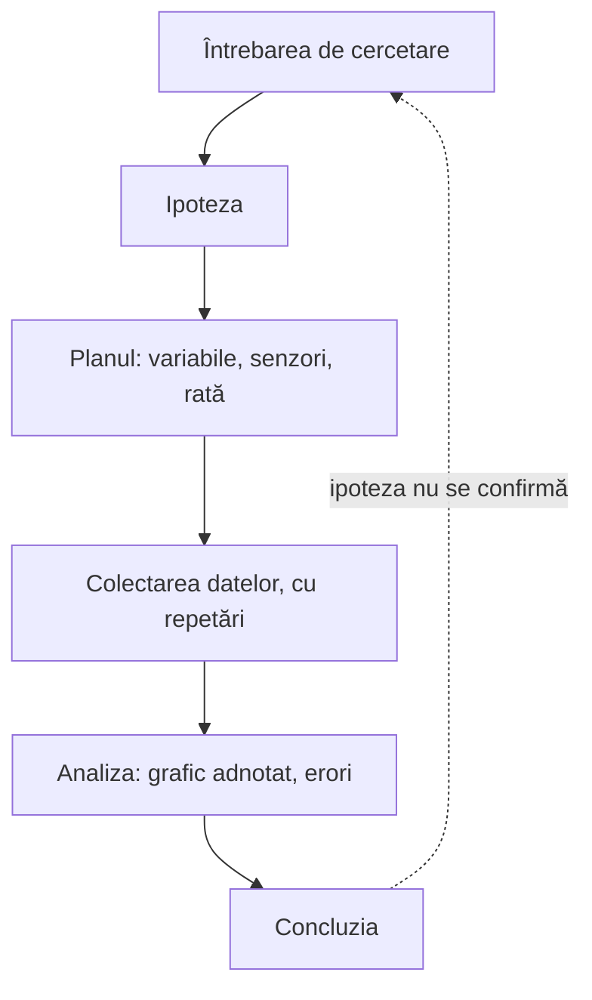

Sesiunea 3 din 4, 90 de minute, unitatea 3 a cursului: *Investigația: de la întrebare la concluzie*. Forma de lucru: laborator / seminar.

> [!abstract] Ce veți putea face
> Rezultatele sesiunii, din curriculumul cursului:
>
> - Să recunoască etapele unei investigații științifice.
> - Să identifice sursele de erori de măsurare.
> - Să formuleze concluzii argumentate pe baza graficelor.
>
> Pe scurt: conducerea unei investigații experimentale de la întrebarea de cercetare la concluzia argumentată pe baza datelor.

## Ce conține

- Etapele investigației: întrebarea de cercetare, ipoteza, variabilele (independentă, dependentă, controlate), planul experimentului.
- Investigație în echipe, cu Labdisc, pe o întrebare aleasă de echipă.
- Erori de măsurare și limitele senzorilor; repetarea măsurărilor.
- Comunicarea rezultatelor: graficul adnotat și concluzia argumentată.

> [!tip] De citit înainte sau după
> - [[la-clasa/metodologie/ciclul-investigatiei|Ciclul investigației]]
> - [[la-clasa/metodologie/niveluri-de-investigatie|Patru niveluri de investigație]]
> - [[la-clasa/anexe/banca-de-intrebari|Banca de întrebări de cercetare]]
> - [[la-clasa/anexe/raport-de-investigatie|Raportul scurt de investigație]]

## Anatomia unei investigații

Investigația merge de la o întrebare la un răspuns sprijinit pe date. Când datele nu confirmă ipoteza, cercul se reia cu o întrebare mai bună; asta nu e un eșec, e felul în care lucrează știința. Pașii urmează modelul lui Pedaste și al colegilor (2015), descris în [[la-clasa/metodologie/ciclul-investigatiei|Ciclul investigației]].



Cuvintele investigației, pe cartonașe. Spuneți-vă explicația, apoi întoarceți.

```cartonase
Întrebarea de cercetare :: O întrebare la care se poate răspunde prin măsurare, cu ce aveți pe masă și în timpul pe care îl aveți.
Ipoteza :: Ce credeți că se va întâmpla și de ce. Spune ce se schimbă, ce se măsoară și ce rămâne la fel.
Variabila independentă :: Ce schimbați voi intenționat, de exemplu materialul cănii.
Variabila dependentă :: Ce măsurați ca să vedeți efectul, de exemplu temperatura ceaiului.
Variabilele controlate :: Ce păstrați la fel ca să fie comparația corectă: volumul de apă, temperatura de pornire, locul.
Eroare sistematică :: Abatere în același sens la fiecare măsurare, de exemplu un senzor necalibrat. Repetarea nu o elimină.
Eroare întâmplătoare :: Abatere care se schimbă de la o măsurare la alta, de exemplu o sondă mișcată. Repetarea o face vizibilă.
Limitele senzorului :: Domeniul de măsurare și rata maximă de eșantionare. Le găsiți în tabelul fiecărui model.
```

Puneți etapele în ordine. Apoi comparați cu schema de mai sus.

```ordine
titlu: Ordonați etapele unei investigații științifice
Întrebarea de cercetare
Ipoteza
Planul experimentului, cu variabilele
Colectarea datelor, cu cel puțin două repetări
Analiza datelor și a erorilor
Concluzia argumentată pe baza graficului
```

## Desfășurarea, pas cu pas

Minutele sunt de la începutul sesiunii. Întrebarea din chenarul „Întrebarea formatorului” e cea pe care formatorul o pune grupului; o puteți folosi la fel cu elevii.

### Mini-input: anatomia unei investigații (min 0-15)

**Scop:** Etapele investigației și tipurile de variabile clarificate.

1. Întrebare, ipoteză, variabile, plan, date, concluzie
2. Exemplul stației „Fenomene termice” reluat ca investigație
3. Ce face o ipoteză testabilă

> [!question] Întrebarea formatorului
> „O ipoteză bună spune ce se schimbă, ce măsurăm și ce păstrăm la fel.”

> [!example] Stația „Fenomene termice”, reluată ca investigație
> - **Întrebarea:** se răcește mai repede apa dintr-un pahar acoperit sau din unul descoperit?
> - **Ipoteza:** apa din paharul descoperit se răcește mai repede, pentru că pierde căldură și prin evaporare.
> - **Variabila independentă:** paharul acoperit sau descoperit.
> - **Variabila dependentă:** temperatura apei, măsurată cu sonda externă.
> - **Variabilele controlate:** volumul de apă, temperatura de pornire, paharul, locul de pe masă.

Aceeași anatomie, la alte discipline. Deschideți exemplul disciplinei voastre.

> [!example]- La chimie
> **Întrebarea:** cum depinde scăderea temperaturii de cantitatea de bicarbonat de sodiu peste care turnați oțetul? **Independentă:** cantitatea de bicarbonat. **Dependentă:** temperatura amestecului. **Controlate:** volumul și temperatura oțetului, paharul.

> [!example]- La biologie
> **Întrebarea:** cât durează până revine pulsul la valoarea de repaus după 10, 20 și 30 de genuflexiuni? **Independentă:** numărul de genuflexiuni. **Dependentă:** timpul de revenire a pulsului. **Controlate:** același elev, același ritm al genuflexiunilor, aceeași poziție la măsurare.

> [!example]- La geografie
> **Întrebarea:** la ora prânzului, e mai cald deasupra asfaltului sau deasupra ierbii? **Independentă:** suprafața. **Dependentă:** temperatura aerului la aceeași înălțime. **Controlate:** ora, înălțimea senzorului, umbra.

> [!example]- La clasele primare
> **Întrebarea:** unde se încălzește mai repede un pahar cu apă rece: la soare sau la umbră? **Independentă:** locul. **Dependentă:** temperatura apei. **Controlate:** aceeași cantitate de apă, pahare la fel, aceeași durată.

**Aveți nevoie de:** Schema investigației (diapozitiv).

### Alegerea întrebării (min 15-25)

**Scop:** Fiecare echipă are o întrebare de cercetare și o ipoteză.

1. Echipa alege din banca de întrebări sau propune una
2. Scrie ipoteza și variabilele în fișa de investigație, un document comun al echipei (de exemplu Google Docs)

> [!question] Întrebarea formatorului
> „Puteți răspunde la întrebare cu ce aveți pe masă în 30 de minute? Dacă nu, o simplificăm.”

**Produs:** Întrebarea și ipoteza scrise.

**Aveți nevoie de:** [[la-clasa/anexe/banca-de-intrebari|banca de întrebări]], după modelul de Labdisc.

> [!warning]- Dacă nu merge
> Întrebare prea largă: formatorul ajută la restrângere.

### Investigația în echipe (min 25-60)

**Scop:** Date colectate și repetate.

1. Planul experimentului
2. Configurarea înregistrării
3. Cel puțin două repetări
4. Notarea condițiilor în documentul echipei

> [!question] Întrebarea formatorului
> „Ce ar putea strica măsurarea? Notați acum, cât vă amintiți.”

**Produs:** Date brute salvate.

**Aveți nevoie de:** Accesoriile cerute de echipe, seringi, lanterne, resorturi, mase marcate.

> [!warning]- Dacă nu merge
> Echipa blocată peste 10 min: formatorul propune o variantă mai simplă a aceleiași întrebări.

### Analiză și erori (min 60-75)

**Scop:** Datele interpretate, erorile estimate.

1. Grafic adnotat
2. Comparația repetărilor
3. Două surse de eroare și cum le-am reduce
4. Concluzia: ipoteza se confirmă sau nu, cu argumente din date

> [!question] Întrebarea formatorului
> „Concluzia voastră trebuie să poată fi citită direct de pe grafic.”

Exersați pe un grafic de geografie. Întrebarea: cum se schimbă temperatura aerului în curtea școlii de dimineața până seara? Desenați curba așteptată, apoi comparați.

```grafic
titlu: Temperatura aerului în curtea școlii, într-o zi senină
x: Ora
y: Temperatura (°C)
prezicere: da
nota: Date ilustrative, calculate cu un model sinusoidal simplificat al variației zilnice (cel mai rece spre ora 3, cel mai cald spre ora 15); nu sunt o măsurare.
date:
6, 10.3
7, 12.0
8, 13.9
9, 16.0
10, 18.1
11, 20.0
12, 21.7
13, 22.9
14, 23.7
15, 24.0
16, 23.7
17, 22.9
18, 21.7
19, 20.0
20, 18.1
```

> [!question]- O concluzie care se poate citi de pe grafic
> „Temperatura a crescut de la aproximativ 10 °C la ora 6 la 24 °C la ora 15, apoi a scăzut. Cea mai caldă parte a zilei nu a fost la prânz, ci după-amiaza.” Fiecare număr se poate verifica cu cursorul.
>
> **Două surse de eroare, cu remediu:** discul lăsat în soare direct arată mai mult decât temperatura aerului, deci îl țineți la umbră; o singură zi poate fi neobișnuită, deci repetați măsurarea în altă zi senină.

**Produs:** Grafic adnotat și concluzie (al treilea artefact).

**Aveți nevoie de:** GlobiLab, foaia de calcul.

### Galeria graficelor (min 75-90)

**Scop:** Rezultatele comunicate și discutate.

1. Fiecare echipă, 2 minute: întrebare, grafic, concluzie
2. Colegii pun o întrebare despre erori

> [!question] Întrebarea formatorului
> „O singură întrebare de la colegi: cât de siguri sunteți și de ce?”

**Aveți nevoie de:** Proiector sau laptopurile pe mese.

> [!warning]- Dacă nu merge
> Timp depășit: prezentare de 1 minut.

## Verificați-vă

Cinci întrebări despre variabile, ipoteze, erori și concluzii.

```quiz
? Întrebarea echipei: „Ce cană ține ceaiul cald mai mult?” Care este variabila independentă?
+ Materialul cănii | Pe ea o schimbați intenționat ca să vedeți efectul.
- Temperatura ceaiului | Pe ea o măsurați: e variabila dependentă.
- Volumul de ceai | Îl păstrați la fel în toate cănile: e o variabilă controlată.

? Care dintre ipotezele de mai jos se poate testa cu Labdisc?
+ Dacă paharul e acoperit, apa pierde mai puține grade în 10 minute decât într-un pahar descoperit | Spune ce se schimbă, ce se măsoară și în cât timp.
- Răcirea apei depinde de mulți factori | E adevărat, dar nu spune ce se schimbă și ce se măsoară, deci nu poate fi infirmată.
- Apa caldă se răcește | Se știe dinainte și nu compară nimic.

? De ce cere sesiunea cel puțin două repetări?
+ Ca să vedeți cât diferă rezultatele și dacă concluzia rezistă | Diferența dintre repetări arată erorile întâmplătoare și cât de siguri puteți fi.
- Ca să corectați erorile senzorului | Repetarea nu elimină o eroare sistematică: un senzor necalibrat greșește la fel de fiecare dată.
- Ca să aveți mai multe date de exportat | Mai multe date nu ajută dacă nu le comparați.

? Măsurați temperatura din curte de la ora 6 la ora 20, la 1 eșantion pe minut. Câte eșantioane setați?
+ 840 | 14 ore × 60 de minute = 840.
- 14 | Ar fi un eșantion pe oră.
- 50 400 | Ar fi un eșantion pe secundă, de 60 de ori prea multe pentru setarea aleasă.

? Ipoteza: apa se răcește mai repede într-o cană de metal decât într-una de ceramică. Curbele ies aproape identice, iar diferența dintre ele e mai mică decât cea dintre repetări. Ce concluzie scrieți?
+ Datele nu susțin ipoteza în condițiile noastre | Diferența e în limitele erorii; concluzia se citește din grafic, chiar dacă nu e cea așteptată.
- Ipoteza e confirmată, senzorul a greșit | Nu aveți niciun argument din date că senzorul a greșit.
- Experimentul a eșuat și trebuie ignorat | Un rezultat care infirmă ipoteza e tot un rezultat. O predicție greșită e la fel de utilă ca una corectă.
```

## După sesiune: lucrul individual

- Realizarea unei investigații proprii pe o temă din curriculumul la fizică (sau al disciplinei pe care o predați).

**Produsul:** Raport scurt de investigație: întrebare, ipoteză, date, grafic, concluzie, erori. **Evaluarea:** evaluare reciprocă.

## Autoevaluare

Bifați ce puteți face fără ajutor. Bifele rămân doar în browserul dumneavoastră.

- [ ] Pot recunoaște etapele unei investigații științifice.
- [ ] Pot identifica sursele de erori de măsurare.
- [ ] Pot formula concluzii argumentate pe baza graficelor.

## Reflecție

> [!quote] „O singură întrebare de la colegi: cât de siguri sunteți și de ce?”

Scrieți, în Padlet-ul cursului sau în documentul comun al grupului (de exemplu un Google Doc), un lucru pe care îl duceți la clasă din sesiunea aceasta și un lucru care încă nu e clar.

## Surse

- Pedaste, M. și colab. (2015). Phases of inquiry-based learning: Definitions and the inquiry cycle. *Educational Research Review*, 14, 47–61. https://doi.org/10.1016/j.edurev.2015.02.003
