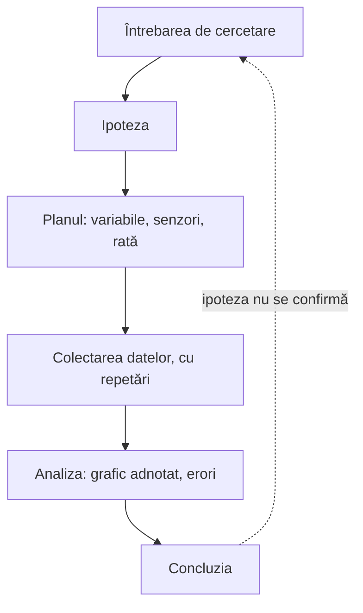

Unitatea 3 din 4 a cursului.

> [!abstract] Ce veți putea face
> - Să recunoască etapele unei investigații științifice.
> - Să identifice sursele de erori de măsurare.
> - Să formuleze concluzii argumentate pe baza graficelor.
>
> Pe scurt: conducerea unei investigații experimentale de la întrebarea de cercetare la concluzia argumentată pe baza datelor.

> [!tip] De citit pe parcurs
> - [[la-clasa/metodologie/ciclul-investigatiei|Ciclul investigației]]
> - [[la-clasa/metodologie/niveluri-de-investigatie|Patru niveluri de investigație]]
> - [[la-clasa/anexe/banca-de-intrebari|Banca de întrebări de cercetare]]
> - [[la-clasa/anexe/raport-de-investigatie|Raportul scurt de investigație]]

## Etapele investigației

În unitatea 2, întrebarea era dată de fișa stației. Acum o alegeți voi. Investigația merge de la o întrebare la un răspuns sprijinit pe date; când datele nu confirmă ipoteza, cercul se reia cu o întrebare mai bună. Pașii urmează modelul lui Pedaste și al colegilor (2015), descris în [[la-clasa/metodologie/ciclul-investigatiei|Ciclul investigației]].



Puneți etapele în ordine, apoi comparați cu schema.

```ordine
titlu: Ordonați etapele unei investigații științifice
Întrebarea de cercetare
Ipoteza
Planul experimentului, cu variabilele
Colectarea datelor, cu cel puțin două repetări
Analiza datelor și a erorilor
Concluzia argumentată pe baza graficului
```

### Întrebarea de cercetare și ipoteza testabilă

O întrebare de cercetare bună se poate rezolva prin măsurare, cu ce aveți pe masă, într-o lecție. Dacă nu se poate, simplificați-o. O ipoteză testabilă spune ce credeți că se va întâmpla și de ce.

> [!quote] O ipoteză bună spune ce se schimbă, ce măsurăm și ce păstrăm la fel.

Alegeți o întrebare din banca disciplinei voastre sau propuneți una. Scrieți întrebarea și ipoteza în fișa de investigație, un document comun al echipei în Google Docs.

> [!example]- Banca de întrebări: fizică
> Răcirea cu și fără capac; iluminarea și distanța de la sursă; presiunea aerului în seringă și volumul; nivelul sonor și distanța; perioada unui resort și masa.

> [!example]- Banca de întrebări: chimie
> Viteza de dizolvare și temperatura apei; pH-ul unor produse din bucătărie; conductivitatea și concentrația.

> [!example]- Banca de întrebări: biologie
> Pulsul la efort și vârsta sau antrenamentul; transpirația la lumină și la întuneric; umiditatea în jurul plantelor de interior.

> [!example]- Banca de întrebări: geografie
> Temperatura și umiditatea pe parcursul zilei; turbiditatea apei după agitare; încălzirea suprafețelor de culori diferite.

> [!example]- Banca de întrebări: clasele primare
> Unde se topește gheața mai repede; cât de cald e la soare și la umbră; cât de zgomotos e în clasă și pe coridor.

Mai multe întrebări, cu senzorii potriviți, sunt în [[la-clasa/anexe/banca-de-intrebari|Banca de întrebări de cercetare]].

### Variabilele: independentă, dependentă, controlate

Cuvintele investigației, pe cartonașe. Spuneți-vă explicația, apoi întoarceți.

```cartonase
Întrebarea de cercetare :: O întrebare la care se poate răspunde prin măsurare, cu ce aveți pe masă și în timpul pe care îl aveți.
Ipoteza :: Ce credeți că se va întâmpla și de ce. Spune ce se schimbă, ce se măsoară și ce rămâne la fel.
Variabila independentă :: Ce schimbați voi intenționat, de exemplu materialul cănii.
Variabila dependentă :: Ce măsurați ca să vedeți efectul, de exemplu temperatura ceaiului.
Variabilele controlate :: Ce păstrați la fel ca să fie comparația corectă: volumul de apă, temperatura de pornire, locul.
Eroare sistematică :: Abatere în același sens la fiecare măsurare, de exemplu un senzor necalibrat. Repetarea nu o elimină.
Eroare întâmplătoare :: Abatere care se schimbă de la o măsurare la alta, de exemplu o sondă mișcată. Repetarea o face vizibilă.
Limitele senzorului :: Domeniul de măsurare și rata maximă de eșantionare. Le găsiți în tabelul fiecărui model.
```

Câte o întrebare din bancă, desfăcută în variabile. Deschideți exemplul disciplinei voastre, apoi încercați singuri pe altă întrebare din bancă.

> [!example]- Fizică: răcirea cu și fără capac
> **Întrebarea:** se răcește mai repede apa dintr-un pahar acoperit sau din unul descoperit? **Ipoteza:** apa din paharul descoperit se răcește mai repede, pentru că pierde căldură și prin evaporare. **Independentă:** paharul acoperit sau descoperit. **Dependentă:** temperatura apei, cu sonda externă. **Controlate:** volumul de apă, temperatura de pornire, paharul, locul.

> [!example]- Chimie: viteza de dizolvare și temperatura apei
> **Întrebarea:** se dizolvă sarea mai repede în apă caldă decât în apă rece? **Independentă:** temperatura apei. **Dependentă:** timpul până când conductivitatea nu mai crește (BioChem). **Controlate:** cantitatea de sare și de apă, amestecarea.

> [!example]- Biologie: transpirația la lumină și la întuneric
> **Întrebarea:** transpiră o plantă mai mult la lumină decât la întuneric? **Independentă:** lumina. **Dependentă:** umiditatea relativă în punga din jurul ramurii. **Controlate:** aceeași plantă sau plante la fel, aceeași durată, aceeași temperatură.

> [!example]- Geografie: încălzirea suprafețelor de culori diferite
> **Întrebarea:** se încălzește mai tare o suprafață închisă la culoare decât una deschisă? **Independentă:** culoarea suprafeței. **Dependentă:** temperatura suprafeței, cu senzorul IR (Enviro). **Controlate:** aceeași lumină, aceeași durată, același material.

> [!example]- Clasele primare: unde se topește gheața mai repede
> **Întrebarea:** se topește un cub de gheață mai repede la soare sau la umbră? **Independentă:** locul. **Dependentă:** timpul până când sonda arată că apa trece de 0 °C. **Controlate:** cuburi la fel de mari, pahare la fel.

### Planul experimentului și repetarea măsurărilor

1. Scrieți planul în fișa echipei: ce măsurați, cu ce senzor, cu ce rată și cât timp, ce păstrați la fel.
2. Configurați înregistrarea.
3. Faceți cel puțin două repetări.
4. Notați condițiile fiecărei repetări în documentul echipei.

> [!question] Gândiți-vă
> Ce ar putea strica măsurarea? Notați acum, cât vă amintiți.

> [!warning]- Dacă nu merge
> Echipa e blocată: alegeți o variantă mai simplă a aceleiași întrebări, de exemplu o singură comparație în loc de trei.

## Investigația în echipe

### Erori de măsurare și limitele senzorilor

1. Comparați repetările: cât diferă?
2. Numiți două surse de eroare și cum le-ați reduce.
3. Verificați limitele senzorului: domeniul de măsurare și rata maximă, din tabelul modelului.

> [!example] Unde caută erorile o echipă
> O sondă mișcată între repetări, o probă mai caldă la pornire, un senzor lăsat în soare direct, un electrod nespălat între probe. Fiecare se vede pe grafic, ca o diferență între repetări sau ca un salt.

### Comunicarea rezultatelor: graficul adnotat și concluzia argumentată

> [!quote] Concluzia trebuie să poată fi citită direct de pe grafic.

Exersați pe o întrebare din banca de geografie: cum se schimbă temperatura aerului pe parcursul zilei? Desenați curba așteptată, apoi comparați.

```grafic
titlu: Temperatura aerului în curtea școlii, într-o zi senină
x: Ora
y: Temperatura (°C)
prezicere: da
nota: Date ilustrative, calculate cu un model sinusoidal simplificat al variației zilnice (cel mai rece spre ora 3, cel mai cald spre ora 15); nu sunt o măsurare.
date:
6, 10.3
7, 12.0
8, 13.9
9, 16.0
10, 18.1
11, 20.0
12, 21.7
13, 22.9
14, 23.7
15, 24.0
16, 23.7
17, 22.9
18, 21.7
19, 20.0
20, 18.1
```

> [!question]- O concluzie care se poate citi de pe grafic
> „Temperatura a crescut de la aproximativ 10 °C la ora 6 la 24 °C la ora 15, apoi a scăzut. Cea mai caldă parte a zilei nu a fost la prânz, ci după-amiaza.” Fiecare număr se poate verifica cu cursorul.
>
> **Două surse de eroare, cu remediu:** discul lăsat în soare direct arată mai mult decât temperatura aerului, deci îl țineți la umbră; o singură zi poate fi neobișnuită, deci repetați măsurarea în altă zi senină.

Prezentați rezultatul ca într-o galerie: puneți în Padletul grupului întrebarea, graficul adnotat și concluzia. Colegii vă lasă câte un comentariu despre erori.

> [!quote] O singură întrebare de la colegi: cât de siguri sunteți și de ce?

## Verificați-vă

Cinci întrebări despre variabile, ipoteze, erori și concluzii.

```quiz
? Întrebarea echipei: „Ce cană ține ceaiul cald mai mult?” Care este variabila independentă?
+ Materialul cănii | Pe ea o schimbați intenționat ca să vedeți efectul.
- Temperatura ceaiului | Pe ea o măsurați: e variabila dependentă.
- Volumul de ceai | Îl păstrați la fel în toate cănile: e o variabilă controlată.

? Care dintre ipotezele de mai jos se poate testa cu Labdisc?
+ O plantă transpiră mai mult la lumină: în aceeași oră, umiditatea din pungă crește mai mult la lumină decât la întuneric | Spune ce se schimbă, ce se măsoară și în cât timp.
- Transpirația plantelor depinde de mulți factori | E adevărat, dar nu spune ce se schimbă și ce se măsoară, deci nu poate fi infirmată.
- Plantele transpiră | Se știe dinainte și nu compară nimic.

? De ce cere investigația cel puțin două repetări?
+ Ca să vedeți cât diferă rezultatele și dacă concluzia rezistă | Diferența dintre repetări arată erorile întâmplătoare și cât de siguri puteți fi.
- Ca să corectați erorile senzorului | Repetarea nu elimină o eroare sistematică: un senzor necalibrat greșește la fel de fiecare dată.
- Ca să aveți mai multe date de exportat | Mai multe date nu ajută dacă nu le comparați.

? Măsurați temperatura din curte de la ora 6 la ora 20, la 1 eșantion pe minut. Câte eșantioane setați?
+ 840 | 14 ore × 60 de minute = 840.
- 14 | Ar fi un eșantion pe oră.
- 50 400 | Ar fi un eșantion pe secundă, de 60 de ori prea multe pentru setarea aleasă.

? Ipoteza: apa se răcește mai repede într-o cană de metal decât într-una de ceramică. Curbele ies aproape identice, iar diferența dintre ele e mai mică decât cea dintre repetări. Ce concluzie scrieți?
+ Datele nu susțin ipoteza în condițiile noastre | Diferența e în limitele erorii; concluzia se citește din grafic, chiar dacă nu e cea așteptată.
- Ipoteza e confirmată, senzorul a greșit | Nu aveți niciun argument din date că senzorul a greșit.
- Experimentul a eșuat și trebuie ignorat | Un rezultat care infirmă ipoteza e tot un rezultat. O predicție greșită e la fel de utilă ca una corectă.
```

## Aplicați

- Realizarea unei investigații proprii pe o temă din curriculumul disciplinei.

**Produsul:** Raport scurt de investigație: întrebare, ipoteză, date, grafic, concluzie, erori. **Evaluarea:** evaluare reciprocă.

## Autoevaluare

Bifați ce puteți face fără ajutor. Bifele rămân doar în browserul dumneavoastră.

- [ ] Pot recunoaște etapele unei investigații științifice.
- [ ] Pot identifica sursele de erori de măsurare.
- [ ] Pot formula concluzii argumentate pe baza graficelor.

## Reflecție

> [!quote] Cât de siguri sunteți de concluzia voastră și de ce?

Scrieți răspunsul în documentul vostru de curs, alături de un lucru pe care îl duceți la clasă și unul care încă nu e clar.

**Mai departe:** ați trecut prin investigație ca elevii. În [[formare/4-lectia-mea-cu-labdisc|unitatea 4]] o proiectați pentru clasa voastră.

## Surse

- Pedaste, M. și colab. (2015). Phases of inquiry-based learning: Definitions and the inquiry cycle. *Educational Research Review*, 14, 47–61. https://doi.org/10.1016/j.edurev.2015.02.003
