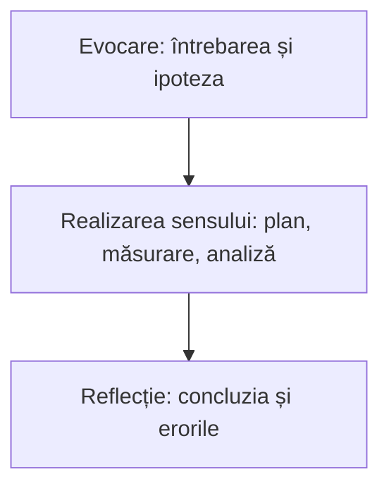

Sesiunea 4 din 4, 90 de minute, unitatea 4 a cursului: *Lecția mea cu Labdisc: proiectare și reflecție*. Forma de lucru: seminar.

> [!abstract] Ce veți putea face
> Rezultatele sesiunii, din curriculumul cursului:
>
> - Să proiecteze o fișă de investigație cu Labdisc pentru o unitate de competență din curriculum.
> - Să integreze activitatea cu Labdisc în etapele lecției.
> - Să evalueze investigațiile elevilor pe baza unor criterii explicite.
> - Să adapteze activitățile pentru gimnaziu, liceu și alte discipline științifice.
>
> Pe scurt: proiectarea și aplicarea la clasă a unei fișe de investigație cu Labdisc, cu criterii de evaluare a produselor elevilor.

## Ce conține

- Corelarea activității cu competențele specifice și unitățile de competență din curriculumul disciplinei (la fizică, de unde a pornit cursul, sau la disciplina pe care o predați).
- Elaborarea fișei de investigație pentru clasa proprie.
- Criterii de evaluare a investigației elevilor.
- Prezentarea fișelor, feedback între colegi, reflecție și plan de aplicare la clasă.

> [!tip] De citit înainte sau după
> - [[la-clasa/anexe/fisa-de-investigatie|Șablonul fișei de investigație]]
> - [[la-clasa/anexe/criterii-de-evaluare|Criterii de evaluare]]
> - [[la-clasa/implementare/organizarea-lectiei|Organizarea lecției]]
> - [[la-clasa/proiecte/index|Proiectele de lecție ale profesorilor]]

## Activitatea cu Labdisc în etapele lecției

Fișa de investigație se așază în cele trei etape ale lecției: **evocarea** (întrebarea și ipoteza), **realizarea sensului** (planul, măsurarea, analiza) și **reflecția** (concluzia și erorile).



Încercați pe o lecție oarecare: puneți activitățile în ordinea în care le fac elevii.

```ordine
titlu: Ordonați activitățile elevilor într-o lecție cu Labdisc
Elevii pornesc de la un fenomen și formulează întrebarea
Fiecare elev desenează pe tabletă graficul pe care îl așteaptă
Echipa configurează senzorii, rata și numărul de eșantioane
Echipa măsoară, repetă și adnotează graficul
Elevii compară graficul real cu cel desenat
Elevii răspund la întrebare și numesc două surse de eroare
```

## Desfășurarea, pas cu pas

Minutele sunt de la începutul sesiunii. Întrebarea din chenarul „Întrebarea formatorului” e cea pe care formatorul o pune grupului; o puteți folosi la fel cu elevii.

### Modelul fișei de investigație (min 0-10)

**Scop:** Structura fișei de investigație cunoscută.

1. Structura: clasa, unitatea de competență, întrebarea, materiale, pași, tabel de date, întrebări de interpretare, criterii de evaluare, securitate
2. Legătura cu etapele lecției: evocare, realizarea sensului, reflecție

> [!question] Întrebarea formatorului
> „Plecați de la o lecție pe care o predați luna aceasta.”

**Aveți nevoie de:** Șablonul fișei de investigație, ca document comun pe care fiecare îl copiază (de exemplu în Google Docs).

### Elaborarea fișei (min 10-50)

**Scop:** O fișă de investigație pentru clasa proprie.

1. Individual sau în perechi, pe aceeași clasă
2. Se pornește de la lista de obstacole din S1
3. Se testează un pas pe dispozitiv dacă e nevoie

> [!question] Întrebarea formatorului
> „Ce va face elevul cu datele după ce apasă Stop?”

**Produs:** Fișa de investigație (draft).

**Aveți nevoie de:** Laptopuri, Labdisc, curriculumul disciplinei.

> [!warning]- Dacă nu merge
> Participant fără temă: propune o lucrare de laborator din curriculumul disciplinei lui, de exemplu pentru clasa a VIII-a.

### Feedback în perechi (min 50-70)

**Scop:** Fișele îmbunătățite prin feedback între colegi.

1. Schimb de fișe: fiecare îi dă colegului acces de comentare la documentul lui
2. Verificare după criterii: întrebare testabilă, variabile clare, timp realist, interpretare cerută elevului
3. „două stele și o dorință”, scrise ca comentarii în documentul colegului

> [!question] Întrebarea formatorului
> „Ce ar face un elev care termină primul?”

Exersați criteriile înainte să le aplicați pe fișa colegului.

```quiz
? Care întrebare se poate testa cu Labdisc într-o lecție?
+ Cum se schimbă pH-ul apei când picurăm suc de lămâie în ea? | Se schimbă un lucru, se măsoară altul, în câteva minute.
- De ce e important să bem apă curată? | E o întrebare bună de discuție, dar nu are răspuns prin măsurare.
- Cum se schimbă clima Moldovei? | Se măsoară în ani și decenii, nu într-o lecție.

? Fișa colegului cere elevilor doar să insereze graficul în raport. Ce criteriu nu e îndeplinit?
+ Elevului i se cere să interpreteze datele | Graficul pus în raport e colectare; interpretarea înseamnă să citească și să explice ce arată graficul.
- Întrebarea se poate testa | Întrebarea poate fi foarte bună; problema e ce face elevul cu datele.
- Timpul e realist | Pasul e rapid; timpul nu e problema aici.

? Elevii n-au mai lucrat niciodată cu senzori. Cu ce nivel de investigație începeți?
+ Confirmare sau structurată | Profesorul dă întrebarea și metoda; elevii învață întâi aparatul. Se urcă un nivel când își configurează singuri senzorii.
- Deschisă | Elevii ar trebui să aleagă singuri întrebarea și metoda fără să cunoască aparatul.
- Ghidată | E pasul următor, după ce elevii se descurcă singuri cu configurarea.

? Ce încărcați în portofoliul Padlet după lecție?
+ Fișa și un grafic al elevilor, fără nume și fără fotografii cu fețe | Dovada aplicării, fără date personale ale elevilor.
- Fotografii ale clasei la lucru, ca să se vadă implicarea | Fotografiile cu fețe sunt date personale; nu se încarcă.
- Rapoartele elevilor cu numele lor, ca să se vadă cine a lucrat | Numele elevilor nu intră în portofoliu.
```

**Produs:** Fișa revizuită (al patrulea artefact).

**Aveți nevoie de:** Lista de criterii.

### Plan de aplicare și lucrul individual (min 70-80)

**Scop:** Plan de aplicare la clasă și sarcina individuală clare.

1. Data și clasa la care aplică fișa
2. Sarcina individuală și portofoliul Padlet
3. Resursele de după curs

> [!question] Întrebarea formatorului
> „Încărcați în Padlet fișa și un grafic al elevilor, fără nume și fără fotografii cu fețe.”

**Produs:** Plan de aplicare.

**Aveți nevoie de:** Link Padlet.

### Încheiere (min 80-90)

**Scop:** Evaluarea cursului și reflecție finală.

1. Reflecție: un lucru pe care îl aplic, un obstacol care rămâne
2. Chestionarul de feedback
3. Încheiere

> [!question] Întrebarea formatorului
> „Ce obstacol de dimineață s-a micșorat azi?”

**Produs:** Chestionar completat.

**Aveți nevoie de:** Chestionar online.

## Adaptarea: alte clase, alte discipline

Aceeași fișă se adaptează pe două axe: cât hotărăsc elevii (nivelul de investigație) și ce senzori cere disciplina. Întoarceți cartonașele cu cele patru niveluri descrise de Banchi și Bell (2008).

```cartonase
Confirmare :: Profesorul dă întrebarea și metoda; răspunsul se știe dinainte. Elevii verifică prin măsurare.
Investigație structurată :: Profesorul dă întrebarea și metoda; răspunsul îl găsesc elevii.
Investigație ghidată :: Profesorul dă întrebarea; elevii își fac singuri planul și găsesc răspunsul.
Investigație deschisă :: Elevii aleg întrebarea, metoda și găsesc răspunsul.
Două stele și o dorință :: Feedback între colegi: două lucruri reușite și unul de îmbunătățit.
```

Ce senzori cere fiecare disciplină, după [[formare/labdisc/aparatul#1.3 Senzori integrați și senzori externi|tabelul senzorilor pe modele]]:

> [!example]- La fizică
> Distanța, tensiunea și curentul (GenSci, Physio), accelerometrul (Physio), lumina, presiunea aerului, temperatura. Exemple: [[la-clasa/proiecte/fizica/index|proiectele de fizică]].

> [!example]- La chimie
> pH-ul (GenSci, Enviro, BioChem), conductivitatea, colorimetrul și termocuplul (BioChem), temperatura externă pentru reacții care degajă sau absorb căldură. Exemple: [[la-clasa/proiecte/chimie/index|proiectele de chimie]].

> [!example]- La biologie
> Ritmul cardiac (BioChem), oxigenul dizolvat (BioChem, Enviro), lumina și umiditatea pentru fotosinteză și transpirația plantelor. Exemple: [[la-clasa/proiecte/biologie/index|proiectele de biologie]].

> [!example]- La geografie
> GPS, presiunea barometrică, umiditatea, UV și temperatura IR (Enviro), turbiditatea apei. Exemple: [[la-clasa/proiecte/geografie/index|proiectele de geografie]].

> [!example]- La clasele primare
> Temperatura, lumina și nivelul sonor, citite direct pe ecranul discului sau pe graficul proiectat. Exemple: [[la-clasa/proiecte/clase-primare/index|proiectele pentru clasele primare]].

Un exemplu de chimie, de liceu: neutralizarea unui acid cu o bază, urmărită cu electrodul de pH. Desenați curba pH-ului pe care o așteptați, apoi comparați.

```grafic
titlu: pH-ul la neutralizarea acidului clorhidric cu hidroxid de sodiu
x: Volumul de NaOH adăugat (ml)
y: pH
prezicere: da
nota: Date ilustrative, calculate pentru 25 ml HCl 0,1 mol/l neutralizat cu NaOH 0,1 mol/l; nu sunt o măsurare.
date:
0, 1.00
5, 1.18
10, 1.37
15, 1.60
20, 1.95
22, 2.19
24, 2.69
24.5, 3.00
25, 7.00
25.5, 11.00
26, 11.29
28, 11.75
30, 11.96
35, 12.22
40, 12.36
```

> [!question]- Cum îl adaptați la gimnaziu?
> La liceu, întrebarea e unde și de ce pH-ul sare brusc (în jur de 25 ml, când acidul a fost neutralizat). La gimnaziu, aceeași măsurare devine o investigație structurată mai simplă: elevii adaugă picături de oțet sau de suc de lămâie în apă și urmăresc cum scade pH-ul, fără calcule de concentrație.

Fără electrod de pH la îndemână, elevii pot explora aceeași idee în simulare: pH-ul unor lichide din casă și ce se întâmplă când le diluați cu apă.

```simulare
url: https://phet.colorado.edu/sims/html/ph-scale/latest/ph-scale_ro.html
titlu: Scara pH
sursa: PhET Interactive Simulations, University of Colorado Boulder, CC BY 4.0.
```

## După sesiune: lucrul individual

- Finalizarea fișei de investigație și aplicarea ei la o lecție.
- Reflecție scrisă asupra lecției.

**Produsul:** Fișa de investigație și dovezi din lecție (grafice, produse ale elevilor, fără date personale) în portofoliul Padlet. **Evaluarea:** feedback constructiv și evaluare reciprocă.

## Autoevaluare

Bifați ce puteți face fără ajutor. Bifele rămân doar în browserul dumneavoastră.

- [ ] Pot proiecta o fișă de investigație cu Labdisc pentru o unitate de competență din curriculum.
- [ ] Pot integra activitatea cu Labdisc în etapele lecției.
- [ ] Pot evalua investigațiile elevilor pe baza unor criterii explicite.
- [ ] Pot adapta activitățile pentru gimnaziu, liceu și alte discipline științifice.

## Reflecție

> [!quote] „Ce obstacol de dimineață s-a micșorat azi?”

Scrieți, în Padlet-ul cursului sau în documentul comun al grupului (de exemplu un Google Doc), un lucru pe care îl duceți la clasă din sesiunea aceasta și un lucru care încă nu e clar.

## Surse

- Banchi, H. și Bell, R. (2008). The Many Levels of Inquiry. *Science and Children*, 46(2), 26–29.
