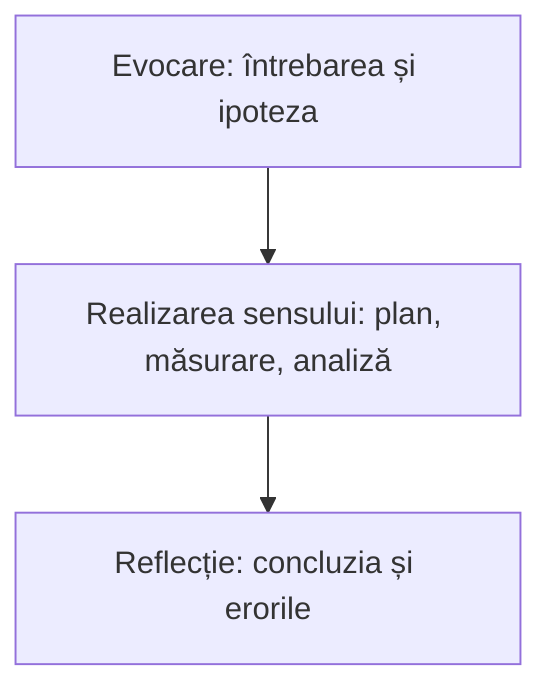

Unitatea 4 din 4 a cursului.

> [!abstract] Ce veți putea face
> - Să proiecteze o fișă de investigație cu Labdisc pentru o unitate de competență din curriculum.
> - Să integreze activitatea cu Labdisc în etapele lecției.
> - Să evalueze investigațiile elevilor pe baza unor criterii explicite.
> - Să adapteze activitățile pentru niveluri diferite și proiecte interdisciplinare.
>
> Pe scurt: proiectarea și aplicarea la clasă a unei fișe de investigație cu Labdisc, cu criterii de evaluare a produselor elevilor.

> [!tip] De citit pe parcurs
> - [[la-clasa/anexe/fisa-de-investigatie|Șablonul fișei de investigație]]
> - [[la-clasa/anexe/criterii-de-evaluare|Criterii de evaluare]]
> - [[la-clasa/implementare/organizarea-lectiei|Organizarea lecției]]
> - [[la-clasa/proiecte/index|Proiectele de lecție ale profesorilor]]

## Fișa de investigație pentru clasa proprie

Plecați de la o lecție pe care o predați luna aceasta și de la lista de obstacole scrisă la începutul [[formare/1-de-la-demonstratie-la-masurare|unității 1]]. Dacă nu aveți încă o temă, porniți de la una dintre stațiile disciplinei voastre din [[formare/2-experimente-in-statii|unitatea 2]].

### Corelarea activității cu competențele specifice și unitățile de competență ale disciplinei

Fiecare disciplină științifică are în curriculum o competență de investigare. Căutați în curriculumul disciplinei voastre unitatea de competență pe care o lucrează lecția aleasă și scrieți-o în capul fișei.

> [!example]- Competența de investigare, pe discipline
> Formulările din curriculumul național, citate în curriculumul cursului:
>
> - **Fizică:** „Investigarea fenomenelor fizice simple prin observare și experimentare…”
> - **Chimie:** „Investigarea experimentală a substanțelor și proceselor chimice…”
> - **Biologie:** „Investigarea lumii vii cu ajutorul metodelor și al mijloacelor specifice…”
> - **Geografie:** „Investigarea spațiului geografic prin conexiuni interdisciplinare…”
> - **Științe la clasele primare:** „Explorarea-investigarea mediului înconjurător…”

### Structura fișei de investigație

Șablonul e în [[la-clasa/anexe/fisa-de-investigatie|Fișa de investigație]]. Faceți-vă o copie în Google Docs și completați-o pentru clasa voastră. Rubricile: clasa, unitatea de competență, întrebarea, materiale, pași, tabel de date, întrebări de interpretare, criterii de evaluare, securitate.

> [!quote] Ce va face elevul cu datele după ce apasă Stop?

Activitatea se așază în cele trei etape ale lecției: **evocarea** (întrebarea și ipoteza), **realizarea sensului** (planul, măsurarea, analiza) și **reflecția** (concluzia și erorile).



Încercați pe o lecție oarecare: puneți activitățile în ordinea în care le fac elevii.

```ordine
titlu: Ordonați activitățile elevilor într-o lecție cu Labdisc
Elevii pornesc de la un fenomen și formulează întrebarea
Fiecare elev desenează pe tabletă graficul pe care îl așteaptă
Echipa configurează senzorii, rata și numărul de eșantioane
Echipa măsoară, repetă și adnotează graficul
Elevii compară graficul real cu cel desenat
Elevii răspund la întrebare și numesc două surse de eroare
```

Un exemplu de chimie, de liceu: neutralizarea unui acid cu o bază, urmărită cu electrodul de pH. Așa ar arăta graficul pe care îl desenează elevii în evocare și pe care îl compară cu datele în reflecție. Desenați curba pH-ului pe care o așteptați, apoi comparați.

```grafic
titlu: pH-ul la neutralizarea acidului clorhidric cu hidroxid de sodiu
x: Volumul de NaOH adăugat (ml)
y: pH
prezicere: da
nota: Date ilustrative, calculate pentru 25 ml HCl 0,1 mol/l neutralizat cu NaOH 0,1 mol/l; nu sunt o măsurare.
date:
0, 1.00
5, 1.18
10, 1.37
15, 1.60
20, 1.95
22, 2.19
24, 2.69
24.5, 3.00
25, 7.00
25.5, 11.00
26, 11.29
28, 11.75
30, 11.96
35, 12.22
40, 12.36
```

> [!question]- Unde sare pH-ul și de ce?
> În jurul a 25 ml, când tot acidul a fost neutralizat. Înainte și după acest punct, multe picături schimbă pH-ul puțin; aproape de el, câteva picături îl schimbă cu mai multe unități. E o întrebare bună de interpretare pentru fișă.

### Criterii de evaluare a investigației elevilor

Criteriile cu care verificați fișa sunt și criteriile cu care se evaluează investigația elevilor: întrebare testabilă, variabile clare, timp realist, interpretare cerută elevului. Lista completă, pentru fișa profesorului și pentru raportul elevilor, e în [[la-clasa/anexe/criterii-de-evaluare|Criterii de evaluare]]. Puneți criteriile într-un formular Google, ca fiecare coleg să le bifeze pentru fișa pe care o citește.

Exersați criteriile înainte să le aplicați pe fișa unui coleg.

```quiz
? Care întrebare se poate testa cu Labdisc într-o lecție?
+ Cum se schimbă pH-ul apei când picurăm suc de lămâie în ea? | Se schimbă un lucru, se măsoară altul, în câteva minute.
- De ce e important să bem apă curată? | E o întrebare bună de discuție, dar nu are răspuns prin măsurare.
- Cum se schimbă clima Moldovei? | Se măsoară în ani și decenii, nu într-o lecție.

? Fișa colegului cere elevilor doar să insereze graficul în raport. Ce criteriu nu e îndeplinit?
+ Elevului i se cere să interpreteze datele | Graficul pus în raport e colectare; interpretarea înseamnă să citească și să explice ce arată graficul.
- Întrebarea se poate testa | Întrebarea poate fi foarte bună; problema e ce face elevul cu datele.
- Timpul e realist | Pasul e rapid; timpul nu e problema aici.

? Elevii n-au mai lucrat niciodată cu senzori. Cu ce nivel de investigație începeți?
+ Confirmare sau structurată | Profesorul dă întrebarea și metoda; elevii învață întâi aparatul. Se urcă un nivel când își configurează singuri senzorii.
- Deschisă | Elevii ar trebui să aleagă singuri întrebarea și metoda fără să cunoască aparatul.
- Ghidată | E pasul următor, după ce elevii se descurcă singuri cu configurarea.

? Ce încărcați în portofoliul Padlet după lecție?
+ Fișa și un grafic al elevilor, fără nume și fără fotografii cu fețe | Dovada aplicării, fără date personale ale elevilor.
- Fotografii ale clasei la lucru, ca să se vadă implicarea | Fotografiile cu fețe sunt date personale; nu se încarcă.
- Rapoartele elevilor cu numele lor, ca să se vadă cine a lucrat | Numele elevilor nu intră în portofoliu.
```

## Prezentare și reflecție

### Feedback între colegi, reflecție, plan de aplicare la clasă

1. Dați unui coleg acces de comentare la fișa voastră, de preferință unui coleg de altă disciplină.
2. Colegul o verifică după criterii: întrebare testabilă, variabile clare, timp realist, interpretare cerută elevului.
3. Feedbackul vine ca „două stele și o dorință”, scris în comentarii în document.

> [!question] Gândiți-vă
> Ce ar face un elev care termină primul?

**Ce produceți:** fișa revizuită, al patrulea produs pentru portofoliu.

Planul de aplicare îl scrieți în Padletul grupului: data și clasa la care aplicați fișa. Modelul de plan e în [[formare/reflectie|Reflecție]].

> [!quote] Încărcați în Padlet fișa și un grafic al elevilor, fără nume și fără fotografii cu fețe.

### Adaptarea: alte niveluri, proiecte interdisciplinare

Aceeași fișă se adaptează pe două axe: cât hotărăsc elevii (nivelul de investigație) și ce discipline se întâlnesc în aceeași întrebare. Întoarceți cartonașele cu cele patru niveluri descrise de Banchi și Bell (2008).

```cartonase
Confirmare :: Profesorul dă întrebarea și metoda; răspunsul se știe dinainte. Elevii verifică prin măsurare.
Investigație structurată :: Profesorul dă întrebarea și metoda; răspunsul îl găsesc elevii.
Investigație ghidată :: Profesorul dă întrebarea; elevii își fac singuri planul și găsesc răspunsul.
Investigație deschisă :: Elevii aleg întrebarea, metoda și găsesc răspunsul.
Două stele și o dorință :: Feedback între colegi: două lucruri reușite și unul de îmbunătățit.
```

> [!example]- De la liceu la gimnaziu și la clasele primare
> Neutralizarea de mai sus, la liceu, cere elevilor să explice unde și de ce sare pH-ul. La gimnaziu, aceeași măsurare devine o investigație structurată: elevii adaugă picături de soluție de bicarbonat de sodiu în oțet și urmăresc cum crește pH-ul, fără calcule de concentrație. La clasele primare, întrebarea se mută pe un fenomen văzut: ce arată termometrul cât timp se topește gheața.

> [!example]- Un proiect interdisciplinar: microclimatul școlii
> Aceleași măsurări de temperatură, umiditate și lumină, în clasă, pe coridor și în curte, răspund la întrebări din mai multe discipline. La geografie: unde e mai cald și de ce. La biologie: unde ar crește mai bine o plantă de interior. La fizică: cum se încălzesc suprafețele la lumină. Punctele de măsurare se pun pe harta școlii în Google My Maps, iar datele din toate echipele merg în aceeași foaie Google Sheets.

> [!example]- Senzorii fiecărei discipline
> După [[formare/labdisc/aparatul#1.3 Senzori integrați și senzori externi|tabelul senzorilor pe modele]]:
>
> - **Fizică:** distanța, tensiunea și curentul (GenSci, Physio), accelerometrul (Physio). [[la-clasa/proiecte/fizica/index|Proiecte de fizică]].
> - **Chimie:** pH-ul (GenSci, Enviro, BioChem), conductivitatea, colorimetrul și termocuplul (BioChem). [[la-clasa/proiecte/chimie/index|Proiecte de chimie]].
> - **Biologie:** ritmul cardiac (BioChem), oxigenul dizolvat (BioChem, Enviro), umiditatea și lumina. [[la-clasa/proiecte/biologie/index|Proiecte de biologie]].
> - **Geografie:** GPS, presiunea barometrică, umiditatea, UV și temperatura IR (Enviro), turbiditatea. [[la-clasa/proiecte/geografie/index|Proiecte de geografie]].
> - **Clasele primare:** temperatura, lumina, nivelul sonor, citite pe ecranul discului sau pe graficul proiectat. [[la-clasa/proiecte/clase-primare/index|Proiecte pentru clasele primare]].

## Aplicați

- Finalizarea fișei de investigație și aplicarea ei la o lecție.
- Reflecție asupra lecției, în portofoliul Padlet.

**Produsul:** Fișa de investigație și dovezi din lecție (grafice, produse ale elevilor, fără date personale) în portofoliul Padlet. **Evaluarea:** feedback constructiv și evaluare reciprocă.

## Autoevaluare

Bifați ce puteți face fără ajutor. Bifele rămân doar în browserul dumneavoastră.

- [ ] Pot proiecta o fișă de investigație cu Labdisc pentru o unitate de competență din curriculum.
- [ ] Pot integra activitatea cu Labdisc în etapele lecției.
- [ ] Pot evalua investigațiile elevilor pe baza unor criterii explicite.
- [ ] Pot adapta activitățile pentru niveluri diferite și proiecte interdisciplinare.

## Reflecție

> [!quote] Ce obstacol de la începutul cursului s-a micșorat?

Scrieți în Padletul grupului un lucru pe care îl aplicați la clasă și un obstacol care rămâne.

**Mai departe:** verificați unde ați ajuns cu [[formare/rezultate|rezultatele cursului]], [[formare/autoevaluare|autoevaluarea]] și [[formare/reflectie|reflecția de după curs]].

## Surse

- Banchi, H. și Bell, R. (2008). The Many Levels of Inquiry. *Science and Children*, 46(2), 26–29.
