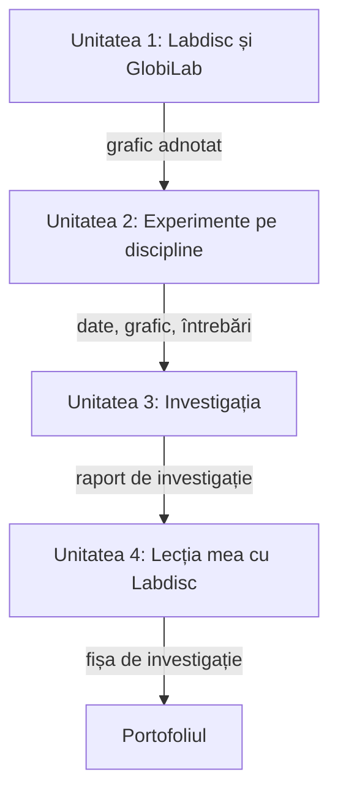

Partea aceasta urmează cursul „Integrarea Labdisc în activități practice de cercetare la științe” (8 ore academice de lucru direct, Centrul „Clasa Viitorului”), pentru cadrele didactice care predau științele: fizică, chimie, biologie, geografie și științe la clasele primare. Partea comună (dispozitivul, analiza datelor, etapele investigației, proiectarea lecției) este aceeași pentru toți; experimentele și temele de investigație se aleg după disciplina fiecăruia.

Fiecare unitate se parcurge în ritmul vostru și are aceeași ordine: ce veți putea face, conținutul cu exerciții interactive, verificarea, sarcina de aplicare, autoevaluarea și reflecția, apoi trecerea la unitatea următoare.

## Drumul cursului

Patru unități, fiecare cu un produs care intră în portofoliu.

## Unitățile cursului

1. [[formare/1-de-la-demonstratie-la-masurare|Labdisc și GlobiLab: de la demonstrație la măsurare]]
2. [[formare/2-experimente-in-statii|Experimente din curriculum cu Labdisc, pe discipline]]
3. [[formare/3-investigatia-deschisa|Investigația: de la întrebare la concluzie]]
4. [[formare/4-lectia-mea-cu-labdisc|Lecția mea cu Labdisc: proiectare și reflecție]]

> [!tip] Cum lucrați cu paginile
> Paginile nu sunt doar de citit. În fiecare unitate găsiți:
>
> - **cartonașe** cu termenii unității, pe care le întoarceți ca să vă verificați;
> - **grafice de prezis**: desenați curba pe care o așteptați, apoi o comparați cu datele;
> - **exerciții de ordonare** pentru pașii unei proceduri;
> - **întrebări cu răspuns imediat**, fiecare cu explicația de ce;
> - **simulări** pentru când nu aveți Labdisc la îndemână;
> - **chenare care se deschid** cu răspunsuri model și exemple pe discipline.
>
> Ce bifați sau desenați rămâne doar în browserul dumneavoastră.

## Tutoriale

Textul dnei Victoria Calistru despre aparat și aplicație, cu un test scurt la finalul fiecărei pagini.

- [[formare/labdisc/index|Labdisc pe scurt]]
- [[formare/labdisc/aparatul|Aparatul: taste, ecran, senzori, configurare]]
- [[formare/labdisc/globilab|GlobiLab: instalare, interfață, colectarea datelor]]
- [[formare/labdisc/modele/index|Modelele Labdisc și senzorii lor]]

## La final

- [[formare/rezultate|Rezultatele cursului]]: ce trebuie să puteți face, legat de fiecare unitate.
- [[formare/autoevaluare|Autoevaluare]]: unde sunteți față de fiecare rezultat, cu un test de verificare.
- [[formare/reflectie|Reflecție]]: întrebările de după curs și planul de aplicare la clasă.
