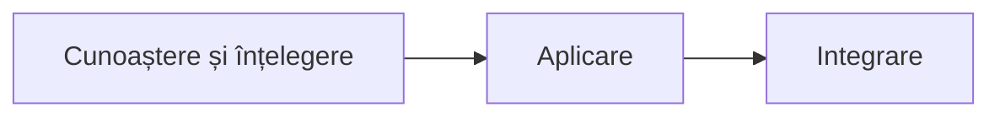
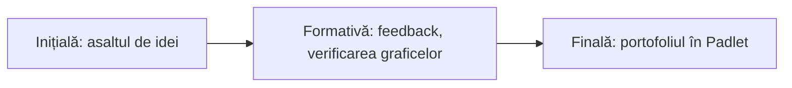

**Scopul cursului.** Dezvoltarea competențelor cadrelor didactice de utilizare a dispozitivului Labdisc și a aplicației GlobiLab pentru colectarea, reprezentarea și interpretarea datelor experimentale și pentru integrarea activităților practice de cercetare în procesul educațional la disciplinele științifice, conform curriculumului și abordării STEAM.

Cursul se adresează cadrelor didactice care predau științele: fizică, chimie, biologie, geografie și științe la clasele primare. Partea comună (dispozitivul, analiza datelor, etapele investigației, proiectarea lecției) este aceeași pentru toți; experimentele și temele de investigație se aleg după disciplina fiecăruia.

## Competențele vizate

- **C-1.** Utilizarea dispozitivului Labdisc și a aplicației GlobiLab pentru colectarea, reprezentarea și analiza datelor experimentale la disciplinele științifice.
- **C-2.** Realizarea investigațiilor experimentale cu senzori digitali, cu formularea ipotezelor, interpretarea graficelor și estimarea erorilor de măsurare.
- **C-3.** Proiectarea și integrarea activităților practice de cercetare cu Labdisc în procesul educațional, în corespundere cu curriculumul disciplinei predate.

## Finalitățile, pe unități

Fiecare finalitate din curriculumul cursului, cu unitatea în care se lucrează. Aceleași rânduri sunt în [[formare/autoevaluare|autoevaluare]], ca afirmații de bifat.

### Cunoaștere și înțelegere

- Să descrie structura dispozitivului Labdisc și senzorii fiecărui model (GenSci, Physio, BioChem, Enviro). *Unitatea* [[formare/1-de-la-demonstratie-la-masurare|1]]
- Să explice parametrii unei înregistrări: senzorii selectați, rata de eșantionare, numărul de eșantioane și durata înregistrării. *Unitatea* [[formare/1-de-la-demonstratie-la-masurare|1]]
- Să recunoască etapele unei investigații științifice: întrebarea de cercetare, ipoteza, planul, colectarea datelor, analiza și concluzia. *Unitatea* [[formare/3-investigatia-deschisa|3]]
- Să identifice sursele de erori de măsurare și limitele senzorilor. *Unitatea* [[formare/3-investigatia-deschisa|3]]

### Aplicare

- Să configureze dispozitivul Labdisc și aplicația GlobiLab pentru o înregistrare, prin USB sau Bluetooth. *Unitatea* [[formare/1-de-la-demonstratie-la-masurare|1]]
- Să aleagă modelul și senzorii potriviți pentru un experiment din disciplina sa. *Unitatea* [[formare/2-experimente-in-statii|2]]
- Să realizeze experimente din curriculumul disciplinei sale cu senzori digitali. *Unitatea* [[formare/2-experimente-in-statii|2]]
- Să analizeze datele în GlobiLab și în foaia de calcul și să formuleze concluzii argumentate pe baza graficelor. *Unitățile* [[formare/2-experimente-in-statii|2]] și [[formare/3-investigatia-deschisa|3]]

### Integrare

- Să proiecteze o fișă de investigație cu Labdisc pentru o unitate de competență din curriculumul disciplinei. *Unitatea* [[formare/4-lectia-mea-cu-labdisc|4]]
- Să integreze activitatea cu Labdisc în etapele lecției: evocare, realizarea sensului, reflecție. *Unitatea* [[formare/4-lectia-mea-cu-labdisc|4]]
- Să evalueze investigațiile elevilor pe baza unor criterii explicite. *Unitatea* [[formare/4-lectia-mea-cu-labdisc|4]]
- Să adapteze activitățile pentru niveluri de școlaritate diferite și pentru proiecte interdisciplinare. *Unitatea* [[formare/4-lectia-mea-cu-labdisc|4]]

## La finalul cursului, profesorul poate să

- utilizeze dispozitivul Labdisc și aplicația GlobiLab pentru a configura, înregistra, vizualiza și exporta date experimentale.
- realizeze experimente din curriculumul disciplinei lor cu senzori digitali și să interpreteze graficele obținute, inclusiv sursele de erori.
- conducă o investigație de la întrebarea de cercetare la concluzia argumentată pe baza datelor.
- proiecteze și aplice la clasă o fișă de investigație cu Labdisc, cu criterii de evaluare a produselor elevilor.

## Cum se evaluează

- Evaluarea inițială: asaltul de idei.
- Evaluarea formativă continuă pe parcursul activităților: feedback-ul instant și interactiv, verificarea graficelor la fiecare stație.
- Evaluarea sumativă/finală: portofoliu în Padlet (fișa de investigație și dovezile aplicării la clasă).

> [!tip] Unde sunteți acum?
> Treceți prin [[formare/autoevaluare|autoevaluare]]: bifați ce puteți face și faceți testul scurt de acolo. Ce nu ați bifat vă arată unitatea de recitit.
