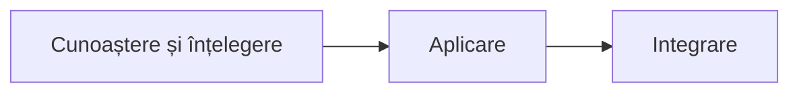
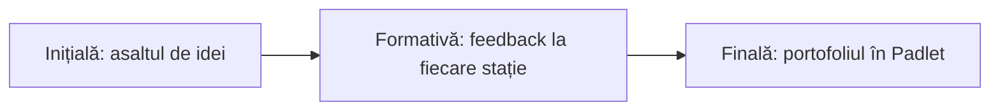

**Scopul cursului.** Dezvoltarea competențelor cadrelor didactice de utilizare a dispozitivului Labdisc și a aplicației GlobiLab pentru colectarea, reprezentarea și interpretarea datelor experimentale și pentru integrarea activităților practice de cercetare în procesul educațional, conform curriculumului la disciplina Fizică și abordării STEAM.

> [!note] Pentru toate disciplinele științifice
> Competențele și finalitățile de mai jos sunt citate din curriculumul cursului, scris inițial pentru fizică. Cursul se adresează profesorilor de fizică, chimie, biologie, geografie și claselor primare; la fiecare grup, formatorul le aplică pe curriculumul disciplinei respective.

## Competențele vizate

- **C-1.** Utilizarea dispozitivului Labdisc și a aplicației GlobiLab pentru colectarea, reprezentarea și analiza datelor experimentale la fizică.
- **C-2.** Realizarea investigațiilor experimentale cu senzori digitali, cu formularea ipotezelor, interpretarea graficelor și estimarea erorilor de măsurare.
- **C-3.** Proiectarea și integrarea activităților practice de cercetare cu Labdisc în procesul educațional, în corespundere cu curriculumul la disciplina Fizică.

## Finalitățile, pe sesiuni

Fiecare finalitate din curriculumul cursului, cu sesiunea în care se lucrează. Aceleași rânduri sunt în [[formare/autoevaluare|autoevaluare]], ca afirmații de bifat.

### Cunoaștere și înțelegere

- Să descrie structura dispozitivului Labdisc: tastele, ecranul, senzorii integrați și externi, porturile și modurile de conectare, precum și senzorii fiecărui model (GenSci, Physio, BioChem, Enviro). *Sesiunea:* [[formare/1-de-la-demonstratie-la-masurare|1. De la demonstrație la măsurare]]
- Să explice parametrii unei înregistrări: senzorii selectați, rata de eșantionare, numărul de eșantioane și durata înregistrării. *Sesiunea:* [[formare/1-de-la-demonstratie-la-masurare|1. De la demonstrație la măsurare]]
- Să recunoască etapele unei investigații științifice: întrebarea de cercetare, ipoteza, planul, colectarea datelor, analiza și concluzia. *Sesiunea:* [[formare/3-investigatia-deschisa|3. Investigația: de la întrebare la concluzie]]
- Să identifice sursele de erori de măsurare și limitele senzorilor. *Sesiunea:* [[formare/3-investigatia-deschisa|3. Investigația: de la întrebare la concluzie]]

### Aplicare

- Să configureze dispozitivul Labdisc și aplicația GlobiLab pentru o înregistrare, prin USB sau Bluetooth. *Sesiunea:* [[formare/1-de-la-demonstratie-la-masurare|1. De la demonstrație la măsurare]]
- Să realizeze experimente de fizică cu senzorii de distanță, temperatură, tensiune și curent electric. *Sesiunea:* [[formare/2-experimente-in-statii|2. Experimente din curriculum, pe stații]]
- Să analizeze datele în GlobiLab cu ajutorul markerului, al adnotărilor și al funcțiilor matematice. *Sesiunea:* [[formare/2-experimente-in-statii|2. Experimente din curriculum, pe stații]]
- Să exporte datele în format .CSV și să le reprezinte grafic în foaia de calcul. *Sesiunea:* [[formare/2-experimente-in-statii|2. Experimente din curriculum, pe stații]]
- Să formuleze concluzii argumentate pe baza graficelor obținute. *Sesiunea:* [[formare/3-investigatia-deschisa|3. Investigația: de la întrebare la concluzie]]

### Integrare

- Să proiecteze o fișă de investigație cu Labdisc pentru o unitate de competență din curriculumul la fizică. *Sesiunea:* [[formare/4-lectia-mea-cu-labdisc|4. Lecția mea cu Labdisc]]
- Să integreze activitatea cu Labdisc în etapele lecției: evocare, realizarea sensului, reflecție. *Sesiunea:* [[formare/4-lectia-mea-cu-labdisc|4. Lecția mea cu Labdisc]]
- Să evalueze investigațiile elevilor pe baza unor criterii explicite. *Sesiunea:* [[formare/4-lectia-mea-cu-labdisc|4. Lecția mea cu Labdisc]]
- Să adapteze activitățile pentru gimnaziu și liceu și pentru alte discipline științifice. *Sesiunea:* [[formare/4-lectia-mea-cu-labdisc|4. Lecția mea cu Labdisc]]

## La finalul cursului, profesorul poate să

- utilizeze dispozitivul Labdisc și aplicația GlobiLab pentru a configura, înregistra, vizualiza și exporta date experimentale.
- realizeze experimente de fizică cu senzori digitali și să interpreteze graficele obținute, inclusiv sursele de erori.
- conducă o investigație de la întrebarea de cercetare la concluzia argumentată pe baza datelor.
- proiecteze și aplice la clasă o fișă de investigație cu Labdisc, cu criterii de evaluare a produselor elevilor.

## Cum se evaluează

- Evaluarea inițială: asaltul de idei.
- Evaluarea formativă continuă pe parcursul activităților: feedback-ul instant și interactiv, verificarea graficelor la fiecare stație.
- Evaluarea sumativă/finală: portofoliu în Padlet (fișa de investigație și dovezile aplicării la clasă).

> [!tip] Unde sunteți acum?
> Treceți prin [[formare/autoevaluare|autoevaluare]]: bifați ce puteți face și faceți testul scurt de acolo. Ce nu ați bifat vă arată sesiunea de recitit.
