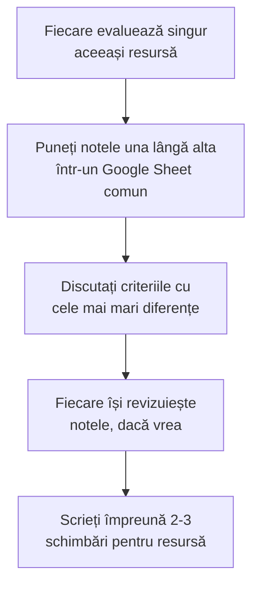

O fișă pe care o completați pe pagină, în cinci-zece minute, ca să vedeți ce merge bine într-o resursă digitală și ce merită schimbat înainte s-o folosiți cu elevii. Merge pentru o lecție din ghid, o simulare, o aplicație sau un material pe care l-ați făcut voi.

## Ce este LORI

LORI (Learning Object Review Instrument, instrumentul de evaluare a obiectelor de învățare) a fost făcut de John Nesbit, Karen Belfer și Tracey Leacock. Versiunea 1.5 notează o resursă pe nouă criterii, fiecare de la 1 la 5. Un criteriu care nu se potrivește resursei se marchează „nu se aplică”.

LORI nu dă o notă finală a resursei. Media e doar orientativă. Contează criteriile cu note mici, pentru că ele arată ce e de îmbunătățit.

## Fișa

Notați fiecare criteriu de la 1 (slab) la 5 (foarte bine). Notele rămân doar în browserul vostru; „Începe o evaluare nouă” le șterge.

```lori
Calitatea conținutului (content quality) :: Conținutul e corect și precis, prezintă ideile echilibrat și are nivelul potrivit de detaliu.
Alinierea la obiectivele de învățare (learning goal alignment) :: Obiectivele, activitățile, evaluarea și caracteristicile elevilor se potrivesc între ele.
Feedback și adaptare (feedback and adaptation) :: Resursa răspunde la ce face elevul: dă feedback care explică sau își adaptează conținutul.
Motivația (motivation) :: Resursa trezește și ține interesul elevilor cărora le e destinată.
Designul prezentării (presentation design) :: Textul, imaginile, graficele și sunetul sunt făcute să ajute înțelegerea, nu s-o încarce.
Ușurința utilizării (interaction usability) :: Navigarea e ușoară, interfața se comportă previzibil, ajutorul e la îndemână.
Accesibilitatea (accessibility) :: Comenzile și formatele pot fi folosite și de elevi cu dizabilități și de pe telefon sau tabletă.
Reutilizabilitatea (reusability) :: Resursa se poate folosi în alte contexte de învățare și cu elevi diferiți.
Conformitatea cu standardele (standards compliance) :: Resursa respectă standardele și specificațiile internaționale, de exemplu cele pentru descrierea prin metadate.
```

> [!tip] Cum citiți „conformitatea cu standardele” pentru o lecție din ghid
> În LORI, criteriul se referă la standarde tehnice internaționale, de exemplu cele pentru metadate. Pentru o lecție sau o fișă, întrebați-vă dacă resursa spune clar autorul, licența, clasa, disciplina și echipamentul. Dacă resursa nu e un obiect digital de felul acesta, marcați „nu se aplică”.

## Ce înseamnă fiecare criteriu, pe scurt

Câte o întrebare de control pentru fiecare criteriu. Atingeți cartonașul.

```cartonase
Calitatea conținutului :: Ar găsi un profesor de specialitate vreo greșeală sau vreo simplificare care induce în eroare?
Alinierea la obiective :: Ce face elevul în resursă îl duce chiar la obiectivul lecției? Evaluarea verifică același lucru?
Feedback și adaptare :: Când elevul greșește, află de ce? Primește altceva decât elevul care a răspuns corect?
Motivația :: Pornește de la ceva ce elevii recunosc din viața lor? Le lasă ceva de descoperit?
Designul prezentării :: E pe ecran doar ce ajută? E evidențiat ce contează? E împărțit în pași mici?
Ușurința utilizării :: Găsește elevul singur următorul pas, fără să vă cheme?
Accesibilitatea :: Merge pe telefon? Au imaginile text alternativ? Se poate folosi fără mouse?
Reutilizabilitatea :: O puteți folosi și la altă clasă, cu alt model de Labdisc, cu altă temă?
Conformitatea cu standardele :: Sunt clare autorul, licența, clasa, disciplina? Se deschide în formate obișnuite?
```

> [!example]- Trei principii de design multimedia, pentru criteriul „designul prezentării”
> Cercetarea lui Richard Mayer despre învățarea multimedia dă câteva reguli utile când faceți dintr-un text o resursă digitală:
>
> - **Coerența:** scoateți textul, imaginile și sunetele care nu ajută învățarea.
> - **Semnalizarea:** evidențiați ce contează, de exemplu cu titluri clare și cu marcaje pe grafic.
> - **Segmentarea:** împărțiți materialul în pași scurți, pe care elevul îi parcurge în ritmul lui.

## Exersați: ce criteriu e afectat?

```quiz
? O simulare spune doar „greșit” când elevul alege un răspuns, fără nicio explicație. Ce criteriu e slab?
+ Feedback și adaptare | Corect: elevul află că a greșit, dar nu de ce și nici ce să facă.
- Calitatea conținutului | Conținutul poate fi corect. Problema e în cum răspunde resursa elevului.
- Accesibilitatea | Accesibilitatea privește cine poate folosi resursa, nu ce feedback dă.

? O lecție merge doar cu un anumit model de Labdisc și nu spune ce faceți dacă aveți altul. Ce criteriu e slab?
- Motivația | Elevii pot fi la fel de interesați. Problema e la profesorul care vrea s-o folosească.
+ Reutilizabilitatea | Corect: lecția e greu de folosit în alt context, cu alt aparat.
- Designul prezentării | Prezentarea poate fi bună. Problema e unde se poate folosi lecția.

? O pagină se citește bine pe calculator, dar pe telefon tabelul iese din ecran. Ce criteriu e slab?
+ Accesibilitatea | Corect: LORI include aici și elevii care lucrează de pe dispozitive mobile.
- Calitatea conținutului | Conținutul nu se schimbă de la un ecran la altul.
- Alinierea la obiective | Obiectivele rămân aceleași, oricare ar fi ecranul.

? Fișa de lucru cere elevilor să „analizeze”, dar întrebările le cer doar să copieze valori de pe ecran. Ce criteriu e slab?
- Ușurința utilizării | Elevii pot folosi fișa fără probleme. Problema e ce le cere.
+ Alinierea la obiectivele de învățare | Corect: activitatea nu duce la obiectivul declarat.
- Conformitatea cu standardele | Nu e o problemă de standarde tehnice.
```

## Cum o folosiți cu colegii

Autorii LORI au propus ca resursele să fie evaluate în echipă: întâi fiecare singur, apoi împreună. Discuția pornește de la criteriile la care notele diferă cel mai mult.



> [!tip] Într-o comisie metodică
> Alegeți o lecție din [[la-clasa/proiecte/index|proiectele de lecție]] pe care o predați luna aceasta. Fiecare o evaluează pe telefon înainte de ședință și trece notele în tabelul comun. Ședința discută doar criteriile cu diferențe mari și se încheie cu adaptarea lecției pentru clasele voastre.

## Cum o folosiți cu produsele elevilor

Când elevii fac ei înșiși o resursă digitală (o prezentare a graficului, o hartă în Google My Maps cu datele din teren, un mic tutorial pentru colegi), LORI vă dă criteriile pentru feedback. Fișa de mai jos e o adaptare făcută de autorii ghidului, cu cinci dintre criteriile LORI scrise pe limba elevilor. Grupurile își evaluează reciproc produsele, de pe telefon.

```lori
Conținutul e corect :: Datele, unitățile de măsură și explicațiile sunt corecte. Un coleg n-ar găsi greșeli.
Răspunde la întrebare :: Produsul arată clar întrebarea de cercetare și răspunsul la ea.
Se înțelege ușor :: Pe ecran e doar ce ajută. Graficul are titlu, axe cu unități și adnotări.
Te ține atent :: Pornește de la ceva interesant și îi lasă pe colegi să descopere ceva.
Merge pentru toți :: Se citește și pe telefon, textul e destul de mare, imaginile au o explicație scrisă.
```

## Cum am folosit LORI pentru paginile din ghid

Paginile din partea „La clasă” au fost refăcute după aceste criterii:

- **Feedback:** exercițiile au explicație la fiecare variantă de răspuns, nu doar „corect” sau „greșit”.
- **Motivația:** graficele de predicție lasă cititorul să-și deseneze întâi curba, apoi să o compare cu datele.
- **Designul prezentării:** text scurt, pași numerotați, diagrame, explicații ascunse până când le deschideți.
- **Accesibilitatea:** tabele înguste, care se citesc pe telefon; fără JavaScript, textul fiecărei piese rămâne vizibil.
- **Reutilizabilitatea:** pentru fiecare lecție, pagina [[la-clasa/implementare/ce-labdisc-aveti|Ce Labdisc aveți?]] arată pe ce modele merge.

## Surse

- Nesbit, J., Belfer, K. și Leacock, T. (2003). *Learning Object Review Instrument (LORI). User Manual*, versiunea 1.5. E-Learning Research and Assessment Network (eLera).
- Leacock, T. L. și Nesbit, J. C. (2007). A Framework for Evaluating the Quality of Multimedia Learning Resources. *Educational Technology & Society*, 10(2), 44–59.
- Nesbit, J., Belfer, K. și Vargo, J. (2002). A Convergent Participation Model for Evaluation of Learning Objects. *Canadian Journal of Learning and Technology*, 28(3).
- Mayer, R. E. (2020). *Multimedia Learning* (ed. a 3-a). Cambridge University Press.
