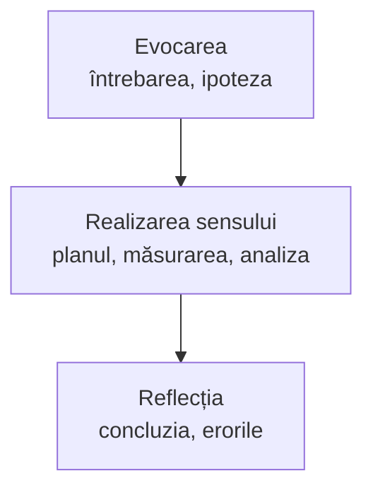

Șablonul cu care pregătiți o lecție de cercetare pentru orice temă, gata de copiat într-un Google Doc, cu un exemplu completat și un exercițiu despre variabile.

La curs, fiecare profesor pleacă de la o lecție pe care o predă luna aceasta și completează șablonul de mai jos. Întrebarea de control a profesorului: ce va face elevul cu datele după ce apasă Stop?

Activitatea se așază în etapele lecției: **evocarea** (întrebarea și ipoteza), **realizarea sensului** (planul, măsurarea, analiza) și **reflecția** (concluzia și erorile).



## Șablonul

| Rubrica | Ce scrieți |
|---|---|
| Clasa | |
| Unitatea de competență din curriculum | |
| Întrebarea de cercetare | O întrebare la care elevii pot răspunde măsurând. |
| Ipoteza | Ce se schimbă, ce măsurăm, ce păstrăm la fel. |
| Variabilele | Independentă (o schimbăm), dependentă (o măsurăm), controlate (le păstrăm la fel). |
| Materiale | Modelul de Labdisc, senzorii, accesoriile. |
| Pașii | Montajul, configurarea (senzori, rata de eșantionare, numărul de eșantioane), înregistrarea, repetarea. |
| Tabelul de date | Coloanele și unitățile de măsură. |
| Întrebări de interpretare | Ce trebuie să citească elevul de pe grafic și să explice. |
| Criterii de evaluare | Vezi [[la-clasa/anexe/criterii-de-evaluare|criteriile]]. |
| Securitate | Ce riscuri are experimentul și cum le evitați. |

> [!note]- Textul șablonului, de copiat într-un Google Doc
> Apăsați butonul de copiere din colțul blocului, apoi lipiți în documentul vostru.
>
> ```text
> FIȘA DE INVESTIGAȚIE
>
> Clasa:
> Unitatea de competență din curriculum:
> Întrebarea de cercetare (o întrebare la care elevii pot răspunde măsurând):
> Ipoteza (ce se schimbă, ce măsurăm, ce păstrăm la fel):
> Variabila independentă (o schimbăm):
> Variabila dependentă (o măsurăm):
> Variabilele controlate (le păstrăm la fel):
> Materiale (modelul de Labdisc, senzorii, accesoriile):
> Pașii (montajul, configurarea: senzori, rata de eșantionare, numărul de eșantioane; înregistrarea; repetarea):
> Tabelul de date (coloanele și unitățile de măsură):
> Întrebări de interpretare (ce trebuie să citească elevul de pe grafic și să explice):
> Criterii de evaluare:
> Securitate (ce riscuri are experimentul și cum le evitați):
> ```

> [!example]- Un exemplu completat: răcirea apei cu și fără capac
> - **Întrebarea de cercetare:** Se răcește apa mai repede cu capac sau fără capac?
> - **Ipoteza:** Apa cu capac va fi mai caldă după 10 minute, pentru că pierde mai puțină căldură prin evaporare.
> - **Variabila independentă:** capacul (cu sau fără).
> - **Variabila dependentă:** temperatura apei.
> - **Variabilele controlate:** cantitatea de apă, temperatura de început, paharul, locul pe masă.
> - **Materiale:** două Labdiscuri, fiecare cu sonda de temperatură externă, două pahare la fel, un capac.
> - **Pașii:** turnați aceeași cantitate de apă caldă în ambele pahare, puneți câte o sondă, acoperiți un pahar; o valoare pe secundă, 600 de eșantioane (10 minute); repetați o dată.
> - **Tabelul de date:** timpul (s), temperatura cu capac (°C), temperatura fără capac (°C).
> - **Întrebări de interpretare:** Care curbă coboară mai repede? Cu câte grade diferă la final? Unde e diferența cea mai mare?
> - **Securitate:** apa caldă o toarnă profesorul; paharele stau departe de marginea mesei.

## Exersați: variabilele

Pe exemplul de mai sus. Merge și cu elevii, înainte să-și completeze singuri fișa.

```quiz
? Care e variabila independentă, cea pe care o schimbăm?
+ Capacul: cu sau fără | Corect: e singurul lucru pe care îl schimbăm între cele două pahare.
- Temperatura apei | Pe ea o măsurăm. E variabila dependentă.
- Timpul | Timpul curge la fel pentru ambele pahare. Nu îl alegem noi diferit.

? Care e variabila dependentă, cea pe care o măsurăm?
- Cantitatea de apă | Pe ea o păstrăm la fel. E o variabilă controlată.
+ Temperatura apei | Corect: senzorul o măsoară ca să vedem efectul capacului.
- Capacul | Pe el îl schimbăm. E variabila independentă.

? Un grup a pus apă mai fierbinte în paharul fără capac. Ce s-a stricat?
- Nimic, tot se vede care se răcește mai repede | Apa mai fierbinte se răcește oricum mai repede. Nu mai știm dacă diferența vine de la capac.
+ O variabilă controlată: temperatura de început | Corect: comparația e corectă doar dacă ambele pahare pornesc de la aceeași temperatură.
- Variabila dependentă | Temperatura se măsoară în continuare corect. Problema e la ce n-a fost păstrat la fel.
```

> [!tip] Portofoliul
> Fiecare profesor face o copie a șablonului în Google Docs. După ce aplicați fișa la clasă, încărcați-o pe Padletul grupului împreună cu un grafic al elevilor, fără nume și fără fotografii cu fețe.

Variantă scurtă pentru elevi: [[la-clasa/anexe/raport-de-investigatie|raportul scurt de investigație]].
