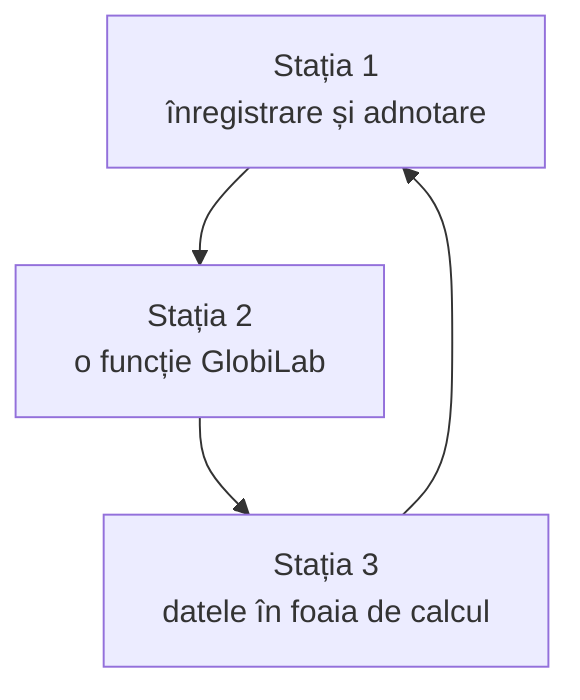

Câte trei fișe de stație pentru fiecare disciplină, pe care le dați grupelor ca document digital. La sfârșit sunt materialele pentru profesor: un grafic de proiectat, o simulare pentru când nu ajung aparatele și întrebări de verificare după stații.

> [!info] Pentru profesor: cum le dați elevilor
> 1. Copiați „Regula la fiecare stație” și cele trei stații ale disciplinei voastre într-un Google Doc.
> 2. Faceți câte o copie pentru fiecare grup, în folderul clasei.
> 3. Grupul scrie predicția și răspunsurile în documentul lui și inserează graficele salvate din GlobiLab.
> 4. La final, fiecare grup pune un grafic adnotat pe Padletul clasei, pentru discuția de sinteză.



Grupele se rotesc, fiecare pornind de la altă stație. La fiecare stație, graficul se adnotează în GlobiLab. La a doua, elevii folosesc și o funcție din GlobiLab (marker, derivată sau integrală), iar la a treia exportă datele în format .CSV și fac graficul în Google Sheets.

Fiecare stație spune ce senzori cere și ce modele îi au, după [[la-clasa/implementare/ce-labdisc-aveti|tabelul senzorilor]]. Dacă modelul unei grupe nu are senzorul, grupa schimbă aparatul cu una vecină.

---

**Regula la fiecare stație:** scrieți predicția în documentul grupului înainte să apăsați Run, faceți înregistrarea, apoi explicați. Adnotați graficul în GlobiLab, salvați-l și inserați-l în document înainte să treceți la stația următoare. O predicție greșită e la fel de utilă ca una corectă.

## Fizică

### Stația 1. Mișcare

**Aveți nevoie de:** Labdisc cu senzor de distanță (GenSci, Physio), un plan înclinat, un cărucior, 2-3 m de spațiu liber, o carte ca țintă.

1. **Predicție.** Profesorul vă arată un grafic x(t). Scrieți în document cum trebuie să meargă un coleg în fața senzorului ca să obțineți acel grafic.
2. **Înregistrare.** Un membru al echipei merge în fața senzorului și încearcă să reproducă graficul. Apoi lăsați căruciorul să coboare pe planul înclinat și înregistrați.
3. **Explicație.** În GlobiLab, aplicați funcția „Derivată” pe graficul x(t) ca să obțineți v(t).

**Întrebări:**

- Cum trebuie să mergi ca graficul să fie o linie orizontală? Dar una înclinată?
- Ce înseamnă panta graficului x(t)?
- Cum arată v(t) pentru căruciorul de pe planul înclinat? Ce vă spune despre mișcarea lui?

**Dacă valorile sar:** obiectul e prea aproape de senzor (sub 0,4 m) sau suprafața nu reflectă bine. Folosiți o carte ca țintă.

### Stația 2. Fenomene termice

**Aveți nevoie de:** Labdisc cu sondă de temperatură externă (toate modelele), un fierbător, un pahar, apă caldă.

**Siguranță:** apa fierbinte stă doar pe masa stației. O toarnă profesorul.

1. **Predicție.** Desenați cum credeți că va scădea temperatura apei în 10 minute, în Google Drawings sau pe tabla digitală a clasei. Inserați desenul în document.
2. **Înregistrare.** Puneți sonda externă în apă. Înregistrați o valoare pe secundă, 10 minute, cu temperatura aerului din clasă (temperatura ambientală) pe același grafic.
3. **Explicație.** Comparați primul și ultimul minut. Cu markerul din GlobiLab, citiți cu câte grade a scăzut temperatura în fiecare.

**Întrebări:**

- Când se răcește apa mai repede: în primul minut sau în al zecelea? De ce?
- Ce vă spune panta graficului?
- Până unde va scădea temperatura apei dacă așteptați mult?

### Stația 3. Electricitate

**Aveți nevoie de:** Labdisc cu senzori de tensiune și de curent (GenSci, Physio), o sursă de curent sau baterii, rezistoare, cabluri banana, un calculator cu Google Sheets.

1. **Predicție.** Cum credeți că se schimbă intensitatea curentului când dublați tensiunea?
2. **Înregistrare.** Montați circuitul: sursa, rezistorul, senzorii de tensiune și de curent. Luați 5 valori ale tensiunii, câte o citire stabilă pentru fiecare.
3. **Explicație.** Exportați datele în format .CSV, deschideți-le în Google Sheets și faceți graficul I = f(U).

**Întrebări:**

- Ce reprezintă panta dreptei?
- Dacă dublăm rezistența și păstrăm sursa, cum se schimbă dreapta?

**Dacă nu merge:** dacă intensitatea depășește domeniul senzorului (±1 A), folosiți un rezistor mai mare. Fără sursă reglabilă, folosiți 1, 2 și 3 baterii în serie.

## Chimie

### Stația 1. Efectul termic al dizolvării

**Aveți nevoie de:** Labdisc cu sondă de temperatură externă (toate modelele), pahare, apă, clorură de calciu, clorură de amoniu, ochelari de protecție.

**Siguranță:** substanțele stau doar pe masa stației. Lucrați cu ochelari de protecție.

1. **Predicție.** Se încălzește sau se răcește apa când dizolvăm clorură de calciu? Dar clorură de amoniu? Scrieți predicția pentru fiecare sare.
2. **Înregistrare.** Puneți sonda în apă și înregistrați câteva secunde, ca să vedeți temperatura de pornire. Adăugați sarea, amestecați și înregistrați până când curba începe să revină spre temperatura camerei. Repetați cu cealaltă sare, în apă proaspătă.
3. **Explicație.** Adnotați pe grafic momentul în care ați adăugat sarea și punctul cel mai înalt sau cel mai jos al curbei.

**Întrebări:**

- Care dizolvare degajă căldură și care absoarbe? Cum se vede pe grafic?
- De ce revine temperatura, încet, spre temperatura camerei?

### Stația 2. pH-ul și neutralizarea

**Aveți nevoie de:** Labdisc cu electrod de pH (GenSci, BioChem, Enviro), oțet, soluție de bicarbonat de sodiu, pipete, apă distilată.

1. **Predicție.** Cum se schimbă pH-ul oțetului când adăugați picătură cu picătură soluție de bicarbonat de sodiu? Desenați graficul așteptat.
2. **Înregistrare.** Clătiți electrodul cu apă distilată și puneți-l în oțet. Porniți înregistrarea și adăugați soluția de bicarbonat câte puțin, amestecând după fiecare adăugare.
3. **Explicație.** Cu markerul din GlobiLab, găsiți momentul în care pH-ul trece de 7.

**Întrebări:**

- Ce pH avea oțetul la început? Ce fel de soluție este?
- Crește pH-ul la fel de repede tot timpul? Unde se schimbă cel mai mult?
- Ce gaz se degajă în timpul reacției?

### Stația 3. Conductivitatea soluțiilor

**Aveți nevoie de:** Labdisc cu electrod de conductivitate (BioChem), sare, zahăr, apă distilată, pahare.

1. **Predicție.** Conduce apa cu sare la fel ca apa cu zahăr? Ce se schimbă când creștem concentrația?
2. **Înregistrare.** Măsurați conductivitatea apei distilate, apoi a apei cu sare și a apei cu zahăr. Pentru sare, adăugați aceeași cantitate de mai multe ori și citiți valoarea după fiecare adăugare.
3. **Explicație.** Exportați datele în format .CSV, deschideți-le în Google Sheets și faceți graficul conductivității în funcție de cantitatea de sare.

**Întrebări:**

- De ce conduce apa cu sare, iar apa cu zahăr aproape deloc?
- Cum arată graficul conductivității față de concentrație?

## Biologie

### Stația 1. Ritmul cardiac la efort

**Aveți nevoie de:** Labdisc cu senzor de ritm cardiac și clemă pentru ureche (BioChem).

1. **Predicție.** În cât timp revine pulsul la valoarea de repaus după 30 de genuflexiuni?
2. **Înregistrare.** Prindeți clema de ureche și înregistrați un minut în repaus. Colegul face 30 de genuflexiuni, apoi stă jos, iar înregistrarea continuă până revine pulsul.
3. **Explicație.** Adnotați pe grafic începutul și sfârșitul efortului și momentul în care pulsul a revenit la repaus.

**Întrebări:**

- Cu cât a crescut pulsul față de repaus?
- În cât timp a revenit? De ce nu revine imediat?

### Stația 2. Transpirația plantelor

**Aveți nevoie de:** Labdisc cu senzor de umiditate relativă și de temperatură ambientală (GenSci, BioChem, Enviro), o plantă în ghiveci, pungi transparente, bandă adezivă.

1. **Predicție.** Cât crește umiditatea într-o pungă închisă în jurul unei ramuri cu frunze, față de una fără frunze?
2. **Înregistrare.** Închideți senzorul în pungă în jurul ramurii cu frunze și înregistrați. Repetați cu o ramură fără frunze, la fel de mult timp.
3. **Explicație.** Cu markerul din GlobiLab, citiți cu cât a crescut umiditatea în fiecare pungă.

**Întrebări:**

- Unde a crescut umiditatea mai mult? De unde vine apa?
- De ce măsurăm și temperatura?

### Stația 3. Aerul expirat

**Aveți nevoie de:** Labdisc cu senzori de umiditate relativă și de temperatură (GenSci, BioChem, Enviro), o pungă de plastic, un pahar.

1. **Predicție.** Prin ce diferă aerul expirat de aerul din clasă? Scrieți ce credeți că se va schimba: umiditatea, temperatura sau amândouă.
2. **Înregistrare.** Înregistrați aerul din clasă, apoi aerul expirat, într-o pungă, în jurul senzorului.
3. **Explicație.** Exportați datele în format .CSV, deschideți-le în Google Sheets și puneți cele două măsurări una lângă alta.

**Întrebări:**

- Cu cât sunt mai mari umiditatea și temperatura aerului expirat?
- Ce spune asta despre ce se întâmplă cu aerul în plămâni?

## Geografie

### Stația 1. Microclimatul școlii

**Aveți nevoie de:** Labdisc cu senzori de temperatură, umiditate, presiunea aerului, lumină și GPS (GenSci, BioChem; Enviro fără lumină), acces în curte, harta școlii în Google My Maps.

1. **Predicție.** Unde este mai cald și mai umed: în clasă, pe coridor sau în curte? De ce?
2. **Înregistrare.** Măsurați în cele trei locuri, câte un minut, cu aparatul ținut la aceeași înălțime.
3. **Explicație.** Puneți fiecare punct pe harta din Google My Maps, cu valorile măsurate.

**Întrebări:**

- Unde a fost cel mai cald și cel mai umed? Ce explică diferența?
- Care mărime s-a schimbat cel mai puțin de la un loc la altul?

### Stația 2. Calitatea apei

**Aveți nevoie de:** Labdisc cu electrod de pH și senzor de turbiditate (BioChem, Enviro), cuve, probe de apă: de la robinet, îmbuteliată, dintr-o baltă sau din ploaie.

1. **Predicție.** Prin ce diferă apa de la robinet, apa îmbuteliată și apa dintr-o baltă sau din ploaie? Ordonați probele după cât de tulburi credeți că sunt.
2. **Înregistrare.** Măsurați pH-ul și turbiditatea fiecărei probe. Clătiți electrodul și cuva între probe.
3. **Explicație.** Cu markerul din GlobiLab, citiți valorile fiecărei probe și treceți-le într-un tabel în document.

**Întrebări:**

- Care probă e cea mai tulbure? De unde vine tulbureala?
- Diferă pH-ul probelor? Care e cel mai departe de 7?

### Stația 3. Încălzirea suprafețelor

**Aveți nevoie de:** Labdisc cu senzor de temperatură în infraroșu și de radiație UV (Enviro), probe de suprafețe: asfalt, iarbă, nisip, o suprafață albă și una neagră, o lampă (în clasă) sau acces în curte.

1. **Predicție.** Care suprafață se încălzește mai tare la aceeași lumină? Ordonați suprafețele.
2. **Înregistrare.** Măsurați temperatura fiecărei suprafețe cu senzorul în infraroșu, la început și după câteva minute la lampă sau la soare. Afară, măsurați și radiația UV.
3. **Explicație.** Exportați datele în format .CSV, deschideți-le în Google Sheets și faceți un grafic cu creșterea temperaturii fiecărei suprafețe.

**Întrebări:**

- Care suprafață s-a încălzit cel mai mult? Care cel mai puțin?
- Ce legătură are culoarea suprafeței cu albedoul?

## Științe la clasele primare

### Stația 1. Topirea gheții

**Aveți nevoie de:** Labdisc cu sondă de temperatură externă (toate modelele), cuburi de gheață, un pahar.

1. **Predicție.** Ce arată termometrul cât timp gheața se topește?
2. **Înregistrare.** Puneți sonda în paharul cu gheață și puțină apă. Înregistrați până se topește gheața.
3. **Explicație.** Adnotați pe grafic momentul în care s-a topit toată gheața.

**Întrebări:**

- Ce temperatură a arătat aparatul cât timp mai era gheață în pahar?
- Ce s-a întâmplat după ce s-a topit toată gheața?

### Stația 2. Aerul sub presiune

**Aveți nevoie de:** Labdisc cu senzor de presiunea aerului (GenSci, Physio, BioChem), o seringă, tubul de plastic al senzorului.

1. **Predicție.** Ce se întâmplă cu aerul din seringă când apăsăm pistonul?
2. **Înregistrare.** Legați seringa la tubul senzorului. Porniți înregistrarea, apăsați încet pistonul, apoi lăsați-l liber.
3. **Explicație.** Cu markerul din GlobiLab, citiți presiunea înainte și după ce ați apăsat.

**Întrebări:**

- Ce s-a întâmplat cu presiunea când am apăsat pistonul?
- Ce s-a întâmplat când am lăsat pistonul liber?

### Stația 3. Vremea

**Aveți nevoie de:** Labdisc cu senzori de temperatură, umiditate și lumină (GenSci, BioChem), acces la fereastră și în curte.

1. **Predicție.** Unde e mai luminos și mai cald: lângă fereastră sau în fundul clasei? Dar afară?
2. **Înregistrare.** Măsurați câte un minut în fiecare loc.
3. **Explicație.** Exportați datele în format .CSV și deschideți-le în Google Sheets împreună cu învățătoarea. Comparați locurile.

**Întrebări:**

- Unde a fost cel mai luminos? Dar cel mai cald?
- Locul cel mai luminos a fost și cel mai cald?

---

## Pentru profesor

### Graficul de proiectat la stația „Mișcare”

Un grafic x(t) pe care îl puteți arăta grupului la pasul „Predicție”. Mutați cursorul ca să discutați fiecare porțiune: unde se îndepărtează elevul, unde stă, unde se întoarce mai repede.

```grafic
titlu: Stația „Mișcare”: cum trebuie să meargă elevul?
x: Timp (s)
y: Distanța față de senzor (m)
nota: Grafic construit pentru exercițiu, din mișcări uniforme pe porțiuni (0,5 m/s, oprire, 1 m/s înapoi); nu e o măsurare. O măsurare reală are colțurile rotunjite.
date:
0, 0.5
1, 1.0
2, 1.5
3, 2.0
4, 2.5
5, 2.5
6, 2.5
7, 2.5
8, 1.5
9, 0.5
```

### Stația „Electricitate” fără aparat

Când un grup așteaptă aparatul, poate face predicția în simulare: schimbă tensiunea și rezistența și urmărește curentul.

```simulare
url: https://phet.colorado.edu/sims/html/ohms-law/latest/ohms-law_ro.html
titlu: Legea lui Ohm
sursa: PhET Interactive Simulations, University of Colorado Boulder, CC BY 4.0.
```

### După stații: verificați înțelegerea

Întrebările de mai jos reiau câte o întrebare din fișele fiecărei discipline. Elevii le fac pe telefon, la discuția de sinteză. Mai multe, pe discipline, sunt în [[la-clasa/anexe/banca-de-intrebari|banca de întrebări]].

```quiz
? Fizică. Graficul x(t) e o linie orizontală. Ce face elevul din fața senzorului?
- Merge cu viteză constantă | Atunci distanța s-ar schimba uniform, iar linia ar fi înclinată.
+ Stă pe loc | Corect: distanța nu se schimbă în timp.
- Se apropie de senzor | Atunci distanța ar scădea, iar linia ar coborî.

? Fizică. Pe graficul I = f(U) al unui rezistor, ce reprezintă panta dreptei?
- Rezistența | E invers: cu cât rezistența e mai mare, cu atât dreapta e mai puțin înclinată.
+ Inversul rezistenței, 1/R | Corect: I = U/R, deci panta e 1/R.
- Tensiunea | Tensiunea e pe axa orizontală, nu e panta.

? Chimie. La dizolvarea unei sări, temperatura apei scade. Ce fel de proces e?
- Exoterm | La un proces exoterm se degajă căldură și temperatura crește.
+ Endoterm | Corect: dizolvarea absoarbe căldură din apă.
- Nu se poate spune din grafic | Tocmai curba temperaturii arată dacă procesul degajă sau absoarbe căldură.

? Chimie. De ce conduce apa cu sare, iar apa cu zahăr aproape deloc?
+ Sarea se desface în ioni, zahărul nu | Corect: curentul e purtat de ioni. Zahărul se dizolvă ca molecule întregi.
- Zahărul nu se dizolvă în apă | Zahărul se dizolvă, dar nu formează ioni.
- Apa cu sare e mai caldă | Temperatura nu explică diferența dintre cele două soluții.

? Biologie. De ce crește umiditatea în punga din jurul ramurii cu frunze?
+ Frunzele elimină vapori de apă prin stomate | Corect: asta e transpirația plantei.
- Punga se încălzește și produce apă | Punga nu produce apă. Vaporii vin din frunze.
- Aerul din clasă intră în pungă | Punga e închisă. Diferența față de ramura fără frunze arată că apa vine din frunze.

? Geografie. Care suprafață se încălzește mai tare la aceeași lumină?
+ Cea închisă la culoare | Corect: absoarbe mai multă lumină și o reflectă mai puțin. Are albedoul mai mic.
- Cea albă | Suprafața albă reflectă cea mai mare parte a luminii.
- Toate la fel | Diferențele se văd clar cu senzorul în infraroșu.

? Clasele primare. Ce arată termometrul cât timp gheața se topește?
- Scade mult sub zero | Apa cu gheață nu coboară mult sub zero cât timp gheața se topește.
+ Aproape 0 °C, aproape la fel până se topește gheața | Corect: căldura primită se folosește ca să topească gheața.
- Crește repede | Temperatura crește abia după ce s-a topit toată gheața.
```
