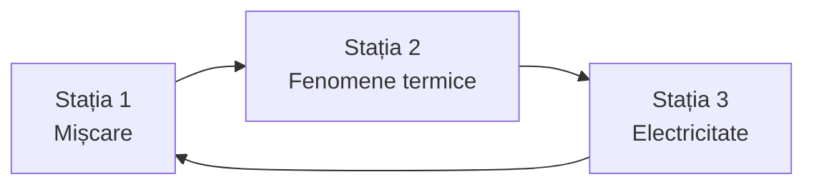

Trei fișe de stație pe care le dați grupelor ca document digital, plus, la final, materialele pentru profesor: graficul de proiectat la stația 1, o simulare pentru stația 3 și întrebări de verificare după stații.

> [!info] Pentru profesor: cum le dați elevilor
> Copiați textul de la „Regula la fiecare stație” până la sfârșitul stației 3 într-un Google Doc și faceți câte o copie pentru fiecare grup, în folderul clasei. Grupul scrie predicțiile, răspunsurile și observațiile direct în documentul lui și inserează graficele salvate din GlobiLab.



Grupele se rotesc, fiecare pornind de la altă stație.

Stațiile cer senzorul de distanță, sonda de temperatură externă și senzorii de tensiune și curent. Le au modelele **GenSci** și **Physio**. Verificați în [[la-clasa/implementare/ce-labdisc-aveti|Ce Labdisc aveți?]].

---

**Regula la fiecare stație:** scrieți predicția în documentul grupului înainte să apăsați Run, faceți înregistrarea, apoi explicați. Salvați graficul și inserați-l în document înainte să treceți la stația următoare. O predicție greșită e la fel de utilă ca una corectă.

## Stația 1. Mișcare

**Aveți nevoie de:** Labdisc cu senzor de distanță, un plan înclinat, un cărucior, 2-3 m de spațiu liber, o carte ca țintă.

1. **Predicție.** Profesorul vă arată un grafic x(t). Scrieți în document cum trebuie să meargă un coleg în fața senzorului ca să obțineți acel grafic.
2. **Înregistrare.** Un membru al echipei merge în fața senzorului și încearcă să reproducă graficul. Apoi lăsați căruciorul să coboare pe planul înclinat și înregistrați.
3. **Explicație.** În GlobiLab, aplicați funcția „Derivată” pe graficul x(t) ca să obțineți v(t).

**Întrebări:**

- Cum trebuie să mergi ca graficul să fie o linie orizontală?
- Ce înseamnă panta graficului x(t)?
- Cum arată v(t) pentru căruciorul de pe planul înclinat? Ce vă spune despre mișcarea lui?

**Dacă valorile sar:** obiectul e prea aproape de senzor (sub 0,4 m) sau suprafața nu reflectă bine. Folosiți o carte ca țintă.

## Stația 2. Fenomene termice

**Aveți nevoie de:** Labdisc cu sondă de temperatură externă, un pahar, apă caldă.

**Siguranță:** apa fierbinte stă doar pe masa stației. O toarnă profesorul.

1. **Predicție.** Desenați cum credeți că va scădea temperatura apei în 10 minute: în Google Drawings sau pe tabla digitală a clasei. Inserați desenul în document.
2. **Înregistrare.** Puneți sonda externă în apă. Înregistrați o valoare pe secundă, 10 minute, cu temperatura aerului din clasă pe același grafic.
3. **Explicație.** Comparați primul și ultimul minut.

**Întrebări:**

- Unde scade temperatura mai repede și de ce?
- Ce vă spune panta graficului?
- Până unde va scădea temperatura apei dacă așteptați mult?

## Stația 3. Electricitate

**Aveți nevoie de:** Labdisc cu senzori de tensiune și de curent, o sursă de curent sau baterii, un rezistor, cabluri, un calculator cu Google Sheets sau altă foaie de calcul.

1. **Predicție.** Cum credeți că se schimbă intensitatea curentului când creșteți tensiunea?
2. **Înregistrare.** Montați circuitul: sursa, rezistorul, senzorii de tensiune și de curent. Luați 5 valori ale tensiunii, câte o citire stabilă pentru fiecare.
3. **Explicație.** Exportați datele în format .CSV, deschideți-le în foaia de calcul și faceți graficul I = f(U).

**Întrebări:**

- Ce reprezintă panta dreptei?
- Dacă dublăm rezistența și păstrăm sursa, cum se schimbă dreapta?

**Dacă nu merge:** dacă intensitatea depășește domeniul senzorului (±1 A), folosiți un rezistor mai mare. Fără sursă reglabilă, folosiți 1, 2 și 3 baterii în serie.

---

## Pentru profesor

### Graficul de proiectat la stația 1

Un grafic x(t) pe care îl puteți arăta grupului la pasul „Predicție”. Mutați cursorul ca să discutați fiecare porțiune: unde se îndepărtează elevul, unde stă, unde se întoarce mai repede.

```grafic
titlu: Stația 1: cum trebuie să meargă elevul?
x: Timp (s)
y: Distanța față de senzor (m)
nota: Grafic construit pentru exercițiu, din mișcări uniforme pe porțiuni (0,5 m/s, oprire, 1 m/s înapoi); nu e o măsurare. O măsurare reală are colțurile rotunjite.
date:
0, 0.5
1, 1.0
2, 1.5
3, 2.0
4, 2.5
5, 2.5
6, 2.5
7, 2.5
8, 1.5
9, 0.5
```

### Stația 3 fără aparat

Când un grup așteaptă aparatul, poate face predicția pentru stația 3 în simulare: schimbă tensiunea și rezistența și urmărește curentul.

```simulare
url: https://phet.colorado.edu/sims/html/ohms-law/latest/ohms-law_ro.html
titlu: Legea lui Ohm
sursa: PhET Interactive Simulations, University of Colorado Boulder, CC BY 4.0.
```

### După stații: verificați înțelegerea

Întrebările de mai jos reiau întrebările din fișe. Elevii le pot face pe telefon, la discuția de sinteză.

```quiz
? Graficul x(t) e o linie orizontală. Ce face elevul din fața senzorului?
- Merge cu viteză constantă | Atunci distanța s-ar schimba uniform, iar linia ar fi înclinată.
+ Stă pe loc | Corect: distanța nu se schimbă în timp.
- Se apropie de senzor | Atunci distanța ar scădea, iar linia ar coborî.

? Ce înseamnă panta graficului x(t)?
+ Viteza | Corect: cu cât linia e mai înclinată, cu atât elevul merge mai repede.
- Distanța parcursă | Distanța se citește pe axa verticală, nu din pantă.
- Accelerația | Accelerația e panta graficului v(t), nu a lui x(t).

? Apa caldă se răcește 10 minute. Când scade temperatura cel mai repede?
+ La început, când apa e mult mai caldă decât aerul | Corect: cu cât diferența de temperatură e mai mare, cu atât apa cedează căldura mai repede.
- La sfârșit | La sfârșit diferența față de aer e mai mică, deci răcirea e mai lentă.
- La fel în tot timpul | Graficul e o curbă, nu o dreaptă: panta scade în timp.

? Dacă așteptați foarte mult, până unde scade temperatura apei?
- Până la 0 °C | Apa nu se răcește singură sub temperatura aerului din jur.
+ Până la temperatura aerului din clasă | Corect: răcirea se oprește când apa și aerul au aceeași temperatură.
- Scade la nesfârșit | Răcirea încetinește tot mai mult și se oprește la temperatura camerei.

? Pe graficul I = f(U) al unui rezistor, ce reprezintă panta dreptei?
- Rezistența | Rezistența e invers: cu cât e mai mare, cu atât dreapta e mai puțin înclinată.
+ Inversul rezistenței, 1/R | Corect: I = U/R, deci panta e 1/R.
- Tensiunea | Tensiunea e pe axa orizontală, nu e panta.

? Dublați rezistența și păstrați sursa. Ce se întâmplă cu dreapta I = f(U)?
+ Devine de două ori mai puțin înclinată | Corect: la aceeași tensiune, curentul e de două ori mai mic.
- Devine de două ori mai înclinată | Asta s-ar întâmpla dacă rezistența s-ar înjumătăți.
- Rămâne la fel | Rezistența schimbă direct panta.
```
