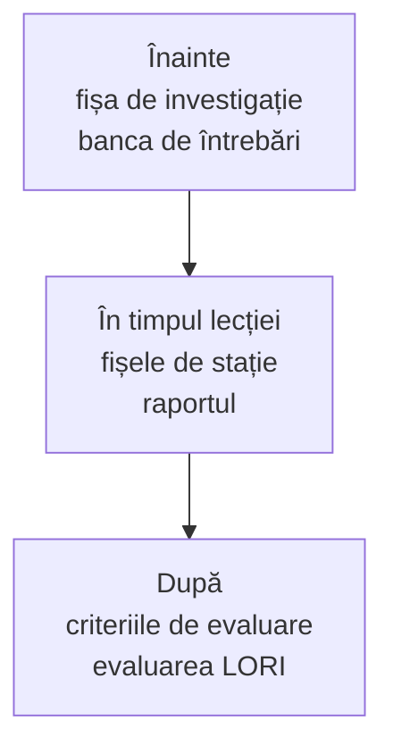

Șabloanele de aici se completează digital: faceți o copie a modelului într-un Google Doc al grupului, în folderul comun al clasei; datele merg în Google Sheets, criteriile într-un formular Google, graficele pe Padletul clasei. Textul fiecărui șablon e curat, gata de copiat. Piesele interactive din jurul lui sunt pentru profesor.

## Pentru elevi

- [[la-clasa/anexe/fise-de-statie|Fișele de stație]]: câte trei experimente pentru fiecare disciplină, de la fizică la clasele primare.
- [[la-clasa/anexe/fisa-de-investigatie|Fișa de investigație]]: șablonul de completat pentru orice temă, de profesor pentru clasa lui și de elevi la lecție.
- [[la-clasa/anexe/raport-de-investigatie|Raportul scurt de investigație]]: întrebare, ipoteză, date, grafic, concluzie, erori.
- [[la-clasa/anexe/banca-de-intrebari|Banca de întrebări]]: întrebări de cercetare după senzori și întrebări de verificare pe teme, la care elevii răspund pe telefon.

## Pentru profesor

- [[la-clasa/anexe/criterii-de-evaluare|Criterii de evaluare]] pentru fișa de investigație și pentru raportul elevilor.
- [[la-clasa/anexe/evaluare-lori|Evaluarea LORI]]: notați o resursă digitală (o lecție, o simulare, o aplicație) pe nouă criterii, singuri sau cu colegii.
- [[la-clasa/implementare/recomandari|Lista de verificare dinaintea lecției]].

> [!tip] Un folder pentru toată clasa
> Puneți șabloanele într-un folder comun al clasei, cu câte o copie pentru fiecare grup. Exportați datele din GlobiLab în format .CSV și deschideți-le în Google Sheets în același folder. Așa rapoartele, datele și graficele stau împreună și le puteți comenta direct. Pentru discuția finală, grupurile pun graficele adnotate pe Padletul clasei, iar criteriile de evaluare pot fi un formular Google.
