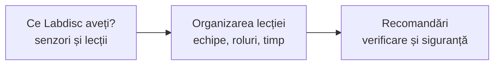

Trei pagini pentru drumul de la „am un aparat” la „lecția a mers”: ce poate aparatul vostru, cum împărțiți clasa și timpul, ce verificați înainte.

- [[la-clasa/implementare/ce-labdisc-aveti|Ce Labdisc aveți?]]: tabelul senzorilor pe modele și, pentru fiecare proiect de lecție, pe ce modele merge. Începeți de aici dacă nu știți ce model are școala.
- [[la-clasa/implementare/organizarea-lectiei|Organizarea lecției]]: echipe, roluri, timp, un aparat la mai mulți elevi, calculatorul duratei înregistrării și ce faceți când ceva nu merge.
- [[la-clasa/implementare/recomandari|Recomandări, erori frecvente și siguranță]]: textul Victoriei Calistru, cu recomandări de folosire, greșelile cele mai dese, lista de verificare dinaintea lecției și regulile de siguranță.

> [!tip] Cu o zi înainte
> Încărcați aparatul, deschideți GlobiLab și faceți o înregistrare de probă cu senzorul din lecție. Lista completă e în [[la-clasa/implementare/recomandari|Recomandări]].
