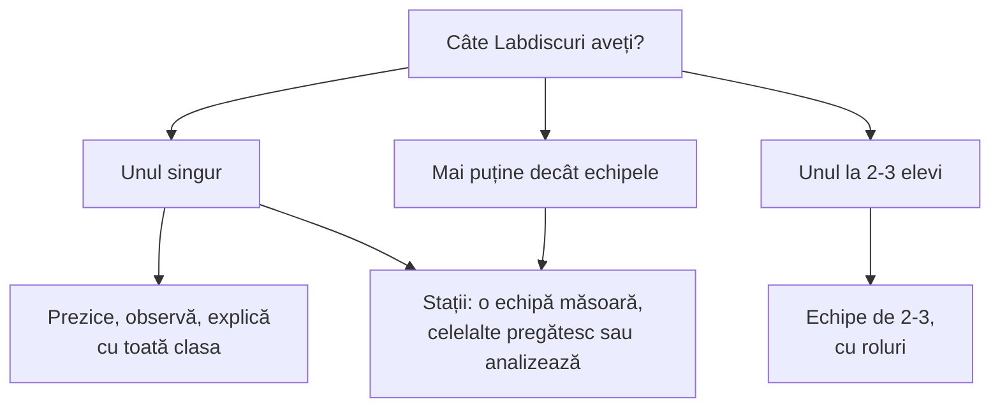
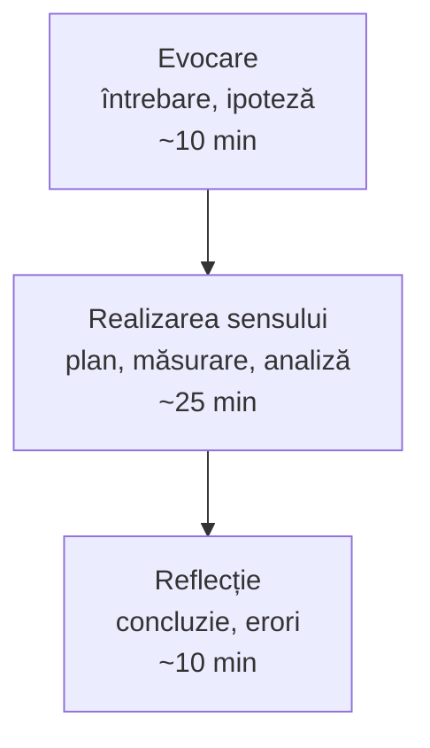

Pagina vă ajută să împărțiți clasa, aparatele și cele 45 de minute: câți elevi la un Labdisc, cine ce face, cât durează înregistrarea și ce faceți când ceva nu merge.

## Echipele

La curs lucrăm câte doi-trei la un Labdisc, și la clasă e un număr bun. Cu cât echipa e mai mare, cu atât mai mulți doar privesc.



Dacă aveți un singur Labdisc, folosiți [[la-clasa/metodologie/prezice-observa-explica|prezice, observă, explică]] cu toată clasa, sau lucrați pe stații: o echipă măsoară, celelalte pregătesc ipoteza sau analizează datele echipei de dinainte. Stații gata făcute, câte trei pe disciplină, sunt în [[la-clasa/anexe/fise-de-statie|fișele de stație]].

> [!tip] Stația fără aparat
> Când aparatele nu ajung, o stație poate lucra cu o simulare pe calculator sau pe telefon. Elevii fac acolo predicția și o verifică în simulare, apoi trec la stația cu Labdisc și compară simularea cu măsurarea reală.

Exemplu pentru o stație fără aparat, legat de lecția [[la-clasa/proiecte/fizica/presiunea-hidrostatica|Presiunea hidrostatică]]: cum se schimbă presiunea cu adâncimea apei?

```simulare
url: https://phet.colorado.edu/sims/html/under-pressure/latest/under-pressure_ro.html
titlu: Sub presiune: presiunea în lichide
sursa: PhET Interactive Simulations, University of Colorado Boulder, CC BY 4.0.
```

## Rolurile

Rolurile se schimbă de la o lecție la alta, ca fiecare elev să ajungă la aparat.

| Rolul | Ce face |
|---|---|
| Operatorul | Configurează senzorii, pornește și oprește măsurarea. |
| Experimentatorul | Pregătește montajul și face fenomenul să se întâmple. |
| Cel care notează | Scrie în documentul echipei ce se întâmplă în timpul măsurării: momente, probleme, schimbări. |
| Purtătorul de cuvânt | Prezintă graficul și concluzia echipei. |

Cartonașe de rol: proiectați-le sau dați fiecărui elev să-și întoarcă rolul pe telefon.

```cartonase
Operatorul :: Configurez senzorii, pornesc și opresc măsurarea. Întreb echipa înainte să apăs Run.
Experimentatorul :: Pregătesc montajul și fac fenomenul să se întâmple: torn apa, mișc căruciorul, aprind lampa.
Cel care notează :: Scriu în documentul echipei ce se întâmplă în timpul măsurării: la ce secundă, ce problemă, ce s-a schimbat.
Purtătorul de cuvânt :: Prezint graficul și concluzia echipei. Arăt pe grafic de unde știm.
```

## Timpul

O oră de 45 de minute încape o singură măsurare bună, cu pregătire și discuție. O împărțire orientativă, după etapele lecției:



Testați aparatul, senzorul și conexiunea înainte de oră (lista e în [[la-clasa/implementare/recomandari|Recomandări]]); cinci minute pierdute cu un cablu la început sunt cinci minute luate din concluzie.

### Cât durează înregistrarea?

Durata unei înregistrări vine din două setări: rata de eșantionare (câte valori pe secundă, pe minut sau pe oră) și numărul de eșantioane. Introduceți-le mai jos înainte de oră, ca să știți dacă măsurarea încape în lecție.

```durata
```

> [!example] Două exemple din ghid
> - **Stația „Fenomene termice”:** o valoare pe secundă, 10 minute, adică 600 de eșantioane.
> - **Lecția [[la-clasa/proiecte/biologie/ecosisteme-artificiale-agroecosisteme|Agroecosisteme]]:** o măsurătoare pe oră, 7 zile în seră, adică 168 de eșantioane. Autorul alege rata mică „pentru a nu umple memoria dispozitivului”.
>
> Unele lecții pentru clasele primare folosesc rata „Manual”: aparatul înregistrează o valoare doar când apăsați tasta. Atunci durata o hotărâți voi.

Verificați-vă: alegeți rata potrivită.

```quiz
? Elevii urmăresc 10 minute cum se răcește apa caldă dintr-un pahar. Ce rată alegeți?
- 1000 de valori pe secundă | Temperatura apei se schimbă încet. Ați aduna 600 000 de valori care spun același lucru.
+ O valoare pe secundă | Corect: în 10 minute iese o curbă netedă din 600 de puncte, ușor de citit.
- O valoare pe oră | În 10 minute n-ați avea nicio valoare.

? Echipa lasă Labdiscul o săptămână într-o seră. Ce rată alegeți?
- 10 valori pe secundă | Ar însemna peste 6 milioane de valori într-o săptămână. Memoria aparatului nu le încape.
+ O valoare pe oră | Corect: 168 de valori arată ziua și noaptea, fără să umple memoria.
- O valoare pe minut | Ar merge, dar 10 080 de valori sunt mult mai multe decât vă trebuie ca să vedeți ciclul zi-noapte.

? Un elev bate din palme lângă microfon. Ce rată alegeți?
- O valoare pe secundă | Un sunet durează fracțiuni de secundă. Cu o valoare pe secundă îl pierdeți.
+ Rata cea mai mare pe care o permite senzorul | Corect: sunetul se schimbă de mii de ori pe secundă. Microfonul permite până la 100 000 de valori pe secundă.
- O valoare pe minut | Ar trece neobservat.
```

## Când ceva nu merge

Deschideți problema pe care o aveți.

> [!question]- Bluetooth-ul nu găsește aparatul
> Conectați-l prin cablu USB.

> [!question]- Graficul e o linie dreaptă, nu se schimbă nimic
> Verificați dacă senzorul e bifat la „Configurare”.

> [!question]- Bateria e descărcată
> Țineți încărcătorul la îndemână; echipa lucrează cu aparatul vecin.

> [!question]- Valorile senzorului de distanță sar
> Obiectul e prea aproape (sub 0,4 m) sau nu reflectă; folosiți o carte ca țintă.

> [!question]- Echipa e blocată de peste 10 minute
> Propuneți o variantă mai simplă a aceleiași întrebări.

> [!question]- O măsurare a eșuat
> Aveți pregătit un grafic salvat dinainte, ca discuția să poată continua.

## Datele elevilor

> [!warning] Fără nume, fără fețe
> Când păstrați sau împărțiți produsele elevilor (grafice, rapoarte), păstrați-le fără nume și fără fotografii cu fețe.
