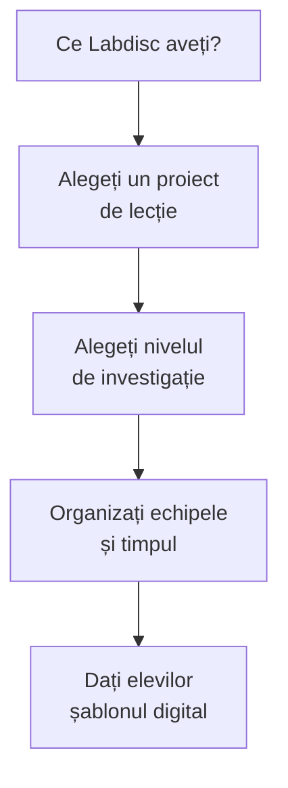

Partea aceasta e pentru lecția de mâine: lecții scrise de profesori, metoda pas cu pas, organizarea clasei și șabloane digitale pe care elevii le completează în documentul grupului. Fiecare pagină are exerciții scurte cu răspuns imediat, pe care le puteți face și cu elevii.

Nu presupune un anumit model de Labdisc: fiecare proiect spune ce senzori folosește, iar [[la-clasa/implementare/ce-labdisc-aveti|Ce Labdisc aveți?]] arată pe ce modele îi găsiți.

## De unde porniți



| Situația | Începeți cu |
|---|---|
| Nu știți ce model are școala | [[la-clasa/implementare/ce-labdisc-aveti\|Ce Labdisc aveți?]] |
| Un singur aparat, toată clasa | [[la-clasa/metodologie/prezice-observa-explica\|Prezice, observă, explică]] |
| Elevii n-au mai lucrat cu senzori | [[la-clasa/metodologie/niveluri-de-investigatie\|Niveluri de investigație]] |
| Vreți o lecție gata scrisă | [[la-clasa/proiecte/index\|Proiecte de lecție]] |
| Aveți nevoie de un șablon pentru elevi | [[la-clasa/anexe/index\|Anexe]] |

## Metodologie

- [[la-clasa/metodologie/ciclul-investigatiei|Ciclul investigației]]: pașii unei lecții în care elevii cercetează cu date reale.
- [[la-clasa/metodologie/niveluri-de-investigatie|Patru niveluri de investigație]]: cât de mult hotărăște profesorul și cât elevii.
- [[la-clasa/metodologie/prezice-observa-explica|Prezice, observă, explică]]: rutina scurtă pentru o demonstrație cu Labdisc.

## Implementare

- [[la-clasa/implementare/ce-labdisc-aveti|Ce Labdisc aveți?]]: senzorii fiecărui model și pe ce modele merge fiecare lecție.
- [[la-clasa/implementare/organizarea-lectiei|Organizarea lecției]]: echipe, roluri, timp, un aparat la mai mulți elevi.
- [[la-clasa/implementare/recomandari|Recomandări, erori frecvente și siguranță]]

## Proiecte de lecție

[[la-clasa/proiecte/index|Secvențele de lecție]] scrise de profesori, pe discipline: fizică, chimie, biologie, geografie și științe la clasele primare. Fiecare poartă numele autorului.

## Anexe

[[la-clasa/anexe/index|Șabloane pentru elevi și pentru profesor]], de copiat într-un Google Doc al grupului, plus o [[la-clasa/anexe/evaluare-lori|fișă de evaluare LORI]] pentru orice resursă digitală.

## Verificați-vă

Trei situații din primele lecții cu Labdisc. Alegeți ce ați face.

```quiz
? Aveți un singur Labdisc și o clasă întreagă. Ce faceți?
- Lăsați aparatul pe catedră și explicați graficul | Așa elevii doar privesc. Graficul îl citește profesorul, nu ei.
+ Folosiți „prezice, observă, explică” cu graficul proiectat | Corect: fiecare elev își face predicția, apoi toată clasa compară cu datele.
- Amânați lecția până aveți mai multe aparate | Un aparat ajunge pentru o rutină bună de 10-15 minute.

? Ați ales o lecție scrisă pentru BioChem, dar școala are GenSci. Ce faceți întâi?
- Renunțați la lecție | Poate nu e nevoie: multe lecții folosesc senzori pe care îi au mai multe modele.
+ Verificați ce senzori cere lecția și dacă GenSci îi are | Corect: pagina „Ce Labdisc aveți?” arată, lecție cu lecție, ce modele merg.
- Faceți lecția fără Labdisc | Pierdeți tocmai măsurarea, care e miezul lecției.

? Elevii au terminat măsurarea și au graficul pe ecran. Ce lipsește ca lecția să fie de cercetare?
- Un rezumat al pașilor făcuți | Rezumatul spune ce ați făcut, nu ce ați aflat.
+ Compararea cu predicția și răspunsul la întrebarea de la început | Corect: concluzia răspunde la întrebare, cu dovezi din grafic.
- Încă o măsurare cu alt senzor | Mai multe date nu înlocuiesc interpretarea.
```
