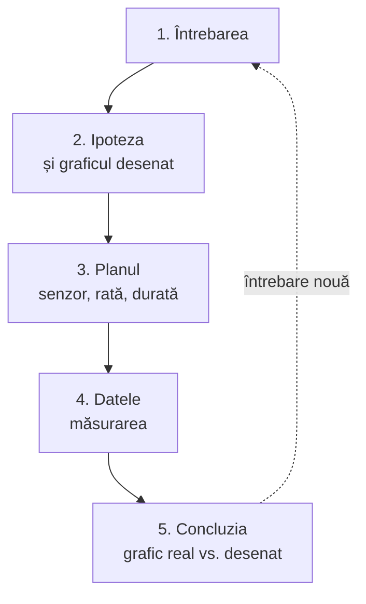

Aici găsiți cei cinci pași ai unei lecții de cercetare cu Labdisc, ce fac elevii și ce face aparatul la fiecare, cu un exemplu dus de la cap la coadă și exerciții pe care le puteți face și cu elevii.

Labdisc măsoară repede și precis, dar nu face singur lecția de cercetare. Dacă elevii doar apasă butonul și copiază graficul, ora rămâne o demonstrație cu un aparat mai scump. Diferența o face ordinea pașilor: elevii au o întrebare și o așteptare înainte să vadă vreo cifră.

Pașii de mai jos urmează modelul învățării prin investigație descris de Pedaste și colegii (2015), simplificat pentru o oră de 45 de minute.



## Pașii, unul câte unul

Exemplul care trece prin toți pașii vine din [[la-clasa/anexe/banca-de-intrebari|banca de întrebări]]: *Se răcește apa mai repede cu capac sau fără capac?*

### 1. Întrebarea

- **Elevii** pornesc de la un fenomen și formulează o întrebare care se poate măsura.
- **Labdisc:** nimic încă.

> [!example] În exemplu
> Ceaiul din cană s-a răcit până la sfârșitul pauzei. Ar fi rămas cald dacă l-am fi acoperit?

### 2. Ipoteza

- **Elevii** spun ce cred că se va întâmpla și de ce. Desenează graficul așteptat, digital: pe un grafic interactiv ca cel de mai jos, în Google Drawings sau pe tabla digitală a clasei.
- **Labdisc:** nimic încă.

> [!example] În exemplu
> Elevii desenează două curbe pe același grafic, temperatura în funcție de timp: una pentru paharul cu capac, una pentru cel fără.

### 3. Planul

- **Elevii** aleg ce măsoară, cu ce senzor, cât de des și cât timp, ce țin constant.
- **Labdisc** se configurează: senzorii, rata de eșantionare, numărul de măsurători.

> [!example] În exemplu
> Două pahare cu aceeași cantitate de apă, turnată din același ceainic, câte o sondă de temperatură externă în fiecare. O valoare pe secundă, 10 minute. Calculatorul de durată e în [[la-clasa/implementare/organizarea-lectiei|Organizarea lecției]].

### 4. Datele

- **Elevii** fac măsurarea, notează în documentul echipei ce s-a întâmplat în timpul ei.
- **Labdisc** înregistrează și afișează datele, pe ecran sau în GlobiLab.

### 5. Concluzia

- **Elevii** compară graficul real cu cel desenat, explică diferențele, răspund la întrebare.
- **GlobiLab** ajută la citirea graficului: valori, pantă, comparații.

> [!question]- Ce faceți când predicția elevilor a ieșit exact?
> Cereți explicația formei, nu doar confirmarea: de ce scade mai repede la început? Apoi schimbați o condiție („și dacă paharul ar fi de metal?”) și întoarceți-vă la pasul 2. Așa se închide cercul din diagramă.

## Încercați pasul 2 pe voi

Întrebarea, tot din banca de întrebări: *Cum se schimbă iluminarea când ne îndepărtăm de sursa de lumină?* Desenați întâi curba pe care o așteptați, apoi apăsați „Arată datele”.

```grafic
titlu: Iluminarea în funcție de distanța față de bec
x: Distanța (cm)
y: Iluminarea (lux)
prezicere: da
nota: Date ilustrative, calculate cu legea inversului pătratului distanței pentru o sursă mică de lumină, fără lumina din cameră; nu sunt o măsurare. La distanță dublă, iluminarea e de patru ori mai mică.
date:
20, 2500
30, 1111
40, 625
50, 400
60, 278
70, 204
80, 156
90, 123
100, 100
```

> [!tip] Ce discutați după
> Mulți desenează o linie dreaptă care coboară. Datele arată o curbă: aproape de bec, câțiva centimetri schimbă mult; departe, aproape nimic. Puneți întrebarea „de ce?” înainte să numiți legea.

## Ce să nu săriți

> [!warning] Graficul desenat înainte
> E cel mai scurt drum spre o discuție bună: „de ce arată altfel decât ați crezut?”.

> [!warning] Erorile de măsurare
> Un senzor necalibrat, o sondă mișcată, o rată de eșantionare prea mică sunt material de lecție, nu ghinion. Lăsați timp pentru ele.

> [!warning] Răspunsul la întrebarea de la început
> Concluzia se scrie ca răspuns la întrebare, nu ca rezumat al experimentului.

## Exersați

Puneți pașii în ordine. Merge și cu elevii, la prima lecție de cercetare.

```ordine
titlu: Ordonați pașii unei investigații
Pornim de la un fenomen și punem o întrebare care se poate măsura
Spunem ce credem că se va întâmpla și desenăm graficul așteptat
Alegem senzorul, rata de eșantionare și ce păstrăm la fel
Facem măsurarea și notăm ce se întâmplă în timpul ei
Comparăm graficul real cu cel desenat
Răspundem la întrebarea de la început, cu dovezi din grafic
```

Verificați-vă: întrebări, ipoteze, concluzii.

```quiz
? Care dintre întrebări se poate testa cu Labdisc într-o lecție?
- De ce e vara mai cald decât iarna? | Răspunsul cere date de luni de zile și multe cauze. Nu se testează într-o oră.
+ Se răcește apa mai repede cu capac sau fără capac? | Corect: se schimbă un singur lucru (capacul), se măsoară temperatura, încape în 10 minute.
- Ce este temperatura? | E o întrebare de definiție. Răspunsul se caută în manual, nu se măsoară.
- E sănătos să bem apă rece? | Cere o judecată, nu o măsurare cu senzorii din clasă.

? Care ipoteză e formulată bine?
- Apa se va răci. | Adevărat, dar nu spune ce comparăm și ce așteptăm să iasă diferit.
+ Apa cu capac va fi mai caldă după 10 minute decât cea fără capac, pentru că pierde mai puțină căldură prin evaporare. Pornim de la aceeași cantitate și aceeași temperatură. | Corect: spune ce schimbăm, ce măsurăm, ce păstrăm la fel și de ce.
- Cred că experimentul va reuși. | Nu spune nimic despre fenomen.

? La ce pas alegeți rata de eșantionare?
- La pasul 4, când porniți măsurarea | Atunci e prea târziu: o rată greșită se vede abia pe grafic.
+ La pasul 3, în plan | Corect: rata și durata se aleg după cât de repede se schimbă fenomenul, înainte de măsurare.
- Nu contează, aparatul o alege singur | Aparatul are o setare implicită, dar nu știe ce fenomen urmăriți.

? Graficul real nu seamănă cu cel desenat de elevi. Ce faceți?
- Repetați măsurarea până iese ca predicția | Datele nu se potrivesc cu dorința. Așa se pierde exact ce era de învățat.
+ Discutați de ce arată altfel | Corect: diferența dintre predicție și date e momentul cel mai bun al lecției.
- Treceți peste, predicția nu se notează | Fără comparație, predicția a fost degeaba.

? Care e o concluzie bună?
- Am măsurat temperatura cu Labdisc timp de 10 minute. | E un rezumat al experimentului, nu un răspuns la întrebare.
+ Da, capacul încetinește răcirea: pe grafic, curba paharului cu capac coboară mai lin și se termină mai sus. | Corect: răspunde la întrebare și arată unde se vede pe grafic.
- Experimentul a fost interesant și am lucrat bine în echipă. | E o reflecție despre lucru, nu o concluzie despre fenomen.
```

## Surse

- Pedaste, M. și colab. (2015). Phases of inquiry-based learning: Definitions and the inquiry cycle. *Educational Research Review*, 14, 47–61. https://doi.org/10.1016/j.edurev.2015.02.003
