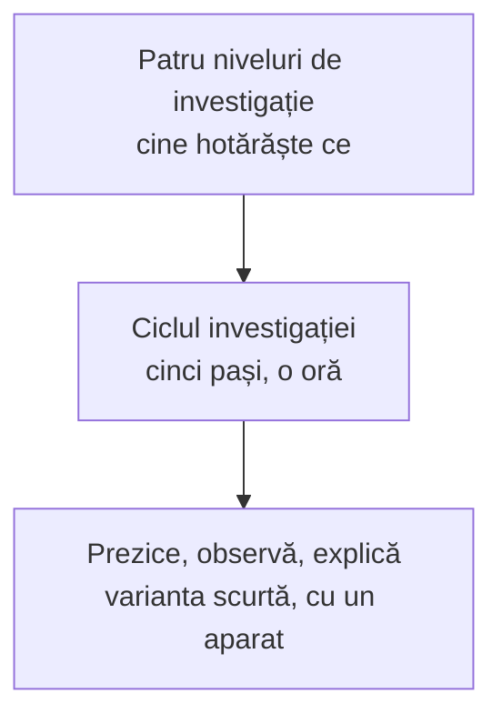

Trei pagini despre cum faceți din Labdisc o lecție de cercetare, nu o demonstrație cu un aparat scump. Fiecare are exerciții scurte cu răspuns imediat.



- [[la-clasa/metodologie/ciclul-investigatiei|Ciclul investigației]]: pașii unei lecții în care elevii cercetează cu date reale, de la întrebare la concluzie.
- [[la-clasa/metodologie/niveluri-de-investigatie|Patru niveluri de investigație]]: cât de mult hotărăște profesorul și cât elevii, și cum urcați de la un nivel la altul.
- [[la-clasa/metodologie/prezice-observa-explica|Prezice, observă, explică]]: rutina de 10-15 minute pentru o demonstrație cu Labdisc în fața clasei.

## Cuvintele de lucru

Termenii pe care îi folosesc paginile și fișele. Atingeți cartonașul ca să vedeți explicația; merg și cu elevii, ca recapitulare.

```cartonase
Întrebarea de cercetare :: O întrebare la care elevii pot răspunde măsurând, cu ce au pe masă.
Ipoteza :: Ce credem că se va întâmpla și de ce. Spune ce se schimbă, ce măsurăm și ce păstrăm la fel.
Variabila independentă :: Ce schimbăm noi, de la o măsurare la alta.
Variabila dependentă :: Ce măsurăm cu senzorul, ca să vedem efectul.
Variabilele controlate :: Ce păstrăm la fel, ca efectul să vină doar din ce am schimbat.
Rata de eșantionare :: Câte valori înregistrează senzorul într-o unitate de timp: pe secundă, pe minut sau pe oră.
Numărul de eșantioane :: Câte valori înregistrează aparatul în total. Împreună cu rata, dă durata înregistrării.
Panta graficului :: Cât de repede se schimbă mărimea măsurată. Cu cât linia e mai înclinată, cu atât schimbarea e mai rapidă.
Sursa de eroare :: Ce ar fi putut strica măsurarea: un senzor necalibrat, o sondă mișcată, o rată prea mică.
```
