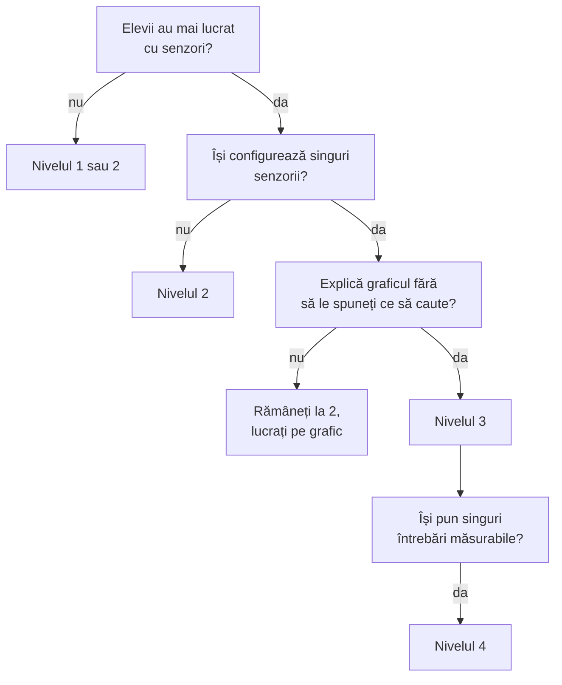

Pagina vă ajută să alegeți cât de deschisă e lecția de mâine: cele patru niveluri, cum recunoașteți la ce nivel e clasa și cum transformați aceeași fișă ca să urce un nivel.

Nu orice lecție cu Labdisc trebuie să fie o investigație deschisă. Banchi și Bell (2008) descriu patru niveluri, după cine stabilește întrebarea, metoda și răspunsul. Elevii care n-au mai lucrat cu senzori încep de jos și urcă.

## Cine hotărăște ce

| Nivelul | Întrebarea | Metoda | Răspunsul |
|---|---|---|---|
| 1. Confirmare | profesorul | profesorul | știut dinainte |
| 2. Structurată | profesorul | profesorul | elevii |
| 3. Ghidată | profesorul | elevii | elevii |
| 4. Deschisă | elevii | elevii | elevii |

Exemple cu Labdisc, câte unul pe nivel:

1. **Confirmare.** Elevii verifică prin măsurare că apa fierbe la aproximativ 100 °C.
2. **Structurată.** Cum se schimbă temperatura apei calde în 10 minute? Fișa spune pașii.
3. **Ghidată.** Ce cană ține ceaiul cald mai mult? Elevii își fac planul.
4. **Deschisă.** Echipa alege singură un fenomen din clasă sau din curte și îl măsoară.

## Ce nivel alegeți?



Un semn că puteți urca un nivel: elevii își configurează singuri senzorii și explică graficul fără să le spuneți ce să caute.

## Aceeași întrebare, patru niveluri

> [!example]- Ceaiul care se răcește, de la nivelul 1 la nivelul 4
> 1. **Confirmare.** Le spuneți elevilor că un lichid fierbinte se răcește întâi repede, apoi tot mai încet. Ei măsoară 10 minute și văd curba.
> 2. **Structurată.** Fișa dă întrebarea („cum se schimbă temperatura apei calde în 10 minute?”), montajul și setările. Forma curbei o descoperă elevii.
> 3. **Ghidată.** Dați doar întrebarea („ce cană ține ceaiul cald mai mult?”) și cănile. Echipa hotărăște câtă apă, câte sonde, cât timp și ce ține la fel.
> 4. **Deschisă.** Elevii observă că ceaiul se răcește în pauză și își pun singuri întrebarea: capacul, materialul, cantitatea sau altceva.

> [!tip] Cum urcați de la 2 la 3 cu aceeași fișă
> Păstrați întrebarea și scoateți din fișă pașii și setările. În locul lor puneți trei rânduri goale: ce schimbăm, ce măsurăm, ce păstrăm la fel. Verificați planul echipei înainte să pornească măsurarea.

## Exersați

Fiecare situație e o lecție reală sau posibilă. Alegeți nivelul.

```quiz
? Profesorul dă întrebarea și fișa cu pașii. Elevii nu știu dinainte ce va ieși pe grafic. Ce nivel e?
- Confirmare | La confirmare, răspunsul e știut dinainte. Aici elevii îl găsesc.
+ Structurată | Corect: întrebarea și metoda vin de la profesor, răspunsul îl găsesc elevii.
- Ghidată | La ghidată, elevii își fac singuri planul. Aici pașii sunt dați.

? Profesorul întreabă „ce cană ține ceaiul cald mai mult?” și pune pe masă trei căni diferite. Echipa hotărăște cum măsoară. Ce nivel e?
- Structurată | Ar fi structurată dacă fișa ar spune pașii. Aici metoda e a elevilor.
+ Ghidată | Corect: întrebarea e a profesorului, planul și răspunsul sunt ale elevilor.
- Deschisă | La deschisă, și întrebarea vine de la elevi.

? Elevii măsoară că gheața care se topește stă la aproximativ 0 °C, după ce au citit asta în manual. Ce nivel e?
+ Confirmare | Corect: răspunsul e cunoscut dinainte, măsurarea îl confirmă. E un început bun pentru o clasă nouă cu senzorii.
- Structurată | La structurată, elevii nu știu dinainte răspunsul.
- Ghidată | Elevii nu și-au făcut planul și știau rezultatul.

? O echipă vrea să afle dacă e mai zgomot în cantină sau în bibliotecă și își alege singură senzorul. Ce nivel e?
- Ghidată | La ghidată, întrebarea vine de la profesor.
+ Deschisă | Corect: întrebarea, metoda și răspunsul sunt ale elevilor.
- Structurată | Nimic nu e dat de profesor aici.

? O clasă lucrează prima dată cu Labdisc. Ce alegeți?
- Direct o investigație deschisă, ca să fie interesant | Fără să știe aparatul, elevii pierd ora cu configurarea, nu cu fenomenul.
+ Nivelul 1 sau 2, apoi urcați | Corect: întâi învață aparatul pe o întrebare dată, apoi primesc tot mai multe decizii.
- Nu contează nivelul | Contează: același experiment poate fi prea greu sau prea ușor după cât lăsați elevilor.
```

Cele patru niveluri, pe scurt. Atingeți ca să verificați.

```cartonase
Confirmare :: Întrebarea, metoda și răspunsul sunt știute dinainte. Elevii verifică prin măsurare.
Structurată :: Profesorul dă întrebarea și metoda. Elevii găsesc răspunsul.
Ghidată :: Profesorul dă întrebarea. Elevii își fac planul și găsesc răspunsul.
Deschisă :: Elevii își pun întrebarea, își fac planul și găsesc răspunsul.
```

## Surse

- Banchi, H. și Bell, R. (2008). The Many Levels of Inquiry. *Science and Children*, 46(2), 26–29.
