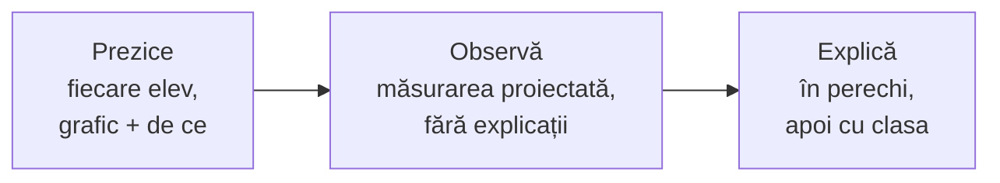

O rutină scurtă pe care o puteți folosi mâine cu un singur aparat și toată clasa: cei trei pași, un grafic pe care elevii își desenează predicția chiar pe pagină și exerciții de verificare.

Când aveți un singur aparat sau puțin timp, Labdisc poate lucra în fața clasei, proiectat pe tablă. Rutina „prezice, observă, explică” (White și Gunstone, 1992) păstrează elevii activi și atunci.



1. **Prezice.** Descrieți experimentul. Fiecare elev desenează graficul pe care îl așteaptă și scrie o propoziție: de ce. Desenul se face digital: pe graficul de mai jos, de pe telefon, sau într-un Google Drawings ori pe o tablă digitală comună (Padlet, Miro).
2. **Observă.** Porniți măsurarea cu graficul proiectat. Elevii notează ce văd, fără explicații încă, în documentul clasei sau pe tabla digitală.
3. **Explică.** Elevii compară graficul lor cu cel real, întâi în perechi, apoi cu toată clasa. Discuția pornește de la diferențe.

Merge bine pentru fenomene rapide: răcirea unei băuturi, sunetul unei sonerii, lumina când acoperiți senzorul, pulsul după zece genuflexiuni.

## Încercați rutina aici

Un pahar cu apă la 80 °C stă pe masă, într-o clasă cu 22 °C. Cum se schimbă temperatura apei în 20 de minute? Atingeți graficul ca să desenați predicția, apoi apăsați „Arată datele”. Elevii pot face același lucru pe telefon, înainte să porniți Labdiscul.

```grafic
titlu: Răcirea apei într-un pahar
x: Timp (min)
y: Temperatura (°C)
prezicere: da
nota: Date ilustrative, calculate cu legea răcirii (Newton) pentru apă la 80 °C într-o cameră cu 22 °C; nu sunt o măsurare. Cu Labdisc, curba voastră va avea altă pantă, după pahar și cantitatea de apă.
date:
0, 80.0
2, 74.5
4, 69.5
6, 65.0
8, 60.9
10, 57.2
12, 53.8
14, 50.8
16, 48.1
18, 45.6
20, 43.3
```

> [!question]- Ce diferențe apar de obicei între predicție și date?
> Multe predicții sunt linii drepte care coboară până la temperatura camerei sau chiar sub ea. Datele arată o curbă care scade repede la început și tot mai încet, apropiindu-se de temperatura camerei fără să coboare sub ea. Întrebați: de ce se răcește mai încet când apa e mai puțin caldă?

## Pașii, în ordine

Rutina se strică cel mai des când explicația vine înainte de observație. Ordonați pașii.

```ordine
titlu: Ordonați pașii rutinei
Descrieți experimentul, fără să spuneți ce va ieși
Fiecare elev își desenează graficul așteptat
Fiecare elev scrie o propoziție: de ce
Porniți măsurarea cu graficul proiectat
Elevii notează ce văd, fără explicații
Perechile compară graficul lor cu cel real
Discutați cu toată clasa, pornind de la diferențe
```

## Verificați-vă

```quiz
? De ce își face fiecare elev predicția singur, înainte de discuție?
- Ca să-i puteți nota | Predicția nu se notează. O predicție greșită e la fel de utilă ca una corectă.
+ Ca fiecare să aibă ceva de comparat cu datele | Corect: fără o predicție proprie, elevul doar privește graficul altcuiva.
- Ca să câștige timp | Câteva minute de predicție nu fac rutina mai scurtă, ci mai utilă.

? În pasul „observă”, un elev strigă de ce scade temperatura. Ce faceți?
- Îl lăudați și explicați imediat | Explicația dată acum le ia celorlalți ocazia să observe singuri.
+ Îi cereți să noteze ideea și s-o spună la pasul „explică” | Corect: observați întâi, explicați după.
- Opriți măsurarea | Fenomenul nu așteaptă, mai ales la cele rapide.

? Pentru ce fenomen merge cel mai bine rutina, cu un singur aparat?
+ Pulsul unui elev după zece genuflexiuni | Corect: e rapid, vizibil pe ecran și toată clasa poate prezice.
- Creșterea unei plante într-o lună | Durează prea mult pentru o rutină de 10-15 minute.
- Temperatura din seră o săptămână | E o înregistrare lungă, potrivită pentru o investigație, nu pentru o demonstrație.

? Graficul real seamănă cu predicția aproape tuturor elevilor. Ce urmează?
- Treceți mai departe, au înțeles | Poate au ghicit forma fără să știe de ce.
+ Cereți explicația formei și schimbați o condiție | Corect: „de ce așa?” și „ce s-ar schimba dacă…?” aduc a doua rundă de predicție.
- Repetați măsurarea | Aceeași măsurare dă același grafic. Schimbați ceva.
```

## Surse

- White, R. și Gunstone, R. (1992). *Probing Understanding*. London: Falmer Press.
