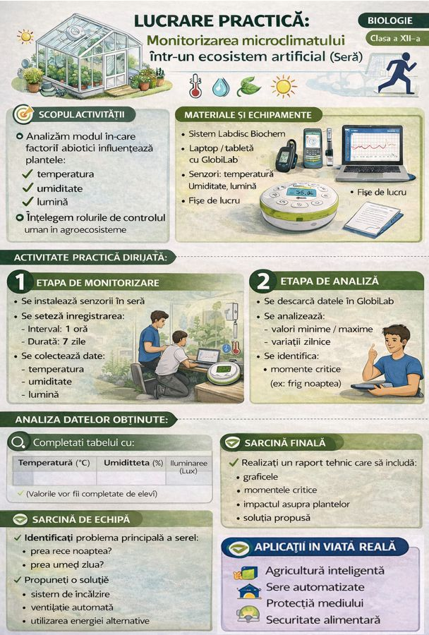
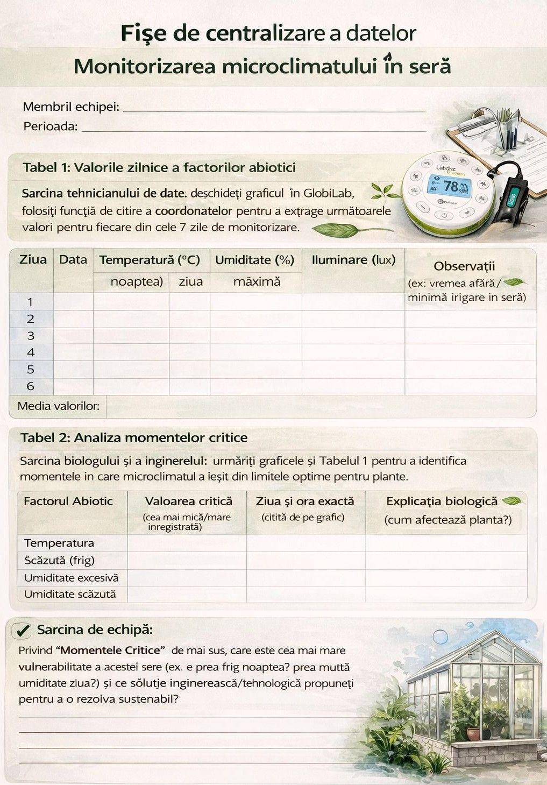

*Secvență de lecție realizată de Chiprisean Ion – profesor de biologie, grad didactic superior. Licență CC BY-SA 4.0.*

***„Monitorizarea microclimatului într-un ecosistem artificial (Sera)”***

## Competențe specifice disciplinei Biologia

-   Investigarea lumii vii cu ajutorul metodelor și al mijloacelor specifice pentru îmbunătățirea calității vieții și a mediului.

## Unități de competență

-   Utilizarea instrumentarului și a tehnicilor de laborator în procesul de investigație a microclimatului într-un ecosistem artificial de tip seră.
-   Proiectarea acțiunilor de conservare a biodiversității vegetale și animale din diverse ecosisteme

## Tehnologii didactice

-   **Platforme digitale:** software-ul GlobiLab.
-   **Metode didactice:** conversația euristică, experimentul digital, observația
-   **Forme de organizare:** lucru în grup

**Materiale și echipamente necesare:** Sistem de achiziție de date Labdisc, dispozitiv (tabletă/laptop) cu aplicația GlobiLab instalată, fișe de lucru.

## Obiective operaționale

La sfârșitul activității, elevul va fi capabil/va putea să:

O1 - Să explice particularitățile microclimatului unui ecosistem artificial (seră) și modul în care variația factorilor abiotici (temperatură, umiditate, lumină) influențează direct starea de sănătate și dezvoltare a plantelor.

O2 - Să utilizeze independent sistemul Labdisc și softul GlobiLab pentru a configura monitorizarea pe termen lung, precum și pentru a extrage și interpreta matematic graficele rezultate (medii zilnice, valori critice).

O3 - Să proiecteze o soluție tehnologică sau ecologică pentru optimizarea condițiilor din seră, fundamentându-și decizia strict pe datele reale colectate.

O4 - Să colaboreze eficient în echipă, asumându-și roluri specifice (biolog, tehnician, inginer, comunicator), pentru a rezolva o problemă reală din domeniul agriculturii cu un impact sustenabil.

## Tehnologii didactice

-   **Platforme digitale:** software-ul GlobiLab.
-   **Metode didactice:** conversația euristică, analiza datelor, observația, problematizarea
-   **Forme de organizare:** lucru în grup

**Materiale și echipamente necesare:** Sistem de achiziție de date Labdisc Biochem, dispozitiv (tabletă/laptop) cu aplicația GlobiLab instalată, fișe de lucru.

**Instructaj de securitate și protecție în timpul aplicației:** *Elevii pot face această aplicație practică pe teritoriul școlii dacă școala dispune de seră funcțională sau la un agent economic din localitate care are seră și să fie accesibilă pentru elevi (poate fi încheiat un contract de parteneriat dintre proprietarul serei și administrația instituției care să reglementeze vizitele elevilor la seră). Deplasarea grupului de elevi la seră se efectuază doar în prezența profesorului care ghidează, îndrumează și monitorizează elevii cum efectuiază sarcinele și să nu deterioreze echipamentele, plantele și alte instalații din seră.*

## Desfășurarea lecției

### Evocare (10 min)

Profesorul inițiază o discuție despre importanța agroecosistemelor pentru securitatea alimentară, cu referire la specificul agricol al țării noastre. Se clarifică diferența majoră dintre un ecosistem natural și un agroecosistem (intervenția și controlul uman).

*„Cât de precis putem controla natura?”* Dacă fermierii investesc mii de lei în sere, cum se asigură că microclimatul este optim 24/7?

Profesorul proiectează sau prezintă câteva ocupații moderne: *inginer agronom*, *specialist în agrotehnologii*, *analist de date de mediu*, *biotehnolog*. Se subliniază că agricultura modernă nu mai înseamnă doar muncă fizică, ci și operarea de softuri, analiza datelor din satelit sau de la senzori (precum cei pe care îi vom folosi *Labdisc Biochem*).

**Tehnologia Realizării:** Tablă interactivă pentru a afișa o imagine-stimul; Problematizarea; Asaltul de idei

### Realizarea sensului (20 min)

Clasa este împărțită în echipe de cercetare. Sarcina lor este să monitorizeze timp de **7 zile** factorii abiotici (Temperatura, Umiditatea Relativă, Nivelul de Iluminare) într-o seră reală (fie o seră aflată pe teritoriul școlii, fie la un agent economic/fermier partener din apropiere).

**Instructajul Tehnic:** configurarea aparatului pentru achiziție de lungă durată direct din GlobiLab. Elevii trebuie să deducă faptul că Labdisc-ul va avea nevoie de o sursă de alimentare continua sau trebuie să fie încărcat complet (conectat la priză/baterie externă mare) și trebuie plasat într-un loc sigur în interiorul serei, ferit de apa directă de la irigații.

*Setări necesare:* Selectarea senzorilor (Temp, Umiditate, Luminozitate). Setarea ratei de eșantionare la 1 măsurătoare pe oră (pentru a nu umple memoria dispozitivului).

-   **Planificarea vizitei:** Echipele stabilesc cine va fi responsabil de amplasarea senzorului și de interviul cu managerul serei sau agronomul serei.

**Tehnologia Realizării:** Lucru în grup; Labdisc Biochem (cu senzor de ritm cardiac), dispozitive (tablete/laptopuri), software GlobiLab. Tensiometre, Algoritmul lucrării.

### Reflecție (10 min)

Elevii sunt puși să deseneze pe caiete cum cred ei că va arăta graficul obținut după o săptămână.

-   *Cum va varia curba luminii?* (Vârfuri ziua, platou la zero noaptea).
-   *Dar curba temperaturii?* (Corelată cu lumina, dar influențată de sistemul de încălzire/ventilație al serei).

**Joc de rol:** *„Dacă ați fi inginerul agronom angajat la această seră și observați pe grafic că în fiecare noapte la ora 03:00 temperatura scade periculos de mult, ce decizii manageriale ați lua?”*

**Tehnologia Realizării:** Lucru în grup; Fișele de laborator completate, ecranele tabletelor cu graficele achiziționate în GlobiLab (pot fi chiar proiectate pe rând la ecranul principal); Joc de rol

### Extindere (5 min)

Dispozitivul este lăsat să înregistreze datele în locația stabilită. Liderii de grupă contactează antreprenorul/specialistul serei pentru a-i adresa 2-3 întrebări despre provocările menținerii microclimatului.

La lecția de evaluare de săptămâna viitoare, echipele vor descărca datele din Labdisc în GlobiLab și vor prezenta un scurt raport tehnic. Raportul trebuie să conțină:

1.  Graficul variațiilor pe cele 7 zile.
2.  Identificarea momentelor critice (ex: cele mai scăzute temperaturi nocturne).
3.  *Soluții de eco-eficiență:* Formularea unei propuneri concrete pentru antreprenor sau pentru școală privind optimizarea serei. De exemplu, pornind de la un proiect de cercetare privind **obținerea energiei alternative din biomasă**, cum ar putea fi integrat un astfel de sistem de încălzire pentru a stabiliza temperatura nocturnă într-un mod sustenabil și economic?

**Tehnologia Realizării:** Lucru individual pe Classroom/ Portofoliul personal

## Fișe de centralizarea datelor

Monitorizarea microclimatului în seră

**Membrii echipei:** \_\_\_\_\_\_\_\_\_\_

**Perioada:** \_\_\_\_\_\_\_\_\_\_

### Tabel 1: Valorile zilnice a factorilor abiotici

*Sarcina tehnicianului de date: deschideți graficul în GlobiLab, folosiți funcția de citire a coordonatelor pentru a extrage următoarele valori pentru fiecare din cele 7 zile de monitorizare.*

| Ziua            | Data | Temperatura (°C) |               | Umiditatea (%) |        | Iluminare (lux) | Observații (ex: vremea afară / irigare în seră) |
|-----------------|------|------------------|---------------|----------------|--------|-----------------|-------------------------------------------------|
|                 |      | minimă (noaptea) | maximă (ziua) | minimă         | maximă |                 |                                                 |
| 1               |      |                  |               |                |        |                 |                                                 |
| 2               |      |                  |               |                |        |                 |                                                 |
| 3               |      |                  |               |                |        |                 |                                                 |
| 4               |      |                  |               |                |        |                 |                                                 |
| 5               |      |                  |               |                |        |                 |                                                 |
| 6               |      |                  |               |                |        |                 |                                                 |
| 7               |      |                  |               |                |        |                 |                                                 |
| Media valorilor |      |                  |               |                |        |                 |                                                 |

### Tabel 2: Analiza momentelor critice

*Sarcina biologului și a inginerului: urmăriți graficele și Tabelul 1 pentru a identifica momentele în care microclimatul a ieșit din limitele optime pentru plante.*

| Factorul Abiotic               | Valoarea critică (cea mai mică/mare înregistrată) | Ziua și ora exactă (citită de pe grafic) | Explicația biologică (cum afectează planta?) |
|--------------------------------|---------------------------------------------------|------------------------------------------|----------------------------------------------|
| Temperatura scăzută (frig)     |                                                   |                                          |                                              |
| Temperatura ridicată (căldură) |                                                   |                                          |                                              |
| Umiditate excesivă             |                                                   |                                          |                                              |
| Umiditate scăzută              |                                                   |                                          |                                              |

### Sarcina de echipă

Privind "Momentele Critice" de mai sus, care este cea mai mare vulnerabilitate a acestei sere (ex. e prea frig noaptea? prea multă umiditate ziua?) și ce **soluție inginerească/tehnologică** propuneți pentru a o rezolva sustenabil?

## RAPORT TEHNIC ȘI DE SOLUȚIONARE

„ Monitorizarea microclimatului în seră”

**Numele echipei :** \_\_\_\_\_\_\_\_\_\_

**Perioada de monitorizare:** \_\_\_\_\_\_\_\_\_\_

**Locația ecosistemului artificial (Sera):** \_\_\_\_\_\_\_\_\_\_

**Membrii echipei și rolurile:**

-   **Tehnician de date:** \_\_\_\_\_\_\_\_\_\_
-   **Biolog / agronom:** \_\_\_\_\_\_\_\_\_\_
-   **Inginer de sistem:** \_\_\_\_\_\_\_\_\_\_
-   **Specialist comunicare:** \_\_\_\_\_\_\_\_\_\_

*Repere pentru raport:*

-   *Ce am vrut să aflăm monitorizând această seră?*
-   Echipamente și setări utilizate
-   Rezultate medii pe perioada celor 7 zile
-   Identificarea Momentelor Critice
-   Impactul condițiilor asupra plantelor
-   Concluzia ecologică
-   Problema principală selectată pentru rezolvare
-   Propunerea tehnică
-   Argumentarea eficienței
-   Importanța datelor în agricultură

## Anexă

