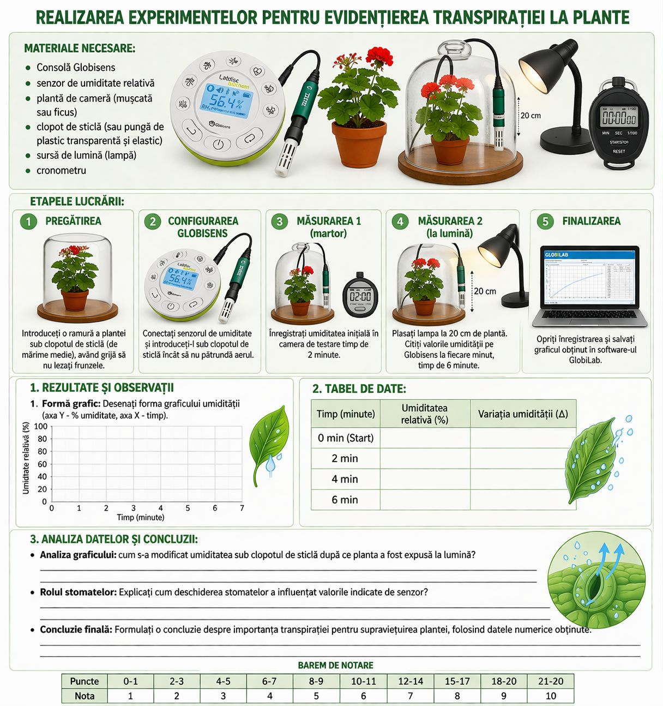

*Secvență de lecție realizată de Chiprisean Irina – profesoară de biologie, grad didactic doi. Licență CC BY-SA 4.0.*

**Tipul lecției:** Lucrare de laborator

## Competențe specifice

-   **CS1.** Utilizarea limbajului științific biologic în diverse contexte de comunicare referitor la structuri, procese, fenomene, legi, concepte.
-   **CS2.** Investigarea lumii vii cu ajutorul metodelor și al mijloacelor specifice pentru îmbunătățirea calității vieții și a mediului.

## Obiective operaționale

La finele activității elevii vor fi capabili:

**O1:** Să definească transpirația ca proces fiziologic de eliminare a apei sub formă de vapori.

**O2:** Să identifice structurile vegetale (stomate) responsabile de reglarea transpirației.

**O3:** Să demonstreze influența factorilor externi (lumină/temperatură) asupra ratei transpirației folosind planta *Pelargonium* (Mușcată).

**O4:** Să înregistreze datele experimentale într-un tabel, corelând timpul de expunere cu valorile umidității indicate de senzor.

**O5:** Să interpreteze graficul obținut, explicând relația dintre creșterea umidității relative și activitatea plantei.

**O6:** Să formuleze concluzii științifice bazate pe dovezi numerice, utilizând terminologia biologică adecvată.

## Scopul lucrării

-   Stabilirea corelației dintre timpul de monitorizare și variația umidității relative (măsurată în %).
-   Utilizarea senzorului de umiditate Globisens pentru monitorizarea precisă a mediului experimental.

## Tehnologii didactice

-   **Platforme digitale:** software-ul GlobiLab.
-   **Metode didactice:** experimentul.
-   **Forme de organizare:** lucru în grup, în pereche.

## Suport teoretic

Transpirația este procesul fiziologic prin care plantele elimină surplusul de apă sub formă de vapori, în principal prin stomatele situate pe epiderma frunzelor. Acest proces asigură circulația sevei brute și răcirea plantei.

**Factorii care influențează intensitatea transpirației:**

-   **Umiditatea aerului:** cu cât aerul este mai uscat, cu atât transpirația este mai intensă.
-   **Lumina și temperatura:** stimulează deschiderea stomatelor, accelerând procesul.
-   **Suprafața foliară:** frunzele mai mari sau mai numeroase cresc cantitatea de apă eliminată.

**Rolul tehnologiei Globisens:** Spre deosebire de metodele clasice (condensarea în punga de plastic), tehnologia Globisens oferă o abordare cantitativă. Senzorul de umiditate generează un grafic în timp real, a cărui pantă reprezintă rata transpirației.

## Materiale necesare

Consolă Globisens, senzor de umiditate relativă, plantă de cameră (mușcată sau ficus), clopot de sticlă (sau pungă de plastic transparentă și elastic), sursă de lumină (lampă), cronometru.

## Etapele lucrării

1.  **Pregătirea:** introduceți o ramură a plantei sau sub clopotul de sticlă (de mărime medie), având grijă să nu lezați frunzele.
2.  **Configurarea Globisens:** Conectați senzorul de umiditate și introduceți-l sub clopotul de sticlă încât să nu pătrundă aerul.
3.  **Măsurarea 1 (martor):** înregistrați umiditatea inițială în camera de testare timp de 2 minute.
4.  **Măsurarea 2 (la lumină):** plasați lampa la 20 cm de plantă. Citiți valorile umidității pe Globisens la fiecare minut, timp de 6 minute.
5.  **Finalizarea:** opriți înregistrarea și salvați graficul obținut în software-ul GlobiLab.

## Rezultate și observații

1.  **Formă grafic:** Desenați forma graficului umidității (axa Y - % umiditate, axa X - timp). L 0 1 2 3 4

**2. Tabel de date:** L 0 1 2 3 4 5 6

| Timp (minute) | Umiditatea relativă (%) | Variația umidității (Δ) |
|---------------|-------------------------|-------------------------|
| 0 min (Start) |                         |                         |
| 2 min         |                         |                         |
| 4 min         |                         |                         |
| 6 min         |                         |                         |

**3. Analiza datelor și concluzii:** L 0 1 2 3

-   **Analiza graficului:** cum s-a modificat umiditatea sub clopotul de sticlă după ce planta a fost expusă la lumină? \_\_\_\_\_\_\_\_\_\_
-   **Rolul stomatelor:** Explicați cum deschiderea stomatelor a influențat valorile indicate de senzor? L 0 1 2 3 \_\_\_\_\_\_\_\_\_\_
-   **Concluzie finală:** Formulați o concluzie despre importanța transpirației pentru supraviețuirea plantei, folosind datele numerice obținute. L 0 1 2 3 4 5 6

**Barem de notare**

| Puncte | Nota |
|--------|------|
| 0-1    | 1    |
| 2-3    | 2    |
| 4-5    | 3    |
| 6-7    | 4    |
| 8-9    | 5    |
| 10-11  | 6    |
| 12-14  | 7    |
| 15-17  | 8    |
| 18-20  | 9    |
| 21-22  | 10   |

## Anexă

