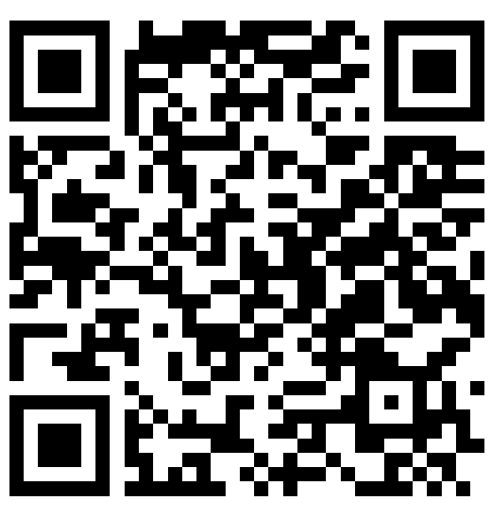

*Secvență de lecție realizată de Baidan Aliona, profesoară de chimie, grad didactic superior. Licență CC BY-SA 4.0.*

## Unități de competență

*5.1.* Explicarea și operarea în situații de comunicare orală și scrisă cu noțiunile ce caracterizează procesele de dizolvare, disociere; interacțiunile în soluții.

## Obiective operaționale

**La finele activității elevii vor fi capabili:**

**O₁** - Să descrie procesul de dizolvare și tipurile de sisteme disperse.

**O₂** -  Să explice fenomenele fizice și chimice care stau la baza dizolvării substanțelor în apă.

**O₃** - Să investigheze experimental variația de temperatură (efectul termic) la dizolvarea diferitor săruri cu ajutorul laboratorul digital Labdisc.

## Tehnologii didactice

- *platforme digitale*: software-ul GlobiLab, AI Canva

- *metode didactice*: video educațional, discuția ghidată, algoritmizarea, experimentul chimic

- *forme de organizar*e: lucru în grup, în perechi, individual.

## Resurse

1.  Curriculum național. Chimie pentru clasele X – XII, aprobat prin ordinul Ministerului Educației, Culturii și Cercetării nr. 906 din 17.07.2019.
2.  Ghid de implementare a curriculumului la disciplina Chimie în clasele X – XII. Chișinău, ediția 2020.
3.  Chimie, manual pentru cl. a X-a de liceu profil real, profil umanist. Chișinău: Editura ARC, 2020. Velișco N., Kudrițcaia S.
4.  Calculator, tablete, laboratorul digital Labdisc BioChem.
5.  Două pahare Berzelius (100 ml), apă distilată, clorură de calciu anhidră, azotat de amoniu, baghetă de sticlă, spatule.

## Desfășurarea lecției

### Reflecție (10 min, 5 min)

**Experiență de laborator**

**Măsurarea efectului termic la dizolvarea substanțelor solide.**

**Ustensile și reactivi:** Dispozitivul Labdisc (dotat cu senzor de temperatură și presiune), laptop, tablete cu software-ul GlobiLab instalat, două pahare Berzelius (100 ml), apă distilată, clorură de calciu anhidră, azotat de amoniu, baghetă de sticlă, spatule.

**Mod de lucru:**

**Pregătirea echipamentului (Hardware)**

Apăsați butonul de pornire (On/Off) de pe Labdisc. Așteptați câteva secunde până când ecranul LCD se aprinde.

Conectați mufa senzorului de temperatură extern (sonda de metal) în portul corespunzător de pe marginea dispozitivului Labdisc.

**Conectarea la dispozitivul de lucru:**

-   *Prin Bluetooth:* Activați Bluetooth-ul pe laptop/tabletă, căutați dispozitivul Labdisc și asociați-l.
-   *Prin cablu USB:* Conectați cablul direct între Labdisc și portul USB al laptopului (recomandat pentru stabilitate, dacă lucrați la catedră).

**Configurarea aplicației GlobiLab (Software)**

- Lansați softul GlobiLab pe dispozitivul asociat.

- Asigurați-vă că iconița Labdisc din colțul ecranului indică o conexiune activă (de obicei, își schimbă culoarea din gri în albastru sau verde).

- Selecția senzorilor (Configurare):

-   Accesați meniul de setări (iconița în formă de roată dințată/Setup).
-   **Bifați EXCLUSIV** senzorul de *Temperatură Externă* (External Temperature).
-   *Atenție:* Asigurați-vă că senzorul de temperatură ambientală (Ambient Temperature) este debifat, pentru a nu suprapune două grafice diferite și a deruta elevii.

1.  **Setarea parametrilor de colectare:**

    -   Setați la 1/sec (o citire pe secundă este ideală pentru a surprinde dinamica dizolvării și a neutralizării).
    -   Setați la 1000 sau pe modul „Continuu”, pentru a avea suficient timp să efectuați reacția fără ca înregistrarea să se oprească prematur.
    -   Confirmați setările.

**Efectuarea experimentului și colectarea datelor**

-   Introduceți sonda de temperatură în paharul cu cei 30 ml de apă distilată (pentru dizolvare).
-   Faceți clic pe butonul Run din GlobiLab.
-   Lăsați softul să înregistreze temperatura constantă timp de 10-15 secunde. Aceasta va forma o linie orizontală pe grafic (Temperatura inițială, T₁).
-   Adăugați substanța solidă nitratul de amoniu . Amestecați ușor cu o baghetă de sticlă, având grijă să nu loviți peretele paharului cu sonda.
-   Repetați același acțiuni doar că adăugați substanța solidă clorura de calciu.
-   Urmăriți pe ecran cum se deseneaza curba temperaturii în timp real (ascendentă pentru procesele exoterme, descendentă pentru cele endoterme).
-   După ce curba atinge punctul de inflexiune (maxim sau minim) și începe să revină lent spre temperatura camerei, apăsați butonul **Stop**.

Analizați graficele obținute. Formulați concluzia.

Elevii accesează link-ul sau codul QR și realizează experimentul.

[https://ghjklrtgf.my.canva.site/c3hy53nek2kmm80s](https://ghjklrtgf.my.canva.site/c3hy53nek2kmm80s)

**Tehnologia realizării:** Experiment chimic; Lucru în grup; Algoritmizare; Experiment chimic digital; Activitate individuală; Discuții ghidate
