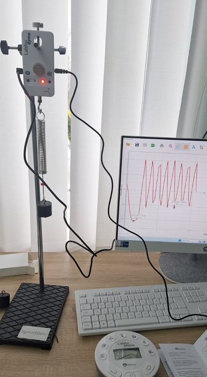

*Secvență de lecție realizată de Covali Angela, profesoară de fizică, grad didactic unu. Licență CC BY-SA 4.0.*

## Unități de competență

5.3. Investigarea experimentală a oscilațiilor mecanice.

5.4. Descrierea, din punct de vedere energetic a oscilațiilor amortizate și a oscilațiilor forțate.

5.5. Aplicarea mărimilor caracteristice (perioadă, frecvență, fază, pulsație, elongație, amplitudine, lungime de undă) ale mișcării oscilatorii și ondulatorii la rezolvarea problemelor.

5.7. Înregistrarea în tabel a valorilor mărimilor fizice măsurate cu calcularea erorii absolute și a erorii relative.

5.8. Analizarea rezultatelor măsurărilor efectuate și formularea concluziilor prin evaluarea rezultatului obținut.

## Obiective operaționale

**Elevii vor fi capabili:**

**O₁** – Să identifice și să explice mărimile fizice specifice mișcării oscilatorii (elongație, amplitudine, perioadă și frecvență), utilizând corect simbolurile și unitățile de măsură din Sistemul Internațional.

**O₂** – Să determine experimental constanta elastică a unui resort și perioada de oscilație a pendulului elastic, utilizând dispozitivul Labdisc Physics (senzorul de forță/poziție) pentru înregistrarea variațiilor în timp real..

**O₃** – Să prelucreze datele obținute prin calcularea valorilor medii și a erorilor de măsură (absolute și relative), pentru a verifica gradului de precizie al experimentului desfășurat.

**O₄** – Să formuleze concluzii argumentate despre dependența perioadei de oscilație de masa corpului și de proprietățile elastice ale resortului, analizând critic eventualele discrepanțe între datele experimentale și modelul teoretic ideal.

## Tehnologii didactice

-   **platforme digitale:** Labdisk Globisens Physics, senzor de forță.
-   **metode didactice:** explicația, demonstrația, experimentul, observația.
-   **forma de organizare:** frontală, în grup.

## Resurse

1.  Fizică, manual pentru clasa a X-a, ediția 2012.
2.  Labdisk, sensor de forță Globisens Physics, resort.
3.  Calculator / tabletă cu aplicația GobiLab.

## Desfășurarea lecției

### Realizarea sensului (10 min, 22 min)

Elevii analizează lucrarea de laborator.

Se fac precizări la mersul lucrării

Realizează montajul experimental.

Fiecare elev sau pereche de elevi efectuiază lucrarea conform instrucțiunilor din Anexă.

**Tehnologia realizării:** Experimentul; Lucrul în grup; Labdisc Globisens; Lucru individual

## Anexă

Numele prenumele \_\_\_\_\_\_\_\_\_\_ clasa X-a \_\_\_\_\_\_\_\_\_\_

***Lucrare de laborator nr. 8***

***„Studiul pendulului elastic și determinarea constantei elastice a unui resort”.***

**Scopul lucrării:** Studierea oscilațiilor unui pendul elastic. Determinarea experimentală a constantei elastice k a resortului folosind măsurători digitale cu Labdisc.

**Aparate și utilaje:** Resort (pendul elastic), set de mase marcate, Labdisc + senzor de forță / accelerometru / poziție, Suport vertical, Calculator/tabletă cu apliacția GlobiLab.

**Considerații teoretice:**

Un pendul elastic este format dintr-un resort de constantă elastică *k* și o masă *m*.

Perioada oscilațiilor: T = t/N; T = 2π √(m/k) de unde k = (4 • π² • m)/T₀²;

**Mersul lucrării:**

1.  Fixează resortul pe suport și atașează corpul de masă cunoscută.
2.  Conectează senzorul de forță și accelerometru/poziție la Labdisc. Senzorul Dymo (Wireless Force & Accelerometer), acesta se poate conecta și wireless prin Bluetooth direct la software-ul GlobiLab, fără a fi nevoie de cabluri fizice între senzor și Labdisc. Odată conectat, Labdiscul va identifica automat senzorul și va afișa unitățile de măsură corespunzătoare pe ecranul LCD. (senzorul este de tip wireless (precum [LABDISC Dymo](https://www.westlab.co.nz/ld12frcacc-nz-labdisc-force-accelerometer)), acesta trebuie pornit separat și asociat cu dispozitivul de calcul (tabletă/PC) folosind codul PIN **1234**)
3.  Deplasează ușor masa și elibereaz-o.
4.  Înregistrează oscilațiile în GlobiLab.
5.  Determină perioada *T* din grafic (media pentru 5–10 oscilații).
6.  Repetă experimentul de 3-4 ori adăugând de fiecare data câte o masa marcată.
7.  Completează tabelul de măsurători.

| Nr. d/o | m (kg) | N   | t (s) | T (s) | k (N/m) | Δk (N/m) |
|---------|--------|-----|-------|-------|---------|----------|
| 1\.     |        |     |       |       |         |          |
| 2\.     |        |     |       |       |         |          |
| 3\.     |        |     |       |       |         |          |
| 4\.     |        |     |       |       |         |          |
| 5\.     |        |     |       |       |         |          |

Calcule:

Reprezentați grafic *T = f (m)*

Prezentați rezultatul final sub forma:k = (k̅ ± Δ̅k̅) *N/m \_\_\_\_\_\_\_\_\_\_* εᵣ = \_\_\_\_\_\_\_\_\_\_%

*Formulați concluzii \_\_\_\_\_\_\_\_\_\_ \_\_\_\_\_\_\_\_\_\_*
